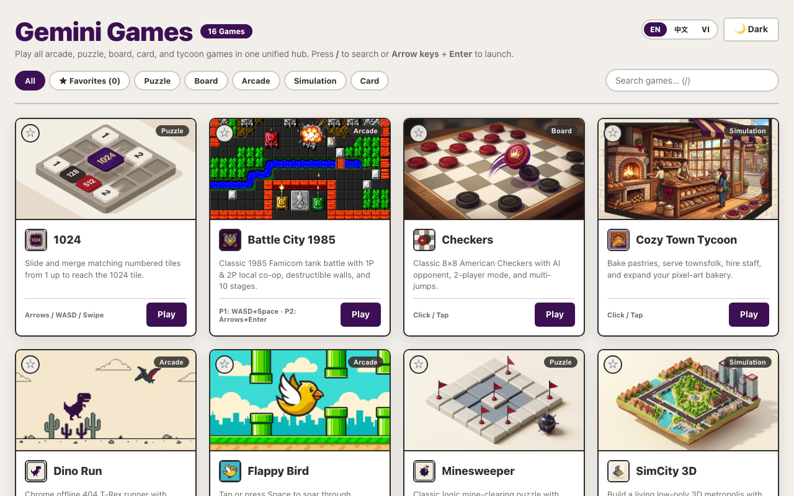

**English** | [中文](./README.zh.md) | [Tiếng Việt](./README.vi.md)

# Gemini Games

A **100% offline-capable**, local-first unified web game hub featuring **16 playable 2D & 3D browser games** built with **TypeScript, Vite, React, HTML5 Canvas 2D, and Three.js**, deployed statically on **Cloudflare Workers Static Assets** (or optionally **Vercel**).

- **Live Demo:** **[https://gemini-games.vuhung16plus.workers.dev/](https://gemini-games.vuhung16plus.workers.dev/)**
- **Quickstart:** [QUICKSTART.md](./QUICKSTART.md) (`git clone`, `make dev`, `make verify`, `make deploy`)
- **9-Day Vibe Coding Course & Tutorial:** [courses/](./courses/README.md) — A hands-on, prompt-driven course tailored for non-IT learners to understand the tech stack, customize existing games, and build new 2D/3D games with AI agents.

A screenshot of our game hub is shown below:

## Highlights
- **Unified 4-Column Dashboard:** Category filtering (`All`, `Puzzle`, `Board`, `Arcade`, `Simulation`, `Card`), live search (`/`), **Favorites**, **Recently Played**, **Light/Dark themes**, **Multilingual UI (`English`, `中文`, `Tiếng Việt`)**, and full keyboard navigation (`Arrow*`, `Enter`, `Esc`).
- **16 Self-Contained Games:** Zero external runtime CDNs, procedural Web Audio SFX with Mute persistence, in-game **How to Play**, **Tutorial**, and **Hints**, plus Vitest unit tests and Playwright E2E suites.
- **Built-In Vibe Coding Curriculum (`courses/`):** Learn how vibe coding works in practice—treating source code as an artifact generated from clear intent and verified with `make verify`.

## Games Collection

| Game | Category | Path |
| :--- | :--- | :--- |
| **1024** | Puzzle | [`games/1024/`](./games/1024/docs/README.md) |
| **Battle City 1985** | Arcade | [`games/battle-city/`](./games/battle-city/docs/README.md) |
| **Checkers** | Board | [`games/checkers/`](./games/checkers/docs/README.md) |
| **Cozy Town Tycoon** | Simulation | [`games/cozy-town-tycoon/`](./games/cozy-town-tycoon/docs/README.md) |
| **Dino Run** | Arcade | [`games/dino-run/`](./games/dino-run/docs/README.md) |
| **Flappy Bird** | Arcade | [`games/flappy-bird/`](./games/flappy-bird/docs/README.md) |
| **Minesweeper** | Puzzle | [`games/minesweeper/`](./games/minesweeper/docs/README.md) |
| **SimCity 3D** | Simulation | [`games/simcity/`](./games/simcity/docs/README.md) |
| **Solitaire** | Card | [`games/solitaire/`](./games/solitaire/docs/README.md) |
| **Sudoku** | Puzzle | [`games/sudoku/`](./games/sudoku/docs/README.md) |
| **Super Mario Bros. 1985** | Arcade | [`games/super-mario-bros/`](./games/super-mario-bros/docs/README.md) |
| **Tá Lả (Phỏm)** | Card | [`games/ta-la-phom/`](./games/ta-la-phom/docs/README.md) |
| **Tấn Đỡ (Bài Tấn)** | Card | [`games/tan-do/`](./games/tan-do/docs/README.md) |
| **Tetris** | Arcade | [`games/tetris/`](./games/tetris/docs/README.md) |
| **Tiến Lên Miền Bắc** | Card | [`games/tien-len-mien-bac/`](./games/tien-len-mien-bac/docs/README.md) |
| **Tiến Lên Miền Nam** | Card | [`games/tien-len-mien-nam/`](./games/tien-len-mien-nam/docs/README.md) |

## Key Project Files
- [QUICKSTART.md](./QUICKSTART.md) — Build, run, test, and deploy commands
- [courses/README.md](./courses/README.md) — 9-Day Game Development Course (Vibe Coding & AI Agents)
- [docs/architecture.md](./docs/architecture.md) — Hub, per-game module, and multi-entry build architecture (with Mermaid diagrams)
- [docs/developer-guide.md](./docs/developer-guide.md) — Developer workflow, `AGENTS.md` checklist, and verification gates
- [docs/techstack.md](./docs/techstack.md) — Core foundation, 2D/3D rendering layers, testing, and Cloudflare hosting
- [AGENTS.md](./AGENTS.md) — Mandatory per-game structure, assets, docs, multilingual support, and verification standards
- [techstacks/techstack.md](./techstacks/techstack.md) — 2D & 3D web game tech stack guidelines
- [styles/STYLE_GUIDE.md](./styles/STYLE_GUIDE.md) — Shared palette, viewport, input, and persistence rules
- [styles/tokens.css](./styles/tokens.css) & [styles/theme.ts](./styles/theme.ts) — Light/Dark CSS tokens and Canvas/Three.js colors
- [src/registry/games.ts](./src/registry/games.ts) — Unified hub game registry
- [src/components/Dashboard.tsx](./src/components/Dashboard.tsx) — Root 4-column Dashboard UI
- [vite.config.ts](./vite.config.ts) — Multi-entry Vite build & `/games/<slug>/*` asset plugin
- [wrangler.jsonc](./wrangler.jsonc) — Cloudflare Workers Static Assets configuration
- [package.json](./package.json) — Root scripts (`dev`, `build`, `test`, `test:e2e`, `deploy`)
