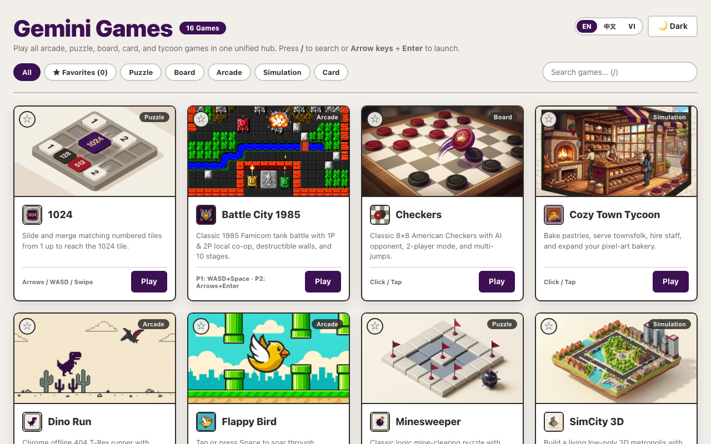

[English](./README.md) | [中文](./README.zh.md) | **Tiếng Việt**

# Gemini Games

Trung tâm trò chơi web thống nhất có thể chạy **100% ngoại tuyến** theo hướng local-first, gồm **16 trò chơi 2D & 3D chơi trực tiếp trên trình duyệt**, được xây dựng bằng **TypeScript, Vite, React, HTML5 Canvas 2D và Three.js**, triển khai tĩnh trên **Cloudflare Workers Static Assets** (hoặc **Vercel**).

- **Bản Demo trực tuyến:** **[https://gemini-games.vuhung16plus.workers.dev/](https://gemini-games.vuhung16plus.workers.dev/)**
- **Hướng dẫn nhanh:** [QUICKSTART.vi.md](./QUICKSTART.vi.md) (`git clone`, `make dev`, `make verify`, `make deploy`)
- **Khóa học & Hướng dẫn Vibe Coding 9 Ngày:** [courses/](./courses/README.vi.md) — Khóa học thực hành bằng prompt dành cho người không chuyên CNTT để hiểu tech stack, tùy chỉnh game có sẵn và tự tạo game 2D/3D mới cùng AI agent.

Dưới đây là ảnh chụp màn hình của trung tâm trò chơi:

## Điểm nổi bật
- **Bảng điều khiển 4 cột thống nhất:** Lọc theo danh mục (`Tất cả`, `Giải đố`, `Cờ`, `Arcade`, `Mô phỏng`, `Đánh bài`), tìm kiếm trực tiếp (`/`), **Yêu thích**, **Chơi gần đây**, **Giao diện Sáng/Tối**, **Hỗ trợ đa ngôn ngữ (`English`, `中文`, `Tiếng Việt`)** và điều hướng bàn phím đầy đủ (`Phím mũi tên`, `Enter`, `Esc`).
- **16 trò chơi độc lập:** Không phụ thuộc CDN bên ngoài khi chạy, âm thanh Web Audio tạo tự động kèm nút Tắt tiếng được lưu trạng thái, tích hợp **Hướng dẫn chơi**, **Chế độ hướng dẫn** và **Gợi ý**, cùng bộ kiểm thử đơn vị Vitest và kiểm thử E2E Playwright.
- **Tích hợp sẵn lộ trình học Vibe Coding (`courses/`):** Thực hành tư duy vibe coding—xem mã nguồn như một sản phẩm đầu ra (artifact) được tạo từ ý tưởng rõ ràng và xác minh bằng `make verify`.

## Bộ sưu tập trò chơi

| Trò chơi | Danh mục | Đường dẫn |
| :--- | :--- | :--- |
| **1024** | Giải đố | [`games/1024/`](./games/1024/docs/README.vi.md) |
| **Battle City 1985 (Bắn Tăng)** | Arcade | [`games/battle-city/`](./games/battle-city/docs/README.vi.md) |
| **Cờ Đam (Checkers)** | Cờ | [`games/checkers/`](./games/checkers/docs/README.vi.md) |
| **Ông Trùm Thị Trấn Ấm Áp** | Mô phỏng | [`games/cozy-town-tycoon/`](./games/cozy-town-tycoon/docs/README.vi.md) |
| **Khủng Long Chạy Bộ (Dino Run)** | Arcade | [`games/dino-run/`](./games/dino-run/docs/README.vi.md) |
| **Flappy Bird** | Arcade | [`games/flappy-bird/`](./games/flappy-bird/docs/README.vi.md) |
| **Dò Mìn (Minesweeper)** | Giải đố | [`games/minesweeper/`](./games/minesweeper/docs/README.vi.md) |
| **SimCity 3D** | Mô phỏng | [`games/simcity/`](./games/simcity/docs/README.vi.md) |
| **Bài Solitaire** | Đánh bài | [`games/solitaire/`](./games/solitaire/docs/README.vi.md) |
| **Sudoku** | Giải đố | [`games/sudoku/`](./games/sudoku/docs/README.vi.md) |
| **Super Mario Bros. 1985** | Arcade | [`games/super-mario-bros/`](./games/super-mario-bros/docs/README.vi.md) |
| **Tá Lả (Phỏm)** | Đánh bài | [`games/ta-la-phom/`](./games/ta-la-phom/docs/README.vi.md) |
| **Tấn Đỡ (Bài Tấn)** | Đánh bài | [`games/tan-do/`](./games/tan-do/docs/README.vi.md) |
| **Xếp Hình (Tetris)** | Arcade | [`games/tetris/`](./games/tetris/docs/README.vi.md) |
| **Tiến Lên Miền Bắc** | Đánh bài | [`games/tien-len-mien-bac/`](./games/tien-len-mien-bac/docs/README.vi.md) |
| **Tiến Lên Miền Nam** | Đánh bài | [`games/tien-len-mien-nam/`](./games/tien-len-mien-nam/docs/README.vi.md) |

## Các tệp quan trọng trong dự án
- [QUICKSTART.vi.md](./QUICKSTART.vi.md) — Lệnh build, chạy, kiểm thử và triển khai
- [courses/README.vi.md](./courses/README.vi.md) — Khóa học Phát triển Game 9 Ngày (Vibe Coding & AI Agents)
- [docs/architecture.md](./docs/architecture.md) — Kiến trúc Hub, mô-đun từng game và multi-entry build (kèm sơ đồ Mermaid)
- [docs/developer-guide.md](./docs/developer-guide.md) — Quy trình phát triển, danh sách kiểm tra `AGENTS.md` và cổng xác minh
- [docs/techstack.md](./docs/techstack.md) — Nền tảng công nghệ, lớp đồ họa 2D/3D, kiểm thử và Cloudflare hosting
- [AGENTS.md](./AGENTS.md) — Tiêu chuẩn bắt buộc cho cấu trúc game, đồ họa, tài liệu, đa ngôn ngữ và kiểm thử
- [techstacks/techstack.md](./techstacks/techstack.md) — Hướng dẫn tech stack cho game web 2D & 3D
- [styles/STYLE_GUIDE.md](./styles/STYLE_GUIDE.md) — Bảng màu dùng chung, quy tắc khung nhìn, điều khiển và lưu trữ
- [styles/tokens.css](./styles/tokens.css) & [styles/theme.ts](./styles/theme.ts) — Biến CSS Sáng/Tối và màu Canvas/Three.js
- [src/registry/games.ts](./src/registry/games.ts) — Danh mục đăng ký game cho Hub thống nhất
- [src/components/Dashboard.tsx](./src/components/Dashboard.tsx) — Giao diện Bảng điều khiển 4 cột
- [vite.config.ts](./vite.config.ts) — Cấu hình Vite multi-entry & plugin tài nguyên `/games/<slug>/*`
- [wrangler.jsonc](./wrangler.jsonc) — Cấu hình Cloudflare Workers Static Assets
- [package.json](./package.json) — Các script gốc (`dev`, `build`, `test`, `test:e2e`, `deploy`)
