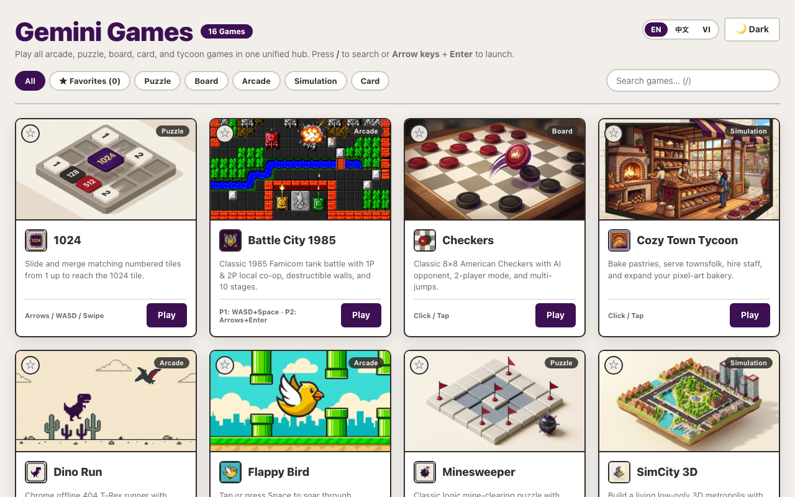

[English](./README.md) | **中文** | [Tiếng Việt](./README.vi.md)

# Gemini 游戏中心 (Gemini Games)

一个支持 **100% 离线运行**、本地优先的统一网页游戏中心，收录 **16 款可游玩的 2D 与 3D 浏览器游戏**，基于 **TypeScript、Vite、React、HTML5 Canvas 2D 与 Three.js** 构建，并静态部署于 **Cloudflare Workers Static Assets**（也支持 **Vercel**）。

- **在线演示：** **[https://gemini-games.vuhung16plus.workers.dev/](https://gemini-games.vuhung16plus.workers.dev/)**
- **快速开始：** [QUICKSTART.zh.md](./QUICKSTART.zh.md)（`git clone`、`make dev`、`make verify`、`make deploy`）
- **9 天 Vibe Coding 实战教程：** [courses/](./courses/README.zh.md) — 面向非 IT/非技术学习者的提示词驱动实战课程，边玩边理解技术栈、改造现有游戏并从零构建新的 2D/3D 游戏。

下面是我们游戏大厅的界面截图：

## 核心亮点
- **统一 4 列游戏大厅：** 支持分类筛选（`全部`、`益智`、`棋类`、`街机`、`模拟`、`卡牌`）、实时搜索（`/`）、**收藏夹**、**最近游玩**、**浅色/深色主题**、**多语言界面（English、中文、Tiếng Việt）** 以及完整键盘导航（`方向键`、`Enter`、`Esc`）。
- **16 款独立自包含游戏：** 零外部运行时 CDN 依赖，程序化 Web Audio 音效与静音记忆，内置 **玩法说明**、**教学模式** 与 **提示**，并配有 Vitest 单元测试与 Playwright E2E 测试套件。
- **内置 Vibe Coding 课程体系（`courses/`）：** 在实践中理解 Vibe Coding——把源代码视为由清晰意图生成的产物，并用 `make verify` 自动验证。

## 游戏列表

| 游戏 | 分类 | 文档路径 |
| :--- | :--- | :--- |
| **1024 数字合成** | 益智 | [`games/1024/`](./games/1024/docs/README.zh.md) |
| **坦克大战 1985** | 街机 | [`games/battle-city/`](./games/battle-city/docs/README.zh.md) |
| **国际跳棋** | 棋类 | [`games/checkers/`](./games/checkers/docs/README.zh.md) |
| **温馨小镇大亨** | 模拟 | [`games/cozy-town-tycoon/`](./games/cozy-town-tycoon/docs/README.zh.md) |
| **恐龙快跑** | 街机 | [`games/dino-run/`](./games/dino-run/docs/README.zh.md) |
| **像素飞鸟** | 街机 | [`games/flappy-bird/`](./games/flappy-bird/docs/README.zh.md) |
| **扫雷** | 益智 | [`games/minesweeper/`](./games/minesweeper/docs/README.zh.md) |
| **模拟城市 3D** | 模拟 | [`games/simcity/`](./games/simcity/docs/README.zh.md) |
| **纸牌接龙** | 卡牌 | [`games/solitaire/`](./games/solitaire/docs/README.zh.md) |
| **数独** | 益智 | [`games/sudoku/`](./games/sudoku/docs/README.zh.md) |
| **超级马力欧兄弟 1985** | 街机 | [`games/super-mario-bros/`](./games/super-mario-bros/docs/README.zh.md) |
| **越南吃牌扑克 (Tá Lả / Phỏm)** | 卡牌 | [`games/ta-la-phom/`](./games/ta-la-phom/docs/README.zh.md) |
| **攻防王牌 (Tấn Đỡ)** | 卡牌 | [`games/tan-do/`](./games/tan-do/docs/README.zh.md) |
| **俄罗斯方块** | 街机 | [`games/tetris/`](./games/tetris/docs/README.zh.md) |
| **北越十三张 (Tiến Lên Miền Bắc)** | 卡牌 | [`games/tien-len-mien-bac/`](./games/tien-len-mien-bac/docs/README.zh.md) |
| **南越十三张 (Tiến Lên Miền Nam)** | 卡牌 | [`games/tien-len-mien-nam/`](./games/tien-len-mien-nam/docs/README.zh.md) |

## 核心项目文件
- [QUICKSTART.zh.md](./QUICKSTART.zh.md) — 构建、运行、测试与部署命令
- [courses/README.zh.md](./courses/README.zh.md) — 9 天游戏开发课程（Vibe Coding 与 AI 智能体）
- [docs/architecture.md](./docs/architecture.md) — 游戏大厅、单游戏模块与多入口构建架构（含 Mermaid 图表）
- [docs/developer-guide.md](./docs/developer-guide.md) — 开发工作流、`AGENTS.md` 检查清单与验证门槛
- [docs/techstack.md](./docs/techstack.md) — 核心技术栈、2D/3D 渲染层、测试与 Cloudflare 托管
- [AGENTS.md](./AGENTS.md) — 强制单游戏结构、美术资源、文档、多语言支持与验证标准
- [techstacks/techstack.md](./techstacks/techstack.md) — 2D 与 3D 网页游戏技术栈指南
- [styles/STYLE_GUIDE.md](./styles/STYLE_GUIDE.md) — 共享配色、视口、输入与持久化规范
- [styles/tokens.css](./styles/tokens.css) & [styles/theme.ts](./styles/theme.ts) — 浅色/深色 CSS 变量与 Canvas/Three.js 颜色
- [src/registry/games.ts](./src/registry/games.ts) — 统一游戏注册表
- [src/components/Dashboard.tsx](./src/components/Dashboard.tsx) — 根 4 列游戏大厅 UI
- [vite.config.ts](./vite.config.ts) — 多入口 Vite 构建与 `/games/<slug>/*` 静态资源插件
- [wrangler.jsonc](./wrangler.jsonc) — Cloudflare Workers Static Assets 配置
- [package.json](./package.json) — 根目录脚本（`dev`、`build`、`test`、`test:e2e`、`deploy`）
