**English** | [中文](./README.zh.md) | [Tiếng Việt](./README.vi.md)

# Game Development with Vibe Coding & AI Agents (9-Day Course)

Welcome to the **Gemini Games 9-Day Game Development Course**! Starting from a **real, working project with 16 playable 2D & 3D web games**, you will learn **vibe coding** hands-on—how to play, understand, control the tools and tech stack, improve existing games, and build brand-new games with **Google `agy` (Antigravity)**.

- **Live Demo:** Play all 16 games online right now at **https://gemini-games.vuhung16plus.workers.dev/**
- **Coding Agent (`agy` Recommended · Free + Google AI Pro):** This course and all 16 games were created using **Google `agy` (Antigravity)**. **`agy` is free** to start, and **Google AI Pro is recommended** so you can access `agy`'s **`orchestrator`** model for complex end-to-end tasks (`/goal`) and multi-agent teamwork (`/teamwork`). The prompts and workflows also work with other coding agents such as **Codex / ChatGPT, Claude Code, GitHub Copilot, and Cursor**.
- **100% Offline or Cloud-Ready:** Run everything **100% offline** on your own machine, or deploy statically to **Cloudflare Workers** (default) or alternatively **Vercel**.
- **Duration:** 9 Days · 1 Module per Day · ~1 Hour per Module
- **Prerequisites:** Basic computer literacy, Node.js 20+, Git, and a terminal (no prior coding, 3D, or game-engine experience required)

---

## Who This Course Is For (And What It Is Not)

- **Who It Is For:** **Non-IT, non-tech learners**, creators, educators, and curious beginners who want to build, customize, and publish real browser games using **vibe coding** while understanding the tech stack behind the scenes.
- **What It Is NOT:**
  - It is **not** a traditional programming course—we do **not** teach coding basics like HTML, CSS, TypeScript, or React syntax from scratch.
  - It is **not** a dry tools manual—we do **not** teach `git`, `gh`, `make`, or `agy` in isolation. Instead, **you learn the tools and tech stack naturally as you go** while improving and creating real games!

---

## Teaching Concept: Vibe Coding vs. Traditional Coding

- **Working-Project-First:** Instead of staring at a blank screen, you start with a working 16-game Hub. You play, explore, take control of the workflow, improve existing games, and create new ones.
- **Ideas & Intent > Implementation:** Traditional coding focuses on hand-writing every line of syntax. In **vibe coding**, **your ideas, player experience, and clear intent** matter most—**source code is an artifact generated from your prompts**, and automated checks (`make verify`) ensure your generated code works reliably.

---

## How This Course Is Delivered (4-Step Vibe Coding Loop)

1. **Play & Explore:** Open a game in the Hub (locally or on the live demo) and experience it as a player.
2. **Ask `agy` in Plain Language:** Ask high-level questions (*"Summarise the project"*, *"Explain the features in Dino Run"*, *"Introduce the tech stack"*).
3. **Prompt `agy` to Improve or Build:** Describe what you want in plain words—start with **`/plan`** (a classic magic keyword that also works in **GitHub Copilot, Claude, ChatGPT, and Cursor**) to review the plan first, or use **`/goal`** (100% unattended) and **`/teamwork`** (parallel multi-agent) in `agy`.
4. **Verify Automatically:** Run one `make` command (`make test`, `make verify`) so automated tests confirm everything still works.

---

## Before You Start: Fork & Clone Your Own Repository

To save and `git push` your own customized games to GitHub, **fork** `https://github.com/vuhung16au/gemini-games` to your own GitHub account first (click **Fork** on GitHub), then clone **your fork**:

```bash
git clone https://github.com/<your-username>/gemini-games.git
cd gemini-games
npm install
make dev
```

> **Tip:** If you cloned the original repo directly, you can still play and edit 100% offline—and whenever you want to push to GitHub, just ask `agy`: *"Create my own GitHub repository for this project and push my changes there."*
>
> **Why `git` Is Strongly Recommended:** Using `git` to commit your progress maintains a clean history so you can always roll back to a safe checkpoint—and it also helps AI agents (`agy` and others) understand, review, and manage changes across your project reliably.

---

## 9-Day Learning Path

```mermaid
flowchart LR
  D1["Day 1: Intro & Setup"] --> D2["Day 2: Concepts & Tests"]
  D2 --> D3["Day 3: Project Architecture"]
  D3 --> D4["Day 4: Tools & Google agy"]
  D4 --> D5["Day 5: Tech Stack Deep Dive"]
  D5 --> D6["Day 6: Modify Dino Run"]
  D6 --> D7["Day 7: Build a Board Game"]
  D7 --> D8["Day 8: Build a 2D Game"]
  D8 --> D9["Day 9: Build a 3D Game & Deploy"]
```



---

## Daily Syllabus

| Day | Module | Focus | Guide |
| :--- | :--- | :--- | :--- |
| **Day 1** | Introduction to Game Development | Vibe coding vs. traditional coding, live demo, `git clone`, offline run | [Day 1 Guide](./day-01-intro-to-game-dev/README.md) |
| **Day 2** | Game Development Concepts | Rules vs. display, automated unit & browser testing | [Day 2 Guide](./day-02-game-dev-concepts/README.md) |
| **Day 3** | Project Architecture | How the Hub & 16 self-contained games fit together | [Day 3 Guide](./day-03-project-architecture/README.md) |
| **Day 4** | Developer Tools & AI Agents | Learning `make`, `git`, `agy`, & Cloudflare/Vercel as you go | [Day 4 Guide](./day-04-dev-tools-and-ai-agents/README.md) |
| **Day 5** | Tech Stack Deep Dive | When to use CSS/SVG, Canvas 2D, or Three.js + TS/Vite/React | [Day 5 Guide](./day-05-tech-stack-deep-dive/README.md) |
| **Day 6** | Modifying Your First Game | Customize `Dino Run` colors, speed & new obstacle via prompts | [Day 6 Guide](./day-06-modifying-dino-run/README.md) |
| **Day 7** | Building a Board Game | Build Tic Tac Toe from scratch + `AGENTS.md` | [Day 7 Guide](./day-07-building-a-board-game/README.md) |
| **Day 8** | Building a 2D Game | Build a 2D Canvas arcade game from scratch | [Day 8 Guide](./day-08-building-a-2d-game/README.md) |
| **Day 9** | Building a 3D Game & Deploy | Build a Three.js 3D game & deploy to Cloudflare / Vercel | [Day 9 Guide](./day-09-building-a-3d-game/README.md) |

---

## Reference Docs in This Repository
- [Repository Overview](../README.md) & [Quickstart](../QUICKSTART.md)
- [AGENTS.md](../AGENTS.md) — Mandatory game standards (docs, icons/covers, tests, multilingual support, hub registration)
- [Architecture](../docs/architecture.md) · [Tech Stack](../docs/techstack.md) · [Developer Guide](../docs/developer-guide.md)
- [Shared Style Guide](../styles/STYLE_GUIDE.md)


---

## Closing Note: Beyond Games

Thank you for learning with me, and I hope you enjoyed this 9-day course! By finishing these modules, you have built a solid foundation in **AI coding agents**, **structured prompting** (`/plan`, `/goal`, `/teamwork`), and **hands-on game development**.

Keep in mind:
- **Games & This Tech Stack Are Just One Example:** `"Game"`, `"webapp"`, `"TypeScript"`, `"React"`, and `"Three.js"` here are simply one example of a problem and a tech stack. Once you master how to prompt clearly and collaborate with AI agents, you can comfortably explore **any tech stack and any problem** (automation, dashboards, mobile apps, APIs, creative tools, and more).
- **Guardrails Keep You Safe:** The SDLC, `git` checkpoints, automated tests, and `make verify` introduced in this project may look heavy at first—but they exist to **keep you safe so you don't shoot yourself in the foot** when AI generates code fast.
- **Tailor It As You Grow:** Once you feel confident and understand what can go wrong, **you can tailor this process and make it lighter** to fit your own speed and style.
