**English** | [中文](./README.zh.md) | [Tiếng Việt](./README.vi.md)

# Game Development with Vibe Coding & AI Agents (9-Day Course)

Welcome to the **Gemini Games 9-Day Game Development Course**! Using this repository's 16 playable 2D & 3D web games as your live classroom, you will learn how to design, build, test, and deploy modern browser games with **vibe coding** and **Google `agy` (Antigravity)**.

- **Duration:** 9 Days · 1 Module per Day · ~1 Hour per Module
- **Audience:** Beginners learning game dev with AI agents & intermediate devs sharpening modern TypeScript/Canvas/Three.js + TDD workflows
- **Prerequisites:** Basic computer literacy, Node.js 20+, Git, and a terminal (no prior 3D or game-engine experience required)

---

## 9-Day Learning Path

```mermaid
flowchart LR
  D1["Day 1: Intro & Setup"] --> D2["Day 2: Concepts & TDD"]
  D2 --> D3["Day 3: Project Architecture"]
  D3 --> D4["Day 4: Tools & Google agy"]
  D4 --> D5["Day 5: Tech Stack Deep Dive"]
  D5 --> D6["Day 6: Modify Dino Run"]
  D6 --> D7["Day 7: Build a Board Game"]
  D7 --> D8["Day 8: Build a 2D Game"]
  D8 --> D9["Day 9: Build a 3D Game & Deploy"]
```

---

## Daily Syllabus

| Day | Module | Focus | Guide |
| :--- | :--- | :--- | :--- |
| **Day 1** | Introduction to Game Development | Vibe coding, AI agents, repo tour, local setup | [Day 1 Guide](./day-01-intro-to-game-dev/README.md) |
| **Day 2** | Game Development Concepts | Software principles, pure sim vs. UI, TDD | [Day 2 Guide](./day-02-game-dev-concepts/README.md) |
| **Day 3** | Project Architecture | Monorepo layout, hub registry, `Dino Run` internals | [Day 3 Guide](./day-03-project-architecture/README.md) |
| **Day 4** | Developer Tools & AI Agents | Node/npm, Git/`gh`, Wrangler, Google `agy` | [Day 4 Guide](./day-04-dev-tools-and-ai-agents/README.md) |
| **Day 5** | Tech Stack Deep Dive | TS, Vite, React, Canvas 2D, Three.js, Vitest, Playwright | [Day 5 Guide](./day-05-tech-stack-deep-dive/README.md) |
| **Day 6** | Modifying Your First Game | Customize `Dino Run` colors, speed & new obstacle | [Day 6 Guide](./day-06-modifying-dino-run/README.md) |
| **Day 7** | Building a Board Game | Build Tic Tac Toe from scratch + `AGENTS.md` | [Day 7 Guide](./day-07-building-a-board-game/README.md) |
| **Day 8** | Building a 2D Game | Build a 2D Canvas arcade game from scratch | [Day 8 Guide](./day-08-building-a-2d-game/README.md) |
| **Day 9** | Building a 3D Game & Deploy | Build a Three.js 3D game & deploy to Cloudflare | [Day 9 Guide](./day-09-building-a-3d-game/README.md) |

---

## Reference Docs in This Repository
- [Repository Overview](../README.md) & [Quickstart](../QUICKSTART.md)
- [AGENTS.md](../AGENTS.md) — Mandatory game standards (docs, icons/covers, tests, multilingual support, hub registration)
- [Architecture](../docs/architecture.md) · [Tech Stack](../docs/techstack.md) · [Developer Guide](../docs/developer-guide.md)
- [Shared Style Guide](../styles/STYLE_GUIDE.md)
