[English](./README.md) | [中文](./README.zh.md) | **Tiếng Việt**

# Phát Triển Game với Vibe Coding & AI Agents (Khóa Học 9 Ngày)

Chào mừng đến với **Khóa học Phát triển Game 9 Ngày cùng Gemini Games**! Sử dụng 16 trò chơi web 2D & 3D trong kho mã nguồn này làm lớp học thực tế, bạn sẽ học cách thiết kế, xây dựng, kiểm thử và triển khai game trình duyệt hiện đại với **vibe coding** và **Google `agy` (Antigravity)**.

- **Thời lượng:** 9 Ngày · 1 Mô-đun mỗi ngày · ~1 Giờ mỗi mô-đun
- **Đối tượng:** Người mới học làm game cùng AI agents & lập trình viên muốn nâng cao quy trình TypeScript/Canvas/Three.js + TDD
- **Yêu cầu đầu vào:** Biết sử dụng máy tính cơ bản, Node.js 20+, Git và terminal (không cần kinh nghiệm 3D hay game engine trước đó)

---

## Lộ Trình Học 9 Ngày

```mermaid
flowchart LR
  D1["Ngày 1: Nhập môn & Cài đặt"] --> D2["Ngày 2: Khái niệm & TDD"]
  D2 --> D3["Ngày 3: Kiến trúc dự án"]
  D3 --> D4["Ngày 4: Công cụ & Google agy"]
  D4 --> D5["Ngày 5: Tech Stack chuyên sâu"]
  D5 --> D6["Ngày 6: Tùy biến Dino Run"]
  D6 --> D7["Ngày 7: Làm game Bàn cờ"]
  D7 --> D8["Ngày 8: Làm game 2D"]
  D8 --> D9["Ngày 9: Làm game 3D & Deploy"]
```

---

## Giáo Trình Theo Ngày

| Ngày | Mô-đun | Trọng tâm | Hướng dẫn |
| :--- | :--- | :--- | :--- |
| **Ngày 1** | Nhập môn Phát triển Game | Vibe coding, AI agents, khám phá repo, chạy local | [Hướng dẫn Ngày 1](./day-01-intro-to-game-dev/README.vi.md) |
| **Ngày 2** | Khái niệm Phát triển Game | Nguyên lý phần mềm, mô phỏng thuần vs. UI, TDD | [Hướng dẫn Ngày 2](./day-02-game-dev-concepts/README.vi.md) |
| **Ngày 3** | Kiến trúc Dự án | Cấu trúc monorepo, hub registry, bên trong `Dino Run` | [Hướng dẫn Ngày 3](./day-03-project-architecture/README.vi.md) |
| **Ngày 4** | Công cụ Lập trình & AI Agents | Node/npm, Git/`gh`, Wrangler, Google `agy` | [Hướng dẫn Ngày 4](./day-04-dev-tools-and-ai-agents/README.vi.md) |
| **Ngày 5** | Tech Stack Chuyên sâu | TS, Vite, React, Canvas 2D, Three.js, Vitest, Playwright | [Hướng dẫn Ngày 5](./day-05-tech-stack-deep-dive/README.vi.md) |
| **Ngày 6** | Chỉnh sửa Game Đầu tiên | Tùy biến màu sắc, tốc độ & chướng ngại vật `Dino Run` | [Hướng dẫn Ngày 6](./day-06-modifying-dino-run/README.vi.md) |
| **Ngày 7** | Xây dựng Game Bàn cờ | Làm Tic Tac Toe từ đầu + chuẩn `AGENTS.md` | [Hướng dẫn Ngày 7](./day-07-building-a-board-game/README.vi.md) |
| **Ngày 8** | Xây dựng Game 2D | Làm game arcade 2D Canvas từ đầu | [Hướng dẫn Ngày 8](./day-08-building-a-2d-game/README.vi.md) |
| **Ngày 9** | Xây dựng Game 3D & Deploy | Làm game 3D Three.js & deploy lên Cloudflare | [Hướng dẫn Ngày 9](./day-09-building-a-3d-game/README.vi.md) |

---

## Tài Liệu Tham Khảo Trong Kho Mã Nguồn
- [Tổng quan Kho mã nguồn](../README.vi.md) & [Bắt đầu nhanh](../QUICKSTART.md)
- [AGENTS.md](../AGENTS.md) — Tiêu chuẩn game bắt buộc (tài liệu, icon/cover, kiểm thử, đa ngôn ngữ, đăng ký hub)
- [Kiến trúc](../docs/architecture.md) · [Tech Stack](../docs/techstack.md) · [Hướng dẫn Lập trình viên](../docs/developer-guide.md)
- [Hướng dẫn Giao diện Dùng chung](../styles/STYLE_GUIDE.md)
