[English](./README.md) | [中文](./README.zh.md) | **Tiếng Việt**

# Làm Game Với Vibe Coding & AI Agents (Khóa Học 9 Ngày)

Chào mừng bạn tới với **Khóa học làm game 9 ngày cùng Gemini Games**! Thay vì phải ngồi nhìn màn hình trắng rồi gõ code từ con số 0, bạn sẽ bắt đầu từ một **web game hub đang chạy ngon lành với 16 tựa game 2D & 3D**. Từ đó, bạn sẽ học **vibe coding** theo kiểu thực chiến: chơi thử, hiểu cấu trúc, làm chủ bộ đồ nghề và tech stack, độ lại game có sẵn, rồi tự tay "sai" **Google `agy` (Antigravity)** làm game mới toanh.

- **Chơi thử bản Live Demo:** Vào quẩy thử cả 16 game ngay tại **[https://gemini-games.vuhung16plus.workers.dev/](https://gemini-games.vuhung16plus.workers.dev/)**
- **Coding Agent (Khuyến nghị `agy` · Miễn phí + Google AI Pro):** Toàn bộ khóa học và 16 game này đều được làm bằng **Google `agy` (Antigravity)**. **`agy` miễn phí** để bạn bắt đầu, nhưng nếu có **Google AI Pro** thì càng xịn vì mở khóa được model **`orchestrator`** trong `agy`—chuyên trị mấy pha chạy tự động từ A-Z (`/goal`) hay gọi cả đội agent (`/teamwork`). Mấy prompt trong bài cũng chạy mượt trên **Codex / ChatGPT, Claude Code, GitHub Copilot và Cursor** nha.
- **Chạy 100% Offline hoặc Đẩy Lên Cloud:** Thích thì chạy **100% offline** trên máy, lúc nào muốn khoe bạn bè thì deploy tĩnh lên **Cloudflare Workers** (mặc định) hoặc **Vercel**.
- **Thời lượng:** 9 Ngày · Mỗi ngày 1 bài · ~1 tiếng mỗi ngày
- **Đầu vào:** Biết xài máy tính cơ bản, có sẵn Node.js 20+, Git và terminal (không cần biết code, 3D hay game engine gì hết nha)

---

## Khóa Học Này Dành Cho Ai (Và Không Dạy Gì?)

- **Dành cho:** **Người không chuyên IT (non-IT, non-tech)**, creator, giáo viên hay bất kỳ ai tò mò muốn tự tay tạo, độ lại và xuất bản game web thật bằng **vibe coding**, đồng thời hiểu rõ tech stack đằng sau chạy thế nào.
- **Khóa học KHÔNG phải là:**
  - **Không** phải lớp dạy code truyền thống—mình **không** bắt bạn ngồi học thuộc cú pháp HTML, CSS, TypeScript hay React từ đầu.
  - **Không** phải giáo trình dạy tool khô khan—mình **không** dạy riêng lẻ từng lệnh `git`, `gh`, `make` hay `agy`. Thay vào đó, **bạn sẽ quen tay với tool và tech stack một cách tự nhiên ngay trong lúc làm game!**

---

## Triết Lý Học: Vibe Coding vs. Code Truyền Thống

- **Bắt đầu từ dự án đang chạy ngon:** Khỏi phải sợ trang giấy trắng, bạn nhảy thẳng vào một Hub 16 game hoàn chỉnh—chơi thử, ngó cách nó vận hành, nắm tool & tech stack, nâng cấp game cũ rồi đẻ game mới.
- **Ý tưởng & Trải nghiệm > Gõ code:** Code truyền thống đòi hỏi ngồi gõ từng dấu chấm phẩy. Trong **vibe coding**, **ý tưởng, cảm giác chơi và mục tiêu rõ ràng của bạn** mới là nhân vật chính—còn **source code chỉ là một artifact sinh ra từ prompt**, kèm dàn test tự động (`make verify`) đứng sau gác cổng cho chắc kèo.

---

## Cách Học Mỗi Ngày (Vòng Lặp Vibe Coding 4 Bước)

1. **Chơi & Soi:** Mở một game trong Hub (trên máy hoặc trên bản Live Demo) và chơi thử như một game thủ thực thụ.
2. **Hỏi `agy` bằng tiếng người:** Hỏi mấy câu tổng quan (*"Tóm tắt dự án"*, *"Giải thích các tính năng trong Dino Run"*, *"Giới thiệu tech stack của dự án"*).
3. **Ra lệnh cho `agy` độ lại hoặc làm mới:** Mô tả thứ bạn muốn bằng lời nói bình thường—bắt đầu với **`/plan`** (từ khóa quốc dân chạy ngon trên cả **GitHub Copilot, Claude, ChatGPT lẫn Cursor**) để duyệt kế hoạch trước, hoặc bung lụa với **`/goal`** (chạy tự động 100% khỏi cần canh) và **`/teamwork`** (cho nhiều agent làm song song) trong `agy`.
4. **Chốt hạ bằng test tự động:** Gõ một lệnh `make` (`make test`, `make verify`) để máy tự kiểm tra xem mọi thứ còn chạy mượt không.

---

## Trước Khi Bắt Đầu: Fork & Clone Repo Riêng Của Bạn

Để thoải mái lưu và `git push` mấy game bạn tự độ lên GitHub, hãy bấm **Fork** tại `https://github.com/vuhung16au/gemini-games` về tài khoản GitHub của bạn trước, rồi clone **bản fork của chính bạn** về máy:

```bash
git clone https://github.com/<your-username>/gemini-games.git
cd gemini-games
npm install
make dev
```

> **Mẹo nhỏ:** Lỡ clone nhầm repo gốc rồi thì cũng không sao, bạn vẫn chơi và sửa **100% offline** bình thường—lúc nào muốn đẩy lên GitHub riêng thì nhắn `agy`: *"Tạo repo GitHub riêng cho dự án này và push các thay đổi của tôi lên đó."*
>
> **Sao lại khuyên dùng `git`?** Có `git` lưu lịch sử giúp bạn luôn có một điểm checkpoint an toàn để quay xe nếu lỡ tay, đồng thời giúp các AI agent (như `agy`) soi thay đổi và quản lý dự án chuẩn hơn nhiều.

---

## Lộ Trình 9 Ngày

```mermaid
flowchart LR
  D1["Ngày 1: Nhập môn & Cài đặt"] --> D2["Ngày 2: Khái niệm & Test"]
  D2 --> D3["Ngày 3: Kiến trúc dự án"]
  D3 --> D4["Ngày 4: Tool & Google agy"]
  D4 --> D5["Ngày 5: Tech Stack chuyên sâu"]
  D5 --> D6["Ngày 6: Độ lại Dino Run"]
  D6 --> D7["Ngày 7: Làm game Cờ/Bàn"]
  D7 --> D8["Ngày 8: Làm game 2D"]
  D8 --> D9["Ngày 9: Làm game 3D & Deploy"]
```



---

## Giáo Trình Chi Tiết Từng Ngày

| Ngày | Chủ đề | Trọng tâm | Tài liệu |
| :--- | :--- | :--- | :--- |
| **Ngày 1** | Nhập môn Làm Game | Vibe coding vs truyền thống, demo online, `git clone`, chạy offline | [Hướng dẫn Ngày 1](./day-01-intro-to-game-dev/README.vi.md) |
| **Ngày 2** | Khái niệm Làm Game | Luật chơi vs hiển thị, unit test & E2E test trên trình duyệt | [Hướng dẫn Ngày 2](./day-02-game-dev-concepts/README.vi.md) |
| **Ngày 3** | Kiến trúc Dự án | Cách Hub & 16 game độc lập bắt tay nhau dưới một mái nhà | [Hướng dẫn Ngày 3](./day-03-project-architecture/README.vi.md) |
| **Ngày 4** | Tool & AI Agents | Quen tay `make`, `git`, `agy` & Cloudflare / Vercel qua thực hành | [Hướng dẫn Ngày 4](./day-04-dev-tools-and-ai-agents/README.vi.md) |
| **Ngày 5** | Tech Stack Chuyên sâu | Khi nào xài CSS/SVG, Canvas 2D hay Three.js + TS/Vite/React | [Hướng dẫn Ngày 5](./day-05-tech-stack-deep-dive/README.vi.md) |
| **Ngày 6** | Độ Game Đầu Tiên | Chỉnh màu, tốc độ & chướng ngại vật `Dino Run` bằng prompt | [Hướng dẫn Ngày 6](./day-06-modifying-dino-run/README.vi.md) |
| **Ngày 7** | Làm Game Bàn Cờ | Tự tạo Tic Tac Toe từ đầu + chuẩn `AGENTS.md` | [Hướng dẫn Ngày 7](./day-07-building-a-board-game/README.vi.md) |
| **Ngày 8** | Làm Game 2D | Làm game arcade 2D Canvas từ con số 0 | [Hướng dẫn Ngày 8](./day-08-building-a-2d-game/README.vi.md) |
| **Ngày 9** | Làm Game 3D & Deploy | Làm game 3D Three.js & deploy lên Cloudflare / Vercel | [Hướng dẫn Ngày 9](./day-09-building-a-3d-game/README.vi.md) |

---

## Tài Liệu Tham Khảo Trong Repo
- [Tổng quan Repo](../README.vi.md) & [Chạy lẹ trên máy](../QUICKSTART.md)
- [AGENTS.md](../AGENTS.md) — Bộ luật bắt buộc cho mọi game (docs, icon/cover, test, đa ngôn ngữ, đăng ký hub)
- [Kiến trúc](../docs/architecture.md) · [Tech Stack](../docs/techstack.md) · [Hướng dẫn Dev](../docs/developer-guide.md)
- [Style Guide Dùng Chung](../styles/STYLE_GUIDE.md)

---

## Lời Kết: Đi Xa Hơn Chuyện Làm Game

Cảm ơn bạn đã đồng hành tới đây, hy vọng 9 ngày vừa rồi mang lại cho bạn nhiều giờ phút vừa học vừa chơi thật vui! Xong xuôi khóa này là bạn đã có nền tảng thực chiến ngon lành về **AI coding agent**, **cách viết prompt cho ra việc** (`/plan`, `/goal`, `/teamwork`), và **tự tay làm ra game chạy thật**.

Nhớ vài điều nhỏ này hen:
- **Game & Tech Stack Này Chỉ Là Ví Dụ:** `"Game"`, `"webapp"`, `"TypeScript"`, `"React"`, hay `"Three.js"` ở đây chỉ là một bài toán mẫu để bạn thực hành. Một khi đã nắm cách đặt đề bài rõ ràng và phối hợp nhịp nhàng với AI, bạn hoàn toàn có thể tự tin nhảy sang **bất kỳ tech stack hay bài toán nào khác** (automation, dashboard dữ liệu, app mobile, API, tool sáng tạo, v.v.).
- **Quy Trình Chặt Chẽ Là Để Bảo Vệ Bạn:** Mấy bước SDLC, checkpoint `git`, test tự động và `make verify` trong repo này mới nhìn có vẻ hơi kỹ tính—nhưng tụi nó chính là **hàng rào an toàn giúp bạn khỏi tự bắn vào chân mình** khi AI đẻ code với tốc độ ánh sáng.
- **Cứng Tay Rồi Thì Cứ Tinh Giản:** Khi đã quen việc và hiểu rõ rủi ro, **bạn cứ thoải mái lược bớt quy trình cho nhẹ nhàng** sao cho hợp với gu và tốc độ của mình nhất.
