[English](./README.md) | [中文](./README.zh.md) | **Tiếng Việt**

# Phát Triển Game với Vibe Coding & AI Agents (Khóa Học 9 Ngày)

Chào mừng đến với **Khóa học Phát triển Game 9 Ngày cùng Gemini Games**! Bắt đầu từ một **dự án hoàn chỉnh đang chạy tốt với 16 trò chơi web 2D & 3D**, bạn sẽ học **vibe coding** qua thực hành trực tiếp—chơi thử, hiểu cấu trúc, làm chủ công cụ và tech stack, cải tiến các game có sẵn và tự tay tạo game mới cùng **Google `agy` (Antigravity)**.

- **Bản Demo Trực tuyến:** Chơi ngay cả 16 game tại **https://gemini-games.vuhung16plus.workers.dev/**
- **Coding Agent (Khuyến nghị `agy` · Miễn phí + Google AI Pro):** Khóa học này và toàn bộ 16 trò chơi được tạo bằng **Google `agy` (Antigravity)**. **`agy` miễn phí** để bắt đầu, nhưng **khuyến nghị dùng Google AI Pro** để truy cập mô hình **`orchestrator`** trong `agy` cho các tác vụ tự động đầu-cuối (`/goal`) và đa tác tử (`/teamwork`). Các câu lệnh cũng hoạt động tốt với **Codex / ChatGPT, Claude Code, GitHub Copilot và Cursor**.
- **Chạy 100% Ngoại tuyến hoặc Đưa lên Cloud:** Chạy **100% offline** trên máy của bạn, hoặc triển khai tĩnh lên **Cloudflare Workers** (mặc định) hay **Vercel**.
- **Thời lượng:** 9 Ngày · 1 Mô-đun mỗi ngày · ~1 Giờ mỗi mô-đun
- **Yêu cầu đầu vào:** Biết sử dụng máy tính cơ bản, Node.js 20+, Git và terminal (không cần kinh nghiệm lập trình, 3D hay game engine)

---

## Khóa Học Này Dành Cho Ai (Và Không Dạy Gì)

- **Dành cho:** **Người học không chuyên CNTT (non-IT, non-tech)**, người sáng tạo nội dung, giáo viên và người mới tò mò muốn tự tạo, tùy biến và xuất bản game web thật bằng **vibe coding**, đồng thời hiểu bức tranh tech stack phía sau.
- **Khóa học KHÔNG phải là:**
  - **Không** phải lớp dạy lập trình truyền thống—chúng tôi **không** dạy cú pháp cơ bản như HTML, CSS, TypeScript hay React từ đầu.
  - **Không** phải giáo trình dạy công cụ khô khan—chúng tôi **không** dạy riêng lẻ `git`, `gh`, `make` hay `agy`. Thay vào đó, **bạn sẽ học công cụ và tech stack một cách tự nhiên ngay trong quá trình làm game!**

---

## Triết Lý Giảng Dạy: Vibe Coding vs. Lập Trình Truyền Thống

- **Bắt đầu từ Dự án Đang Chạy:** Thay vì nhìn vào màn hình trắng, bạn bắt đầu với một Hub 16 game hoàn chỉnh—chơi thử, hiểu cách vận hành, làm chủ công cụ & tech stack, nâng cấp game cũ và tạo game mới.
- **Ý tưởng & Mục tiêu > Tự viết Code:** Lập trình truyền thống tập trung vào việc gõ từng dòng cú pháp. Trong **vibe coding**, **ý tưởng, trải nghiệm người chơi và mục tiêu rõ ràng của bạn** mới là quan trọng nhất—**mã nguồn chỉ là sản phẩm phụ (artifact) được tạo ra từ câu lệnh (prompt)**, và các bài kiểm tra tự động (`make verify`) giúp bạn đảm bảo sản phẩm chạy chuẩn xác.

---

## Cách Triển Khai Khóa Học (Vòng Lặp Vibe Coding 4 Bước)

1. **Chơi & Khám phá:** Mở một trò chơi trong Hub (trên máy hoặc trên bản demo trực tuyến) và trải nghiệm như người chơi.
2. **Hỏi `agy` bằng Ngôn ngữ Tự nhiên:** Đặt câu hỏi tổng quan (*"Tóm tắt dự án"*, *"Giải thích các tính năng trong Dino Run"*, *"Giới thiệu tech stack của dự án"*).
3. **Ra lệnh cho `agy` Cải tiến hoặc Tạo mới:** Mô tả điều bạn muốn bằng lời nói đời thường—bắt đầu với **`/plan`** (từ khóa kinh điển hoạt động trên cả **GitHub Copilot, Claude, ChatGPT và Cursor**) để duyệt kế hoạch trước, hoặc dùng **`/goal`** (100% tự động không cần canh) và **`/teamwork`** (nhiều agent song song) trong `agy`.
4. **Xác minh Tự động:** Chạy một lệnh `make` (`make test`, `make verify`) để kiểm thử tự động xác nhận mọi thứ hoạt động tốt.

---

## Trước Khi Bắt Đầu: Fork & Clone Kho Mã Nguồn Riêng Của Bạn

Để lưu và `git push` các game bạn tự tùy chỉnh lên GitHub, hãy nhấn **Fork** tại `https://github.com/vuhung16au/gemini-games` về tài khoản GitHub của bạn trước, sau đó clone **bản fork của chính bạn**:

```bash
git clone https://github.com/<your-username>/gemini-games.git
cd gemini-games
npm install
make dev
```

> **Mẹo:** Nếu bạn đã clone trực tiếp repo gốc, bạn vẫn chơi và chỉnh sửa **100% ngoại tuyến** bình thường—khi muốn đẩy lên GitHub riêng, chỉ cần nói với `agy`: *"Tạo kho GitHub riêng cho dự án này và push các thay đổi của tôi lên đó."*
>
> **Vì sao Rất Khuyến nghị Dùng `git`:** Dùng `git` để lưu lịch sử giúp bạn luôn có thể quay lại một điểm mốc (checkpoint) an toàn khi cần—đồng thời giúp các AI agent (như `agy`) theo dõi, đối chiếu và quản lý thay đổi trong dự án chính xác hơn.

---

## Lộ Trình Học 9 Ngày

```mermaid
flowchart LR
  D1["Ngày 1: Nhập môn & Cài đặt"] --> D2["Ngày 2: Khái niệm & Kiểm thử"]
  D2 --> D3["Ngày 3: Kiến trúc dự án"]
  D3 --> D4["Ngày 4: Công cụ & Google agy"]
  D4 --> D5["Ngày 5: Tech Stack chuyên sâu"]
  D5 --> D6["Ngày 6: Tùy biến Dino Run"]
  D6 --> D7["Ngày 7: Làm game Bàn cờ"]
  D7 --> D8["Ngày 8: Làm game 2D"]
  D8 --> D9["Ngày 9: Làm game 3D & Deploy"]
```



---

## Giáo Trình Theo Ngày

| Ngày | Mô-đun | Trọng tâm | Hướng dẫn |
| :--- | :--- | :--- | :--- |
| **Ngày 1** | Nhập môn Phát triển Game | Vibe coding vs truyền thống, demo trực tuyến, `git clone`, chạy offline | [Hướng dẫn Ngày 1](./day-01-intro-to-game-dev/README.vi.md) |
| **Ngày 2** | Khái niệm Phát triển Game | Luật chơi vs hiển thị, kiểm thử đơn vị & trình duyệt tự động | [Hướng dẫn Ngày 2](./day-02-game-dev-concepts/README.vi.md) |
| **Ngày 3** | Kiến trúc Dự án | Cách Hub & 16 game độc lập kết nối với nhau | [Hướng dẫn Ngày 3](./day-03-project-architecture/README.vi.md) |
| **Ngày 4** | Công cụ & AI Agents | Học `make`, `git`, `agy` & Cloudflare / Vercel ngay khi thực hành | [Hướng dẫn Ngày 4](./day-04-dev-tools-and-ai-agents/README.vi.md) |
| **Ngày 5** | Tech Stack Chuyên sâu | Khi nào dùng CSS/SVG, Canvas 2D hay Three.js + TS/Vite/React | [Hướng dẫn Ngày 5](./day-05-tech-stack-deep-dive/README.vi.md) |
| **Ngày 6** | Chỉnh sửa Game Đầu tiên | Tùy biến màu sắc, tốc độ & chướng ngại vật `Dino Run` bằng prompt | [Hướng dẫn Ngày 6](./day-06-modifying-dino-run/README.vi.md) |
| **Ngày 7** | Xây dựng Game Bàn cờ | Làm Tic Tac Toe từ đầu + chuẩn `AGENTS.md` | [Hướng dẫn Ngày 7](./day-07-building-a-board-game/README.vi.md) |
| **Ngày 8** | Xây dựng Game 2D | Làm game arcade 2D Canvas từ đầu | [Hướng dẫn Ngày 8](./day-08-building-a-2d-game/README.vi.md) |
| **Ngày 9** | Xây dựng Game 3D & Deploy | Làm game 3D Three.js & deploy lên Cloudflare / Vercel | [Hướng dẫn Ngày 9](./day-09-building-a-3d-game/README.vi.md) |

---

## Tài Liệu Tham Khảo Trong Kho Mã Nguồn
- [Tổng quan Kho mã nguồn](../README.vi.md) & [Bắt đầu nhanh](../QUICKSTART.md)
- [AGENTS.md](../AGENTS.md) — Tiêu chuẩn game bắt buộc (tài liệu, icon/cover, kiểm thử, đa ngôn ngữ, đăng ký hub)
- [Kiến trúc](../docs/architecture.md) · [Tech Stack](../docs/techstack.md) · [Hướng dẫn Lập trình viên](../docs/developer-guide.md)
- [Hướng dẫn Giao diện Dùng chung](../styles/STYLE_GUIDE.md)


---

## Lời Kết: Vượt Ra Ngoài Phạm Vi Làm Game

Cảm ơn bạn đã đồng hành học tập cùng tôi, và hy vọng bạn đã có những giờ phút thú vị với khóa học 9 ngày này! Khi hoàn thành các mô-đun trên, bạn đã nắm được nền tảng thực hành về **AI coding agent**, **cách viết prompt hiệu quả** (`/plan`, `/goal`, `/teamwork`), và **tự tay phát triển trò chơi**.

Hãy luôn nhớ:
- **Game & Tech Stack Này Chỉ Là Một Ví Dụ:** `"Game"`, `"webapp"`, `"TypeScript"`, `"React"`, hay `"Three.js"` ở đây chỉ là một ví dụ về bài toán và bộ công nghệ. Khi đã làm chủ cách viết prompt rõ ràng và phối hợp với AI, bạn có thể tự tin khám phá **bất kỳ tech stack và bài toán nào khác** (tự động hóa, dashboard dữ liệu, ứng dụng di động, API, công cụ sáng tạo, v.v.).
- **Quy Trình Nghiêm Ngặt Giúp Bạn An Toàn:** Quy trình SDLC, các điểm lưu `git`, kiểm thử tự động và `make verify` trong dự án này thoạt nhìn có thể hơi nặng nề—nhưng chúng là **hàng rào bảo vệ giúp bạn không tự bắn vào chân mình** khi AI tạo mã nguồn với tốc độ cao.
- **Tùy Biến Nhẹ Nhàng Khi Đã Tự Tin:** Khi đã vững tay và hiểu rõ rủi ro, **bạn hoàn toàn có thể tinh giản quy trình này cho nhẹ nhàng hơn** để phù hợp với tốc độ và phong cách của riêng mình.
