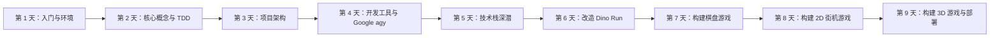

[English](./README.md) | **中文** | [Tiếng Việt](./README.vi.md)

# Vibe Coding 与 AI 智能体游戏开发（9 天课程）

欢迎来到 **Gemini Games 9 天游戏开发课程**！本课程以仓库中的 16 款可游玩 2D 与 3D 网页游戏作为实战课堂，带你学习如何使用 **Vibe Coding** 与 **Google `agy` (Antigravity)** 设计、开发、测试并部署现代浏览器游戏。

- **课程时长：** 9 天 · 每天 1 个模块 · 每个模块约 1 小时
- **适用人群：** 借助 AI 智能体学习游戏开发的初学者，以及希望精进 TypeScript/Canvas/Three.js + TDD 工作流的进阶开发者
- **前置要求：** 基本电脑操作能力、Node.js 20+、Git 与终端（无需任何编程、3D 或游戏引擎经验）

---

## 本课程的授课方式（Vibe Coding 四步循环）

本课程专为 **非 IT、非技术背景的学习者** 设计：你**永远不需要**手动编写或逐行阅读底层 TypeScript 代码。每节课都围绕以下 4 步 **Vibe Coding** 循环展开：

1. **试玩与体验：** 在浏览器中打开游戏，以玩家视角感受交互与规则。
2. **用自然语言向 `agy` 提问：** 用通俗的话语了解全貌（例如 *“总结这个项目”*、*“介绍 Dino Run 的功能”*、*“介绍本项目使用的技术栈”*）。
3. **用提示词让 `agy` 改进或开发：** 只描述你想要的结果，`agy` 会自动定位文件并完成编码。
4. **自动验证：** 运行一条 `make` 命令（`make test`、`make verify`），让自动化检查确认一切运行正常。

---

## 9 天学习路径

---

## 每日课程大纲

| 天数 | 模块 | 核心内容 | 课程指南 |
| :--- | :--- | :--- | :--- |
| **第 1 天** | 游戏开发入门 | Vibe coding、AI 智能体、仓库导览、本地启动 | [第 1 天指南](./day-01-intro-to-game-dev/README.zh.md) |
| **第 2 天** | 游戏开发核心概念 | 软件工程原则、纯模拟 vs UI、TDD | [第 2 天指南](./day-02-game-dev-concepts/README.zh.md) |
| **第 3 天** | 项目架构 | Monorepo 结构、中心注册表、`Dino Run` 内部机制 | [第 3 天指南](./day-03-project-architecture/README.zh.md) |
| **第 4 天** | 开发工具与 AI 智能体 | Node/npm、Git/`gh`、Wrangler、Google `agy` | [第 4 天指南](./day-04-dev-tools-and-ai-agents/README.zh.md) |
| **第 5 天** | 技术栈深潜 | TS、Vite、React、Canvas 2D、Three.js、Vitest、Playwright | [第 5 天指南](./day-05-tech-stack-deep-dive/README.zh.md) |
| **第 6 天** | 改造你的第一款游戏 | 自定义 `Dino Run` 配色、速度与新障碍物 | [第 6 天指南](./day-06-modifying-dino-run/README.zh.md) |
| **第 7 天** | 构建棋盘游戏 | 从零构建井字棋 + 遵循 `AGENTS.md` | [第 7 天指南](./day-07-building-a-board-game/README.zh.md) |
| **第 8 天** | 构建 2D 游戏 | 从零构建 2D Canvas 街机游戏 | [第 8 天指南](./day-08-building-a-2d-game/README.zh.md) |
| **第 9 天** | 构建 3D 游戏并部署 | 构建 Three.js 3D 游戏并部署至 Cloudflare | [第 9 天指南](./day-09-building-a-3d-game/README.zh.md) |

---

## 仓库参考文档
- [项目总览](../README.zh.md) & [快速开始](../QUICKSTART.md)
- [AGENTS.md](../AGENTS.md) — 强制游戏规范（文档、图标/封面、测试、多语言支持、大厅注册）
- [项目架构](../docs/architecture.md) · [技术栈](../docs/techstack.md) · [开发者指南](../docs/developer-guide.md)
- [共享样式指南](../styles/STYLE_GUIDE.md)
