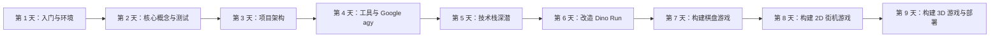

[English](./README.md) | **中文** | [Tiếng Việt](./README.vi.md)

# Vibe Coding 与 AI 智能体游戏开发（9 天课程）

欢迎来到 **Gemini Games 9 天游戏开发课程**！本课程从一个**已经可以运行、内置 16 款 2D 与 3D 网页游戏的真实项目**出发，带你通过动手实践掌握 **Vibe Coding**——学会试玩、理解架构、驾驭工具与技术栈，并借助 **Google `agy` (Antigravity)** 改进现有游戏或创造全新游戏。

- **在线演示：** 立即体验全部 16 款游戏：**https://gemini-games.vuhung16plus.workers.dev/**
- **AI 编程智能体（推荐 `agy` · 免费 + Google AI Pro）：** 本课程及全部 16 款游戏均使用 **Google `agy` (Antigravity)** 创建。**`agy` 本身免费**，但**推荐订阅 Google AI Pro** 以使用 `agy` 中的 **`orchestrator` 模型**，从而充分发挥端到端无人值守（`/goal`）与多智能体协作（`/teamwork`）的能力；同时所有提示词也兼容 **Codex / ChatGPT、Claude Code、GitHub Copilot、Cursor** 等工具。
- **100% 离线可玩或云端部署：** 可在本地 **100% 离线** 运行，也可一键静态部署到 **Cloudflare Workers**（默认）或 **Vercel**。
- **课程时长：** 9 天 · 每天 1 个模块 · 每个模块约 1 小时
- **前置要求：** 基本电脑操作能力、Node.js 20+、Git 与终端（无需任何编程、3D 或游戏引擎经验）

---

## 本课程适合谁（以及不教什么）

- **适合人群：** 希望通过 **Vibe Coding** 亲手打造、定制并发布真实网页游戏的 **非 IT、非技术背景学习者**、创作者、教师与好奇的初学者。
- **本课程不教什么：**
  - **不是**传统编程入门课——我们**不会**从零讲解 HTML、CSS、TypeScript 或 React 语法。
  - **不是**枯燥的工具说明书——我们**不会**孤立地教学 `git`、`gh`、`make` 或 `agy`。相反，**你会在改进与制作真实游戏的过程中自然掌握这些工具与技术栈！**

---

## 教学理念：Vibe Coding 与传统编程的区别

- **从可运行项目出发：** 你不需要对着空白屏幕发呆，而是直接从一个包含 16 款游戏的完整大厅起步——先体验、再理解、逐步掌控工具与技术栈，最后改造旧游戏或创造新游戏。
- **创意与意图 > 手写实现：** 传统编程要求逐行手敲代码；而在 **Vibe Coding** 中，**你的创意、玩家体验与清晰意图**才是核心——**源代码只是由你的提示词生成的产物（Artifact）**，再由自动化检查（`make verify`）保障可靠性。

---

## 授课方式（Vibe Coding 四步循环）

1. **试玩与体验：** 在本地或在线演示中打开游戏，以玩家视角感受交互与玩法。
2. **用自然语言向 `agy` 提问：** 了解全局（例如 *“总结这个项目”*、*“介绍 Dino Run 的功能”*、*“介绍本项目使用的技术栈”*）。
3. **用提示词让 `agy` 改进或开发：** 只描述你想要的结果——先用 **`/plan`**（一个经典的通用魔法指令，在 **GitHub Copilot、Claude、ChatGPT 与 Cursor** 中同样有效）对齐方案，或在 `agy` 中使用 **`/goal`**（100% 无人值守）和 **`/teamwork`**（多智能体并行）。
4. **自动验证：** 运行一条 `make` 命令（`make test`、`make verify`），让自动化测试确认一切正常。

---

## 开始之前：克隆代码仓库

```bash
git clone https://github.com/vuhung16au/gemini-games.git
cd gemini-games
npm install
make dev
```

---

## 9 天学习路径



---

## 每日课程大纲

| 天数 | 模块 | 核心内容 | 课程指南 |
| :--- | :--- | :--- | :--- |
| **第 1 天** | 游戏开发入门 | Vibe Coding vs 传统编程、在线演示、`git clone`、离线运行 | [第 1 天指南](./day-01-intro-to-game-dev/README.zh.md) |
| **第 2 天** | 游戏开发核心概念 | 规则与显示分离、单元测试与浏览器自动化测试 | [第 2 天指南](./day-02-game-dev-concepts/README.zh.md) |
| **第 3 天** | 项目架构 | 游戏大厅与 16 款自包含游戏如何协作 | [第 3 天指南](./day-03-project-architecture/README.zh.md) |
| **第 4 天** | 开发工具与 AI 智能体 | 边做边学 `make`、`git`、`agy` 与 Cloudflare / Vercel | [第 4 天指南](./day-04-dev-tools-and-ai-agents/README.zh.md) |
| **第 5 天** | 技术栈深潜 | 何时用 CSS/SVG、Canvas 2D 或 Three.js + TS/Vite/React | [第 5 天指南](./day-05-tech-stack-deep-dive/README.zh.md) |
| **第 6 天** | 改造你的第一款游戏 | 用提示词定制 `Dino Run` 配色、速度与新障碍物 | [第 6 天指南](./day-06-modifying-dino-run/README.zh.md) |
| **第 7 天** | 构建棋盘游戏 | 从零构建井字棋 + 遵循 `AGENTS.md` | [第 7 天指南](./day-07-building-a-board-game/README.zh.md) |
| **第 8 天** | 构建 2D 游戏 | 从零构建 2D Canvas 街机游戏 | [第 8 天指南](./day-08-building-a-2d-game/README.zh.md) |
| **第 9 天** | 构建 3D 游戏并部署 | 构建 Three.js 3D 游戏并部署至 Cloudflare / Vercel | [第 9 天指南](./day-09-building-a-3d-game/README.zh.md) |

---

## 仓库参考文档
- [项目总览](../README.zh.md) & [快速开始](../QUICKSTART.md)
- [AGENTS.md](../AGENTS.md) — 强制游戏规范（文档、图标/封面、测试、多语言支持、大厅注册）
- [项目架构](../docs/architecture.md) · [技术栈](../docs/techstack.md) · [开发者指南](../docs/developer-guide.md)
- [共享样式指南](../styles/STYLE_GUIDE.md)
