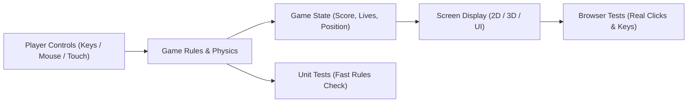

**English** | [中文](./README.zh.md) | [Tiếng Việt](./README.vi.md)

# Day 2 — Understanding Game Development Concepts & Automated Testing

**Estimated Time:** 1 Hour · **Previous:** [Day 1](../day-01-intro-to-game-dev/README.md) · **Next:** [Day 3](../day-03-project-architecture/README.md)

---

## Overview & Key Concepts
Great browser games feel smooth and stay bug-free because they separate **game rules** (physics, scoring, win/lose logic) from **what you see on screen** (graphics, buttons, sound). Today you will learn the big ideas behind how games in this project work and how automated tests keep them reliable.



- **Rules vs. Display:** Keeping the game rules separate from the graphics means AI agents can test jumping, collisions, and scoring in milliseconds without even opening a browser.
- **Smooth Frame Timing:** Clamping frame steps ensures a game runs at the exact same speed on every laptop or monitor, and automatically pauses if you switch browser tabs.
- **Two Layers of Automated Testing:** **Unit tests** check the game's math and rules; **End-to-End (E2E) browser tests** open a real browser, press keys, and check that nothing crashes.

---

## Learning Objectives & Outcomes
By the end of Day 2, you will be able to:
1. Explain in plain English why separating game rules from screen drawing makes AI-assisted game building much more reliable.
2. Tell the difference between **unit tests** (checking rules) and **browser E2E tests** (checking real gameplay).
3. Run both test suites with simple `make` commands and ask `agy` how tests are implemented.

---

## Step-by-Step Guide

### 1. Run Both Test Suites on `Dino Run`
You don't need to inspect test code manually—just run the automated checks from the repository root:
```bash
make test GAME=dino-run       # Fast unit tests + coverage check
make test-e2e GAME=dino-run   # Opens real Chromium and plays the game automatically
```

### 2. Ask `agy` to Explain `Dino Run` & Its Tests in Plain English
Try the sample prompts below so `agy` explains how the game features and tests work without jargon.

---

## Sample `agy` Prompts
```text
Explain the features in the game "Dino Run" in plain English, including both
game modes, controls, hints, and tutorial mode.
```
```text
How are the tests implemented in this project? Explain in simple terms what
unit tests and browser E2E tests check for Dino Run, and what >=70% test
coverage means.
```

---

## Key Takeaways
- Separating **game rules** from **screen visuals** makes AI vibe coding fast and predictable.
- `make test GAME=<slug>` checks game rules + coverage, while `make test-e2e GAME=<slug>` tests real browser play.

---

## Exercises & Challenges (Prompt-Only Vibe Coding)

Use Google `agy` with the sample prompts below—no manual coding required:

1. **Understand the Project:** Ask `agy` how tests are implemented across the project in plain English.
   ```text
   How are the tests implemented across this project? Explain the difference
   between make test, make test-e2e, and make test-all for a non-technical
   learner.
   ```
2. **Improve a Feature:** Ask `agy` to make `Minesweeper`'s in-game hint messages easier for beginners to understand.
   ```text
   Improve Minesweeper's in-game hint messages so they explain in plain, friendly
   language why a suggested tile is safe or a mine. Verify with make test
   GAME=minesweeper.
   ```
3. **Implement a New Feature:** Ask `agy` to add a simple move counter to `Checkers`.
   ```text
   /plan Add a visible move counter to Checkers that resets on New Game and saves
   with the game state. Verify everything with make verify GAME=checkers.
   ```
4. **Improve Tests / Docs:** Ask `agy` to strengthen automated test coverage for `1024`.
   ```text
   Check the test coverage report for the 1024 game and ask agy to add edge-case
   unit tests for any untested game rules so coverage is even stronger.
   ```
5. **Create a New Game:** Ask `agy` to build a **"Rock-Paper-Scissors"** game with Best-of-5 rounds and full tests.
   ```text
   /plan Create "Rock-Paper-Scissors" following AGENTS.md, with Best-of-5 rounds,
   win-streak tracking, How to Play, Tutorial, Hint, and automated unit + browser
   tests.
   ```
