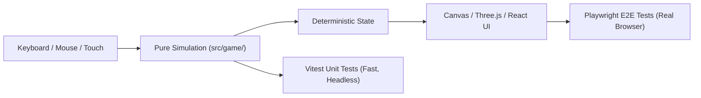

# Day 2 — Understanding Game Development Concepts & TDD

**Estimated Time:** 1 Hour · **Previous:** [Day 1](../day-01-intro-to-game-dev/README.md) · **Next:** [Day 3](../day-03-project-architecture/README.md)

---

## Overview & Key Concepts
Great browser games feel responsive and stay bug-free because they separate **pure game rules** from **rendering and UI**. Today you will learn the core engineering principles behind every game in this repo.



- **Separation of Concerns:** `src/game/` has **zero DOM or Canvas imports**, so physics, scoring, and AI can be tested in milliseconds.
- **Fixed-Timestep / Clamped `dt`:** Clamping frame delta (`dt <= 0.05s`) ensures games behave identically on 60Hz and 144Hz monitors and never explode when switching browser tabs (`visibilitychange`).
- **Test-Driven Development (TDD) with AI:** Asking `agy` to write Vitest unit tests + Playwright E2E tests catches subtle regressions immediately.

---

## Learning Objectives & Outcomes
By the end of Day 2, you will be able to:
1. Explain why separating `src/game/` from `src/renderer/` and `src/components/` makes AI-assisted coding much more reliable.
2. Distinguish between **Vitest unit tests** (logic) and **Playwright E2E tests** (real browser flows).
3. Run both test suites on an existing game.

---

## Step-by-Step Guide

### 1. Inspect a Pure Simulation File vs. a Renderer
Open and compare:
- [`games/dino-run/src/game/engine.ts`](../../games/dino-run/src/game/engine.ts) — Notice there is no `document`, `window`, or `canvas` code!
- [`games/dino-run/src/renderer/canvasRenderer.ts`](../../games/dino-run/src/renderer/canvasRenderer.ts) — Reads `DinoState` and draws pixels.

### 2. Run Unit Tests & E2E Tests on `Dino Run`
```bash
cd games/dino-run
npm install
npm test            # Vitest: runs in < 1 second
npm run test:e2e    # Playwright: opens real Chromium and plays the game
```

### 3. Read the Tests
Inspect [`games/dino-run/src/game/__tests__/engine.test.ts`](../../games/dino-run/src/game/__tests__/engine.test.ts) and [`games/dino-run/e2e/dino.spec.ts`](../../games/dino-run/e2e/dino.spec.ts). Notice how unit tests assert exact physics/collision rules while E2E tests verify zero console errors, keyboard controls, modals, and `localStorage` persistence.

---

## Sample `agy` Prompts
```text
Read games/dino-run/src/game/engine.ts and games/dino-run/src/game/__tests__/engine.test.ts.
Explain how collision detection and the restart cooldown work, and suggest 2 extra edge-case unit tests we could add.
```

---

## Key Takeaways
- Pure simulation (`src/game/`) + clamped `dt` = deterministic, testable gameplay.
- Every game in this repo must pass `npm test`, `npm run test:e2e`, `npx tsc --noEmit`, and `npm run build`.

---

## Exercises & Challenges
1. Run `npm test` inside `games/1024` and `games/ta-la-phom` to see how puzzle and card games are unit-tested.
2. **Challenge:** Ask `agy` to explain how `visibilitychange` is handled in [`games/dino-run/src/App.tsx`](../../games/dino-run/src/App.tsx) and why it prevents unfair crashes when switching tabs.
