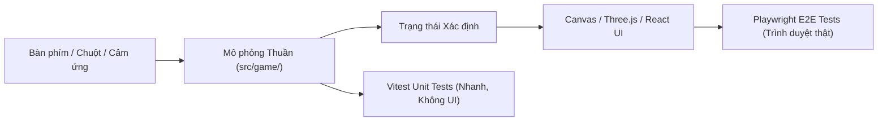

[English](./README.md) | [中文](./README.zh.md) | **Tiếng Việt**

# Ngày 2 — Hiểu các Khái niệm Phát triển Game & TDD

**Thời lượng ước tính:** 1 Giờ · **Trước:** [Ngày 1](../day-01-intro-to-game-dev/README.vi.md) · **Tiếp theo:** [Ngày 3](../day-03-project-architecture/README.vi.md)

---

## Tổng quan & Khái niệm chính
Các game trình duyệt mượt mà và ít lỗi đều tách biệt **luật chơi thuần túy** khỏi **phần vẽ đồ họa và giao diện UI**. Hôm nay bạn sẽ học các nguyên lý kỹ thuật cốt lõi đằng sau mỗi trò chơi trong kho mã nguồn này.



- **Tách biệt mối quan tâm (Separation of Concerns):** `src/game/` **không import DOM hay Canvas**, giúp kiểm thử vật lý, tính điểm và AI chỉ trong vài mili-giây.
- **Bước thời gian giới hạn (`dt`):** Giới hạn chênh lệch khung hình (`dt <= 0.05s`) giúp game chạy giống hệt nhau trên màn hình 60Hz và 144Hz, đồng thời không bị lỗi khi chuyển tab (`visibilitychange`).
- **Phát triển hướng kiểm thử (TDD) với AI:** Yêu cầu `agy` viết đồng thời Vitest unit test + Playwright E2E test giúp phát hiện lỗi hồi quy ngay lập tức.

---

## Mục tiêu & Kết quả học tập
Sau Ngày 2, bạn sẽ có thể:
1. Giải thích vì sao tách `src/game/` khỏi `src/renderer/` và `src/components/` giúp lập trình cùng AI đáng tin cậy hơn nhiều.
2. Phân biệt giữa **Vitest unit test** (logic) và **Playwright E2E test** (luồng trình duyệt thật).
3. Chạy cả hai bộ kiểm thử trên một game có sẵn.

---

## Hướng dẫn từng bước

### 1. So sánh tệp Mô phỏng Thuần và Renderer
Mở và đối chiếu:
- [`games/dino-run/src/game/engine.ts`](../../games/dino-run/src/game/engine.ts) — Lưu ý không hề có mã `document`, `window` hay `canvas`!
- [`games/dino-run/src/renderer/canvasRenderer.ts`](../../games/dino-run/src/renderer/canvasRenderer.ts) — Đọc `DinoState` và vẽ từng pixel.

### 2. Chạy Unit Test & E2E Test trên `Dino Run`
```bash
cd games/dino-run
npm install
npm test            # Vitest: chạy trong < 1 giây
npm run test:e2e    # Playwright: mở Chromium thật và chơi thử game
```

### 3. Đọc mã kiểm thử
Xem [`games/dino-run/src/game/__tests__/engine.test.ts`](../../games/dino-run/src/game/__tests__/engine.test.ts) và [`games/dino-run/e2e/dino.spec.ts`](../../games/dino-run/e2e/dino.spec.ts). Chú ý cách unit test kiểm tra chính xác quy tắc vật lý/va chạm, còn E2E test kiểm tra không có lỗi console, phím bấm, hộp thoại và lưu trữ `localStorage`.

---

## Câu lệnh mẫu cho `agy`
```text
Read games/dino-run/src/game/engine.ts and games/dino-run/src/game/__tests__/engine.test.ts.
Explain how collision detection and the restart cooldown work, and suggest 2 extra edge-case unit tests we could add.
```

---

## Điểm cốt lõi
- Mô phỏng thuần (`src/game/`) + giới hạn `dt` = gameplay xác định, dễ kiểm thử.
- Mọi game trong repo đều phải vượt qua `npm test`, `npm run test:e2e`, `npx tsc --noEmit` và `npm run build`.

---

## Bài tập & Thử thách
1. Chạy `npm test` trong `games/1024` và `games/ta-la-phom` để xem cách kiểm thử đơn vị cho game giải đố và game bài.
2. **Thử thách:** Yêu cầu `agy` giải thích cách xử lý `visibilitychange` trong [`games/dino-run/src/App.tsx`](../../games/dino-run/src/App.tsx) và lý do nó giúp tránh thua oan khi chuyển tab.
