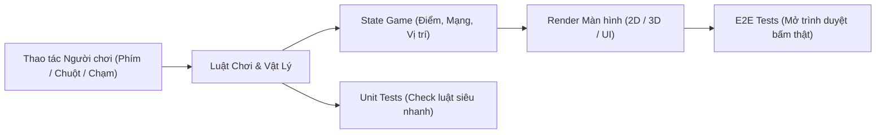

[English](./README.md) | [中文](./README.zh.md) | **Tiếng Việt**

# Ngày 2 — Khái Niệm Làm Game & Kiểm Thử Tự Động

**Thời lượng ước tính:** 1 Giờ · **Trước:** [Ngày 1](../day-01-intro-to-game-dev/README.vi.md) · **Tiếp theo:** [Ngày 3](../day-03-project-architecture/README.vi.md)

---

## Tổng quan & Ý chính
Mấy game web chạy mượt mà, ít bug đều có chung một bí kíp: tách bạch **luật chơi** (vật lý, tính điểm, thắng/thua) khỏi **phần hiển thị trên màn hình** (đồ họa, nút bấm, âm thanh). Hôm nay bạn sẽ nắm ý tưởng cốt lõi đó và xem dàn test tự động giữ cho game ổn định như thế nào.



- **Luật chơi vs. Hiển thị (Render):** Khi luật chơi đứng riêng khỏi đồ họa, AI agent có thể test nhảy, va chạm, tính điểm chỉ trong vài mili-giây mà chẳng cần bật trình duyệt.
- **Nhịp khung hình mượt mà:** Giới hạn bước thời gian giúp game chạy đều nhau trên mọi loại màn hình, và tự động tạm dừng (pause) mỗi khi bạn chuyển sang tab khác.
- **Hai lớp test tự động:** **Unit test** lo check luật và phép tính; **E2E test** thì mở hẳn trình duyệt thật, tự bấm phím và đảm bảo game không bị văng lỗi.

---

## Mục tiêu & Kết quả sau Ngày 2
Xong Ngày 2, bạn sẽ nắm được:
1. Giải thích bằng ngôn ngữ bình dân vì sao tách luật chơi khỏi phần vẽ màn hình giúp AI làm game chuẩn và đáng tin hơn.
2. Phân biệt rạch ròi **unit test** (check luật) và **E2E test** (check trải nghiệm chơi thật trên trình duyệt).
3. Chạy được cả 2 bộ test bằng lệnh `make` và hỏi `agy` cách hệ thống test đang vận hành.

---

## Hướng dẫn từng bước

### 1. Chạy cả 2 bộ test cho `Dino Run`
Không cần mở file test lên đọc làm gì—chỉ cần đứng ở thư mục gốc và gõ:
```bash
make test GAME=dino-run       # Chạy unit test siêu nhanh + đo coverage
make test-e2e GAME=dino-run   # Mở Chromium thật và tự chơi thử
```

### 2. Hỏi `agy` giải thích `Dino Run` & cách test thật dễ hiểu
Dùng thử mấy prompt mẫu bên dưới để `agy` giải thích mượt mà, không dính thuật ngữ code hack não.

---

## Prompt mẫu cho `agy`
```text
Explain the features in the game "Dino Run" in plain English (or Vietnamese),
including both game modes, controls, hints, and tutorial mode.
```
```text
How are the tests implemented in this project? Explain in simple terms what
unit tests and browser E2E tests check for Dino Run, and what >=70% test
coverage means.
```

---

## Chốt lại ý chính
- Tách **luật chơi** khỏi **phần hiển thị** giúp vibe coding với AI vừa nhanh vừa ít bug.
- `make test GAME=<slug>` lo check luật chơi + coverage, còn `make test-e2e GAME=<slug>` lo test trực tiếp trên trình duyệt thật.

---

## Bài tập & Thử thách (Vibe Coding Thuần Prompt)

Dùng mấy prompt gợi ý bên dưới với Google `agy`—khỏi cần tự viết code:

1. **Hiểu Dự án Sâu hơn:** Nhờ `agy` giải thích cách hệ thống test được tổ chức trong dự án.
   ```text
   How are the tests implemented across this project? Explain the difference
   between make test, make test-e2e, and make test-all for a non-technical
   learner.
   ```
2. **Cải tiến Tính năng:** Nhờ `agy` viết lại thông báo gợi ý (Hints) trong `Dò Mìn (Minesweeper)` cho dễ hiểu hơn với người mới.
   ```text
   Improve Minesweeper's in-game hint messages so they explain in plain, friendly
   language why a suggested tile is safe or a mine. Verify with make test
   GAME=minesweeper.
   ```
3. **Thêm Tính năng Mới:** Nhờ `agy` gắn thêm bộ đếm số nước đi vào game `Cờ Đam (Checkers)`.
   ```text
   /plan Add a visible move counter to Checkers that resets on New Game and saves
   with the game state. Verify everything with make verify GAME=checkers.
   ```
4. **Tăng Coverage / Check Test:** Nhờ `agy` soi báo cáo coverage của game `1024` và viết thêm test cho mấy trường hợp chưa phủ tới.
   ```text
   Check the test coverage report for the 1024 game and add edge-case unit tests
   for any untested game rules so coverage is even stronger.
   ```
5. **Tạo Game Mới:** Nhờ `agy` làm game **"Kéo-Búa-Bao (Rock-Paper-Scissors)"** đấu 5 thắng 3 (Best-of-5) kèm full bộ test.
   ```text
   /plan Create "Rock-Paper-Scissors" following AGENTS.md, with Best-of-5 rounds,
   win-streak tracking, How to Play, Tutorial, Hint, and automated unit + browser
   tests.
   ```
