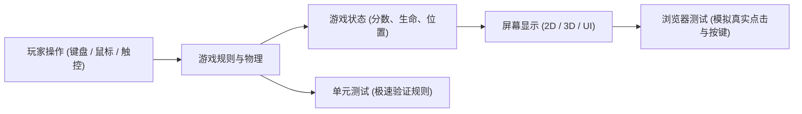

[English](./README.md) | **中文** | [Tiếng Việt](./README.vi.md)

# 第 2 天 — 理解游戏开发核心概念与自动化测试

**预计用时：** 1 小时 · **上一篇：** [第 1 天](../day-01-intro-to-game-dev/README.zh.md) · **下一篇：** [第 3 天](../day-03-project-architecture/README.zh.md)

---

## 概览与核心概念
优秀的浏览器游戏之所以流畅且稳定少 Bug，是因为它们把**游戏规则**（物理、计分、胜负逻辑）和**屏幕显示**（画面、按钮、音效）清晰分开。今天你将用通俗的方式理解这些核心设计理念，以及自动化测试如何保障游戏质量。



- **规则与显示分离：** 把游戏规则独立出来，AI 智能体无需打开浏览器就能在几毫秒内验证跳跃、碰撞和计分是否正确。
- **平滑帧率控制：** 限制每帧时间步长可确保游戏在不同刷新率的电脑上速度一致，并在切换标签页时自动暂停。
- **两层自动化测试：** **单元测试**验证数学与规则；**端到端（E2E）浏览器测试**会启动真实浏览器，模拟按键与点击，确保游玩过程零报错。

---

## 学习目标与成果
完成第 2 天后，你将能够：
1. 用通俗语言说明为什么“规则与画面分离”能让 AI 编程更可靠。
2. 区分**单元测试**（测规则）与**浏览器 E2E 测试**（测真实游玩体验）。
3. 用简单的 `make` 命令运行两套测试，并让 `agy` 解释测试是如何实现的。

---

## 分步指南

### 1. 在 `Dino Run` 上运行两套测试
无需手动翻看测试代码——直接在仓库根目录运行：
```bash
make test GAME=dino-run       # 快速单元测试 + 覆盖率检查
make test-e2e GAME=dino-run   # 启动真实 Chromium 自动试玩并校验
```

### 2. 用通俗提示词让 `agy` 讲解 `Dino Run` 与测试原理
尝试使用下方的示例提示词，让 `agy` 用简单易懂的语言为你讲解。

---

## 示例 `agy` 提示词
```text
Explain the features in the game "Dino Run" in plain English (or Chinese), including both game modes, controls, hints, and tutorial mode.
```
```text
How are the tests implemented in this project? Explain in simple terms what unit tests and browser E2E tests check for Dino Run, and what >=70% test coverage means.
```

---

## 核心要点
- 将**游戏规则**与**屏幕画面**分离，让 AI Vibe Coding 快速且稳定。
- `make test GAME=<slug>` 检查规则与覆盖率，`make test-e2e GAME=<slug>` 检查真实浏览器游玩流程。

---

## 练习与挑战（纯提示词 Vibe Coding）

使用下方示例提示词向 Google `agy` 提问——无需手动编写代码：

1. **深入理解项目：** 让 `agy` 用通俗语言解释本项目的测试是如何实现的。
   ```text
   How are the tests implemented across this project? Explain the difference between make test, make test-e2e, and make test-all for a non-technical learner.
   ```
2. **改进现有功能：** 让 `agy` 优化 `Minesweeper` 的提示信息，使其对新手更友好。
   ```text
   Improve Minesweeper's in-game hint messages so they explain in plain, friendly language why a suggested tile is safe or a mine. Verify with make test GAME=minesweeper.
   ```
3. **实现新功能：** 让 `agy` 为 `Checkers` 添加一个步数计数器。
   ```text
   /plan Add a visible move counter to Checkers that resets on New Game and saves with the game state. Verify everything with make verify GAME=checkers.
   ```
4. **完善测试 / 文档：** 让 `agy` 检查并增强 `1024` 游戏的自动化测试覆盖率。
   ```text
   Check the test coverage report for the 1024 game and add edge-case unit tests for any untested game rules so coverage is even stronger.
   ```
5. **创建新游戏：** 让 `agy` 从零构建一款五局三胜制的 **“石头剪刀布 (Rock-Paper-Scissors)”** 并配齐自动化测试。
   ```text
   /plan Create "Rock-Paper-Scissors" following AGENTS.md, with Best-of-5 rounds, win-streak tracking, How to Play, Tutorial, Hint, and automated unit + browser tests.
   ```
