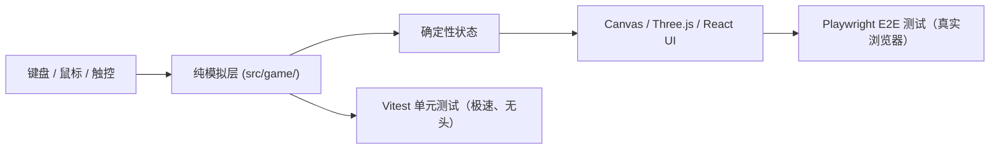

[English](./README.md) | **中文** | [Tiếng Việt](./README.vi.md)

# 第 2 天 — 理解游戏开发核心概念与 TDD

**预计用时：** 1 小时 · **上一篇：** [第 1 天](../day-01-intro-to-game-dev/README.zh.md) · **下一篇：** [第 3 天](../day-03-project-architecture/README.zh.md)

---

## 概览与核心概念
优秀的浏览器游戏之所以手感流畅且稳定少 Bug，是因为它们将**纯游戏规则**与**渲染及 UI** 彻底分离。今天你将学习本仓库每款游戏背后的核心工程原则。



- **关注点分离：** `src/game/` **零 DOM 或 Canvas 导入**，因此物理、计分与 AI 逻辑可以在毫秒级完成单元测试。
- **固定步长 / 限幅 `dt`：** 限制帧间隔（`dt <= 0.05s`）确保游戏在 60Hz 和 144Hz 显示器上表现一致，并在切换标签页（`visibilitychange`）时不会数值爆炸。
- **结合 AI 的测试驱动开发（TDD）：** 让 `agy` 同时编写 Vitest 单元测试与 Playwright E2E 测试，可以立即捕获细微回归问题。

---

## 学习目标与成果
完成第 2 天后，你将能够：
1. 说明为什么把 `src/game/` 与 `src/renderer/`、`src/components/` 分离能让 AI 辅助编程更可靠。
2. 区分 **Vitest 单元测试**（逻辑）与 **Playwright E2E 测试**（真实浏览器流程）。
3. 在现有游戏上运行这两套测试。

---

## 分步指南

### 1. 对比纯模拟文件与渲染器
打开并对比：
- [`games/dino-run/src/game/engine.ts`](../../games/dino-run/src/game/engine.ts) — 注意其中没有任何 `document`、`window` 或 `canvas` 代码！
- [`games/dino-run/src/renderer/canvasRenderer.ts`](../../games/dino-run/src/renderer/canvasRenderer.ts) — 读取 `DinoState` 并绘制像素。

### 2. 在 `Dino Run` 上运行单元测试与 E2E 测试
```bash
cd games/dino-run
npm install
npm test            # Vitest：不到 1 秒即可完成
npm run test:e2e    # Playwright：启动真实 Chromium 进行游戏测试
```

### 3. 阅读测试源码
查看 [`games/dino-run/src/game/__tests__/engine.test.ts`](../../games/dino-run/src/game/__tests__/engine.test.ts) 与 [`games/dino-run/e2e/dino.spec.ts`](../../games/dino-run/e2e/dino.spec.ts)。注意单元测试如何断言精确物理与碰撞规则，而 E2E 测试如何验证零控制台报错、键盘控制、弹窗与 `localStorage` 持久化。

---

## 示例 `agy` 提示词
```text
Read games/dino-run/src/game/engine.ts and games/dino-run/src/game/__tests__/engine.test.ts.
Explain how collision detection and the restart cooldown work, and suggest 2 extra edge-case unit tests we could add.
```

---

## 核心要点
- 纯模拟层（`src/game/`）+ 限幅 `dt` = 确定性、可测试的游戏逻辑。
- 本仓库每款游戏都必须通过 `npm test`、`npm run test:e2e`、`npx tsc --noEmit` 与 `npm run build`。

---

## 练习与挑战
1. 在 `games/1024` 与 `games/ta-la-phom` 中运行 `npm test`，观察益智与卡牌游戏如何进行单元测试。
2. **挑战：** 让 `agy` 解释 [`games/dino-run/src/App.tsx`](../../games/dino-run/src/App.tsx) 如何处理 `visibilitychange`，以及它为何能防止切标签页导致的误死。
