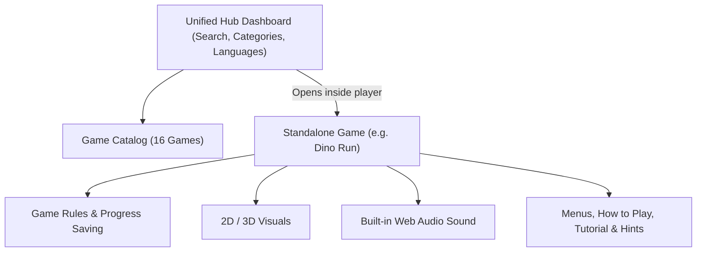

**English** | [中文](./README.zh.md) | [Tiếng Việt](./README.vi.md)

# Day 3 — How the Project Fits Together (Architecture)

**Estimated Time:** 1 Hour · **Previous:** [Day 2](../day-02-game-dev-concepts/README.md) · **Next:** [Day 4](../day-04-dev-tools-and-ai-agents/README.md)

---

## Overview & Key Concepts
Today you will learn at a high level how the **Gemini Games Hub** connects all **16 games** under one roof, and how a single game (like **Dino Run**) is organized into clean building blocks so `agy` can update any part safely.



---

## Learning Objectives & Outcomes
By the end of Day 3, you will be able to:
1. Understand the big picture of how the root Hub and individual game folders work together.
2. Explain why every game works both **on its own** and **inside the unified Hub**.
3. Describe the 4 building blocks inside every game: **Rules**, **Visuals**, **Sound**, and **UI / Help**.

---

## Step-by-Step Guide

### 1. View the Visual Architecture Guide
Open [`docs/architecture.md`](../../docs/architecture.md) to see the high-level system diagrams.

### 2. Understand Why Every Game Is Self-Contained
- Each game lives in its own folder under `games/` with its own rules, icons, cover artwork, docs, and tests.
- When you build the project (`npm run build`), the bundler automatically packages the Hub **plus** all 16 games into one static `dist/` folder ready for local preview or Cloudflare.

---

## Sample `agy` Prompts
```text
Summarise how this project is organized in plain English. How does the main
Hub know about all 16 games, and why can each game run both standalone and
inside the Hub?
```
```text
Explain the building blocks of "Dino Run" (rules, visuals, sound effects, help
modal, and saving high scores) without showing raw code.
```

---

## Key Takeaways
- Every game is self-contained yet plugs automatically into the unified Hub.
- Shared theme colors and UI styles keep all 16 games feeling like one cohesive collection.

---

## Exercises & Challenges (Prompt-Only Vibe Coding)

Use Google `agy` with the sample prompts below—no manual coding required:

1. **Understand the Project:** Ask `agy` to explain how the Hub shares styles, themes, and languages across the project.
   ```text
   Explain in simple terms how Light/Dark themes, purple/ivory colors, and
   English/Chinese/Vietnamese translations work across the Gemini Games Hub.
   ```
2. **Improve a Feature:** Ask `agy` to add helpful keyboard shortcut tooltips to the Hub's game player bar.
   ```text
   Improve the Hub's game-player top bar by adding clear tooltips on the Reload
   and Fullscreen buttons in English, Chinese, and Vietnamese. Verify with make
   test and make lint.
   ```
3. **Implement a New Feature:** Ask `agy` to add a **"Games Played"** counter to `Dino Run`'s Game Over screen.
   ```text
   /plan Add a "Games Played" counter to Dino Run that saves automatically in the
   browser and shows on the Game Over screen. Verify with make verify
   GAME=dino-run.
   ```
4. **Improve Tests / Docs:** Ask `agy` to add a plain-English summary of how high scores are saved locally.
   ```text
   Summarise how all 16 games save high scores and mute settings locally in the
   browser (without any backend server), and add a short note about this to the
   project architecture docs.
   ```
5. **Create a New Game:** Ask `agy` to build a lightweight **"Coin Flipper"** game and register it in the Hub.
   ```text
   /plan Build a "Coin Flipper" game following AGENTS.md, with streak tracking,
   crisp SVG coin flip animation, How to Play, Tutorial, Hint, and automated
   tests.
   ```
