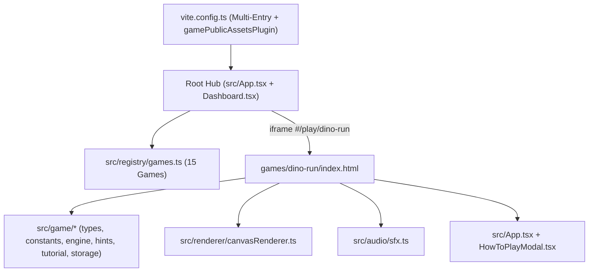

**English** | [中文](./README.zh.md) | [Tiếng Việt](./README.vi.md)

# Day 3 — Understanding This Project's Architecture

**Estimated Time:** 1 Hour · **Previous:** [Day 2](../day-02-game-dev-concepts/README.md) · **Next:** [Day 4](../day-04-dev-tools-and-ai-agents/README.md)

---

## Overview & Key Concepts
Today you will learn how the **Gemini Games** monorepo connects the root Dashboard to all 15 games, and dissect the full architecture of **Dino Run** (`games/dino-run/`).



---

## Learning Objectives & Outcomes
By the end of Day 3, you will be able to:
1. Navigate the root monorepo layout (`src/`, `styles/`, `games/`, `docs/`, `e2e/`).
2. Explain how [`vite.config.ts`](../../vite.config.ts) discovers and bundles every `games/*/index.html` and copies `public/` assets.
3. Trace the complete data flow of `games/dino-run/` from keyboard event to Canvas frame.

---

## Step-by-Step Guide

### 1. Read the Root Architecture Guide
Open [`docs/architecture.md`](../../docs/architecture.md) and review the three diagrams.

### 2. Trace How a Game Appears on the Dashboard
1. Open [`src/registry/games.ts`](../../src/registry/games.ts) and find the `'dino-run'` entry.
2. Open [`vite.config.ts`](../../vite.config.ts) and inspect `discoverGameSlugs()` and `gamePublicAssetsPlugin()`.
3. Notice why every game uses relative paths (`base: './'` and `./icons/icon-192.png`): it works both standalone (`cd games/dino-run && npm run dev`) and inside the unified hub!

### 3. Anatomy of a Game (`games/dino-run/`)
Inspect the files inside [`games/dino-run/`](../../games/dino-run/docs/architecture.md):
- `src/game/constants.ts` — Tunable physics (`GRAVITY`, `JUMP_VELOCITY`, `BASE_SPEED`)
- `src/game/engine.ts` — State transitions (`triggerJump`, `setDucking`, `stepDino`)
- `src/game/storage.ts` — Safe `try/catch` `localStorage` under `dino_run_v1`
- `src/renderer/canvasRenderer.ts` — Pixel-art T-Rex, cacti, pterodactyls, Day/Night cycle
- `src/audio/sfx.ts` — Procedural Web Audio tones (zero `.mp3` files!)
- `src/main.tsx` — Imports shared `../../../styles/tokens.css` and `../../../styles/game-ui.css`

---

## Sample `agy` Prompts
```text
Trace what happens step-by-step when the player presses Space in games/dino-run/src/App.tsx, from the keydown listener to the pixel-art T-Rex jumping on the canvas.
```

---

## Key Takeaways
- Every game is self-contained yet plugs automatically into the root build via `vite.config.ts` and `src/registry/games.ts`.
- Shared styling lives in `styles/tokens.css`, `styles/game-ui.css`, and `styles/theme.ts`.

---

## Exercises & Challenges
1. Find the `localStorage` key used by `games/dino-run`, `games/tetris`, and `games/simcity`.
2. **Challenge:** Run `npm run build` at the repository root and inspect the generated `dist/games/dino-run/` directory to see how `gamePublicAssetsPlugin` copied the icons and covers.
