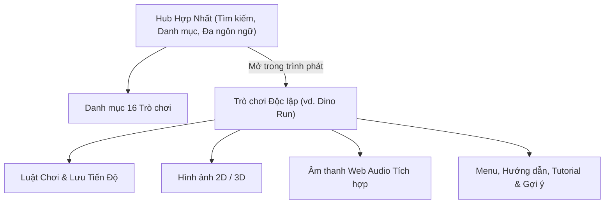

[English](./README.md) | [中文](./README.zh.md) | **Tiếng Việt**

# Ngày 3 — Cách Dự Án Kết Nối Với Nhau (Kiến Trúc Tổng Quan)

**Thời lượng ước tính:** 1 Giờ · **Trước:** [Ngày 2](../day-02-game-dev-concepts/README.vi.md) · **Tiếp theo:** [Ngày 4](../day-04-dev-tools-and-ai-agents/README.vi.md)

---

## Tổng quan & Khái niệm chính
Hôm nay bạn sẽ hiểu ở mức tổng quan cách **Gemini Games Hub** kết nối cả **16 trò chơi** dưới cùng một mái nhà, và cách mỗi trò chơi (như **Dino Run**) được tổ chức thành các khối rõ ràng để `agy` có thể chỉnh sửa an toàn.



---

## Mục tiêu & Kết quả học tập
Sau Ngày 3, bạn sẽ có thể:
1. Hiểu bức tranh tổng thể cách Hub gốc và từng thư mục game phối hợp với nhau.
2. Giải thích vì sao mọi game đều chạy được cả **độc lập** lẫn **bên trong Hub hợp nhất**.
3. Mô tả 4 khối cấu thành của mỗi game: **Luật chơi**, **Hình ảnh**, **Âm thanh**, và **Giao diện / Trợ giúp**.

---

## Hướng dẫn từng bước

### 1. Xem Tài liệu Kiến trúc Trực quan
Mở [`docs/architecture.md`](../../docs/architecture.md) để xem các sơ đồ tổng quan.

### 2. Hiểu Vì Sao Mỗi Game Đều Độc Lập
- Mỗi game nằm trong thư mục riêng dưới `games/` với luật chơi, biểu tượng, ảnh bìa, tài liệu và kiểm thử riêng.
- Khi bạn chạy build (`npm run build`), công cụ đóng gói tự động gom Hub **cùng** cả 16 game vào một thư mục tĩnh `dist/` sẵn sàng chạy local hoặc đẩy lên Cloudflare.

---

## Câu lệnh mẫu cho `agy`
```text
Summarise how this project is organized in plain English (or Vietnamese). How does the main Hub know about all 16 games, and why can each game run both standalone and inside the Hub?
```
```text
Explain the building blocks of "Dino Run" (rules, visuals, sound effects, help modal, and saving high scores) without showing raw code.
```

---

## Điểm cốt lõi
- Mỗi game hoàn toàn độc lập nhưng tự động tích hợp vào Hub hợp nhất.
- Bảng màu và phong cách UI dùng chung giúp cả 16 game trông như một bộ sưu tập đồng nhất.

---

## Bài tập & Thử thách (Vibe Coding Chỉ Dùng Câu Lệnh)

Sử dụng các câu lệnh mẫu bên dưới với Google `agy`—không cần tự viết code thủ công:

1. **Hiểu Dự án Sâu hơn:** Nhờ `agy` giải thích cách Hub quản lý giao diện Sáng/Tối và 3 ngôn ngữ.
   ```text
   Explain in simple terms how Light/Dark themes, purple/ivory colors, and English/Chinese/Vietnamese translations work across the Gemini Games Hub.
   ```
2. **Cải tiến Tính năng:** Nhờ `agy` thêm chú thích phím tắt thân thiện cho thanh điều khiển trình phát game.
   ```text
   Improve the Hub's game-player top bar by adding clear tooltips on the Reload and Fullscreen buttons in English, Chinese, and Vietnamese. Verify with make test and make lint.
   ```
3. **Triển khai Tính năng Mới:** Nhờ `agy` thêm bộ đếm **"Số lượt đã chơi"** vào màn hình kết thúc của `Dino Run`.
   ```text
   /plan Add a "Games Played" counter to Dino Run that saves automatically in the browser and shows on the Game Over screen. Verify with make verify GAME=dino-run.
   ```
4. **Cải thiện Kiểm thử / Tài liệu:** Nhờ `agy` tóm tắt cách các game lưu điểm cao và cài đặt âm thanh ngay trên trình duyệt.
   ```text
   Summarise how all 16 games save high scores and mute settings locally in the browser (without any backend server), and add a short note about this to the project architecture docs.
   ```
5. **Tạo Game Mới:** Nhờ `agy` xây dựng mini-game **"Tung Đồng Xu (Coin Flipper)"** và đăng ký vào Hub.
   ```text
   /plan Build a "Coin Flipper" game following AGENTS.md, with streak tracking, crisp SVG coin flip animation, How to Play, Tutorial, Hint, and automated tests.
   ```
