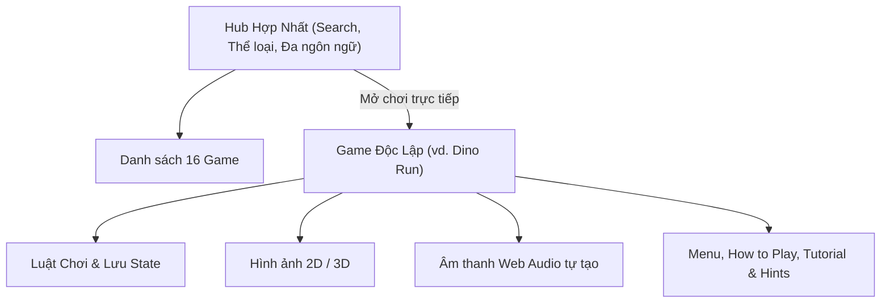

[English](./README.md) | [中文](./README.zh.md) | **Tiếng Việt**

# Ngày 3 — Cách Dự Án Kết Nối Với Nhau (Kiến Trúc Tổng Quan)

**Thời lượng ước tính:** 1 Giờ · **Trước:** [Ngày 2](../day-02-game-dev-concepts/README.vi.md) · **Tiếp theo:** [Ngày 4](../day-04-dev-tools-and-ai-agents/README.vi.md)

---

## Tổng quan & Ý chính
Hôm nay bạn sẽ nhìn bức tranh toàn cảnh xem **Gemini Games Hub** gom cả **16 tựa game** về chung một nhà kiểu gì, và bên trong mỗi game (như **Dino Run**) được chia thành từng khối gọn gàng ra sao để `agy` vào sửa không bị rối.



---

## Mục tiêu & Kết quả sau Ngày 3
Xong Ngày 3, bạn sẽ nắm được:
1. Hình dung rõ cách Hub ở thư mục gốc và từng thư mục game riêng lẻ phối hợp với nhau.
2. Giải thích được vì sao game nào cũng chạy ngon dù mở **riêng lẻ (standalone)** hay mở **bên trong Hub**.
3. Kể tên 4 mảnh ghép chính của một game: **Luật chơi**, **Hình ảnh**, **Âm thanh**, và **Giao diện / Trợ giúp**.

---

## Hướng dẫn từng bước

### 1. Ngó qua tài liệu Kiến trúc trực quan
Mở [`docs/architecture.md`](../../docs/architecture.md) để xem mấy sơ đồ tổng quan cho dễ hình dung.

### 2. Vì sao mỗi game đều "tự thân vận động" được?
- Mỗi game có một giang sơn riêng dưới `games/` với đủ luật chơi, icon, ảnh bìa, tài liệu và bộ test của riêng mình.
- Khi bạn chạy build (`npm run build`), hệ thống đóng gói tự động gom Hub **lẫn** cả 16 game vào chung một thư mục tĩnh `dist/`—mang chạy local hay đẩy lên Cloudflare đều gọn ơ.

---

## Prompt mẫu cho `agy`
```text
Summarise how this project is organized in plain English (or Vietnamese). How
does the main Hub know about all 16 games, and why can each game run both
standalone and inside the Hub?
```
```text
Explain the building blocks of "Dino Run" (rules, visuals, sound effects, help
modal, and saving high scores) without showing raw code.
```

---

## Chốt lại ý chính
- Game nào cũng độc lập 100%, nhưng hễ đăng ký là tự động khớp mượt vào Hub chung.
- Bộ màu và style UI dùng chung giúp cả 16 game nhìn đồng bộ như một bộ sưu tập xịn xò.

---

## Bài tập & Thử thách (Vibe Coding Thuần Prompt)

Dùng mấy prompt gợi ý bên dưới với Google `agy`—không cần tự đụng tay viết code:

1. **Hiểu Dự án Sâu hơn:** Nhờ `agy` giải thích cách Hub xử lý Light/Dark mode và 3 ngôn ngữ.
   ```text
   Explain in simple terms how Light/Dark themes, purple/ivory colors, and
   English/Chinese/Vietnamese translations work across the Gemini Games Hub.
   ```
2. **Cải tiến Tính năng:** Nhờ `agy` thêm tooltip gợi ý phím tắt thân thiện lên thanh điều khiển của trình phát game.
   ```text
   Improve the Hub's game-player top bar by adding clear tooltips on the Reload
   and Fullscreen buttons in English, Chinese, and Vietnamese. Verify with make
   test and make lint.
   ```
3. **Thêm Tính năng Mới:** Nhờ `agy` thêm bộ đếm **"Số lượt đã chơi"** vào màn hình Game Over của `Dino Run`.
   ```text
   /plan Add a "Games Played" counter to Dino Run that saves automatically in the
   browser and shows on the Game Over screen. Verify with make verify
   GAME=dino-run.
   ```
4. **Check Tài liệu / Lưu trữ:** Nhờ `agy` tóm tắt cách cả 16 game lưu điểm cao và trạng thái Mute bằng `localStorage` ngay trên trình duyệt.
   ```text
   Summarise how all 16 games save high scores and mute settings locally in the
   browser (without any backend server), and add a short note about this to the
   project architecture docs.
   ```
5. **Tạo Game Mới:** Nhờ `agy` làm mini-game **"Tung Đồng Xu (Coin Flipper)"** rồi đăng ký lên Hub luôn.
   ```text
   /plan Build a "Coin Flipper" game following AGENTS.md, with streak tracking,
   crisp SVG coin flip animation, How to Play, Tutorial, Hint, and automated
   tests.
   ```
