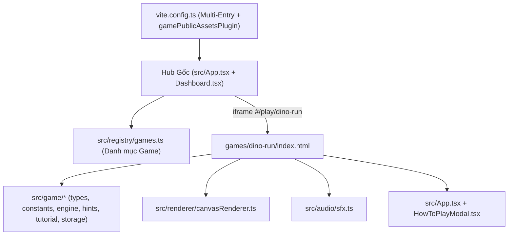

[English](./README.md) | [中文](./README.zh.md) | **Tiếng Việt**

# Ngày 3 — Hiểu Kiến trúc Dự án

**Thời lượng ước tính:** 1 Giờ · **Trước:** [Ngày 2](../day-02-game-dev-concepts/README.vi.md) · **Tiếp theo:** [Ngày 4](../day-04-dev-tools-and-ai-agents/README.vi.md)

---

## Tổng quan & Khái niệm chính
Hôm nay bạn sẽ tìm hiểu cách monorepo **Gemini Games** kết nối Dashboard gốc với toàn bộ các game, đồng thời phân tích kiến trúc đầy đủ của **Dino Run** (`games/dino-run/`).



---

## Mục tiêu & Kết quả học tập
Sau Ngày 3, bạn sẽ có thể:
1. Điều hướng cấu trúc monorepo gốc (`src/`, `styles/`, `games/`, `docs/`, `e2e/`).
2. Giải thích cách [`vite.config.ts`](../../vite.config.ts) tự động khám phá, đóng gói mọi `games/*/index.html` và sao chép tài nguyên `public/`.
3. Truy vết luồng dữ liệu hoàn chỉnh của `games/dino-run/` từ sự kiện bàn phím đến khung hình Canvas.

---

## Hướng dẫn từng bước

### 1. Đọc tài liệu Kiến trúc Gốc
Mở [`docs/architecture.md`](../../docs/architecture.md) và xem 3 sơ đồ kiến trúc.

### 2. Theo dõi cách một Game xuất hiện trên Dashboard
1. Mở [`src/registry/games.ts`](../../src/registry/games.ts) và tìm mục `'dino-run'`.
2. Mở [`vite.config.ts`](../../vite.config.ts) để xem `discoverGameSlugs()` và `gamePublicAssetsPlugin()`.
3. Chú ý lý do mọi game dùng đường dẫn tương đối (`base: './'` và `./icons/icon-192.png`): nhờ vậy game chạy được cả khi độc lập (`cd games/dino-run && npm run dev`) lẫn khi nhúng trong hub hợp nhất!

### 3. Giải phẫu một Game (`games/dino-run/`)
Xem các tệp bên trong [`games/dino-run/`](../../games/dino-run/docs/architecture.md):
- `src/game/constants.ts` — Tham số vật lý (`GRAVITY`, `JUMP_VELOCITY`, `BASE_SPEED`)
- `src/game/engine.ts` — Chuyển đổi trạng thái (`triggerJump`, `setDucking`, `stepDino`)
- `src/game/storage.ts` — Lưu trữ `localStorage` an toàn với `try/catch` dưới khóa `dino_run_v1`
- `src/renderer/canvasRenderer.ts` — Khủng long pixel, xương rồng, thằn lằn bay, chu kỳ Ngày/Đêm
- `src/audio/sfx.ts` — Âm thanh Web Audio tạo bằng mã (không cần tệp `.mp3`!)
- `src/main.tsx` — Import giao diện dùng chung `../../../styles/tokens.css` và `../../../styles/game-ui.css`

---

## Câu lệnh mẫu cho `agy`
```text
Trace what happens step-by-step when the player presses Space in games/dino-run/src/App.tsx, from the keydown listener to the pixel-art T-Rex jumping on the canvas.
```

---

## Điểm cốt lõi
- Mỗi game hoàn toàn độc lập nhưng tự động tích hợp vào bản build gốc qua `vite.config.ts` và `src/registry/games.ts`.
- Giao diện dùng chung nằm tại `styles/tokens.css`, `styles/game-ui.css` và `styles/theme.ts`.

---

## Bài tập & Thử thách
1. Tìm khóa `localStorage` được dùng bởi `games/dino-run`, `games/tetris` và `games/simcity`.
2. **Thử thách:** Chạy `npm run build` ở thư mục gốc và kiểm tra thư mục `dist/games/dino-run/` để xem `gamePublicAssetsPlugin` đã sao chép icon và ảnh bìa như thế nào.
