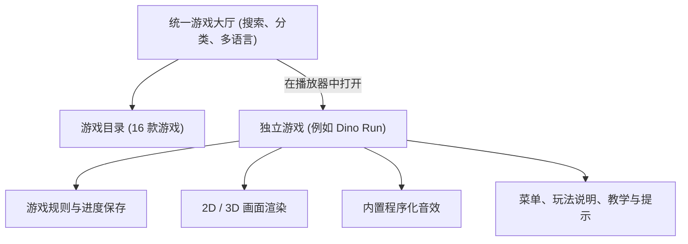

[English](./README.md) | **中文** | [Tiếng Việt](./README.vi.md)

# 第 3 天 — 从全局理解项目架构

**预计用时：** 1 小时 · **上一篇：** [第 2 天](../day-02-game-dev-concepts/README.zh.md) · **下一篇：** [第 4 天](../day-04-dev-tools-and-ai-agents/README.zh.md)

---

## 概览与核心概念
今天你将从宏观层面理解 **Gemini Games 游戏大厅** 如何将全部 **16 款游戏** 整合在一起，以及单款游戏（如 **Dino Run**）如何拆分为清晰的模块，从而让 `agy` 可以安全地修改任何部分。



---

## 学习目标与成果
完成第 3 天后，你将能够：
1. 理解根目录游戏大厅与各个独立游戏目录如何协同工作。
2. 说明为什么每款游戏既能**独立运行**，又能**无缝嵌入统一大厅**。
3. 概括每款游戏的 4 大组成部分：**规则**、**画面**、**音效** 与 **界面/帮助**。

---

## 分步指南

### 1. 查看可视化架构指南
打开 [`docs/architecture.md`](../../docs/architecture.md)，浏览项目的整体架构图。

### 2. 理解为什么每款游戏都是自包含的
- 每款游戏都放在 `games/` 下的独立文件夹中，拥有自己的规则、图标、封面图、文档与测试。
- 运行构建命令（`npm run build`）时，构建工具会自动把大厅与全部 16 款游戏打包进同一个静态 `dist/` 目录，方便本地预览或部署到 Cloudflare。

---

## 示例 `agy` 提示词
```text
Summarise how this project is organized in plain English (or Chinese). How
does the main Hub know about all 16 games, and why can each game run both
standalone and inside the Hub?
```
```text
Explain the building blocks of "Dino Run" (rules, visuals, sound effects, help
modal, and saving high scores) without showing raw code.
```

---

## 核心要点
- 每款游戏独立自包含，同时又能自动接入统一大厅。
- 共享主题配色与 UI 规范让 16 款游戏拥有一致的视觉体验。

---

## 练习与挑战（纯提示词 Vibe Coding）

使用下方示例提示词向 Google `agy` 提问——无需手动编写代码：

1. **深入理解项目：** 让 `agy` 用通俗语言解释大厅如何管理浅色/深色主题与三语切换。
   ```text
   Explain in simple terms how Light/Dark themes, purple/ivory colors, and
   English/Chinese/Vietnamese translations work across the Gemini Games Hub.
   ```
2. **改进现有功能：** 让 `agy` 为大厅游戏播放器顶部栏按钮添加多语言提示信息。
   ```text
   Improve the Hub's game-player top bar by adding clear tooltips on the Reload
   and Fullscreen buttons in English, Chinese, and Vietnamese. Verify with make
   test and make lint.
   ```
3. **实现新功能：** 让 `agy` 为 `Dino Run` 的结束界面添加“累计游玩局数”统计。
   ```text
   /plan Add a "Games Played" counter to Dino Run that saves automatically in the
   browser and shows on the Game Over screen. Verify with make verify
   GAME=dino-run.
   ```
4. **完善测试 / 文档：** 让 `agy` 总结所有游戏如何在浏览器本地保存最高分与静音设置。
   ```text
   Summarise how all 16 games save high scores and mute settings locally in the
   browser (without any backend server), and add a short note about this to the
   project architecture docs.
   ```
5. **创建新游戏：** 让 `agy` 构建一个轻量级的 **“抛硬币连胜 (Coin Flipper)”** 小游戏并注册到大厅。
   ```text
   /plan Build a "Coin Flipper" game following AGENTS.md, with streak tracking,
   crisp SVG coin flip animation, How to Play, Tutorial, Hint, and automated
   tests.
   ```
