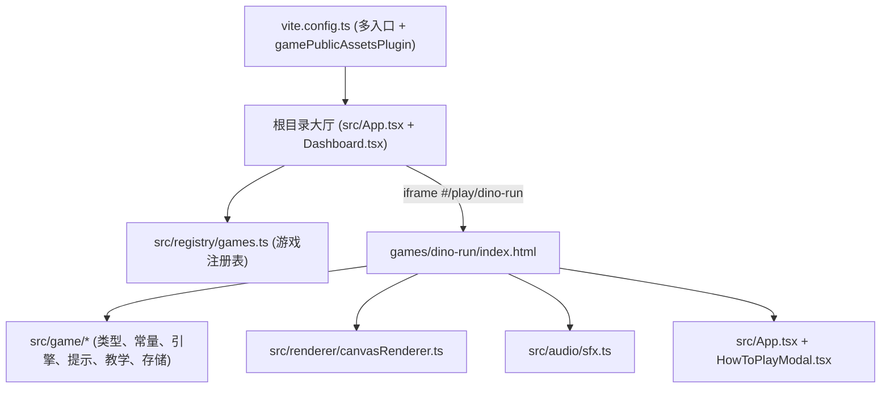

[English](./README.md) | **中文** | [Tiếng Việt](./README.vi.md)

# 第 3 天 — 理解本项目架构

**预计用时：** 1 小时 · **上一篇：** [第 2 天](../day-02-game-dev-concepts/README.zh.md) · **下一篇：** [第 4 天](../day-04-dev-tools-and-ai-agents/README.zh.md)

---

## 概览与核心概念
今天你将学习 **Gemini Games** 单仓库（Monorepo）如何将根目录大厅与所有独立游戏连接起来，并深入剖析 **Dino Run**（`games/dino-run/`）的完整架构。



---

## 学习目标与成果
完成第 3 天后，你将能够：
1. 熟悉根目录单仓库布局（`src/`、`styles/`、`games/`、`docs/`、`e2e/`）。
2. 解释 [`vite.config.ts`](../../vite.config.ts) 如何自动发现并打包每个 `games/*/index.html` 与拷贝 `public/` 静态资源。
3. 追踪 `games/dino-run/` 从键盘事件到 Canvas 绘制帧的完整数据流。

---

## 分步指南

### 1. 阅读根目录架构文档
打开 [`docs/architecture.md`](../../docs/architecture.md) 并查看其中的三张架构图。

### 2. 追踪游戏如何出现在大厅中
1. 打开 [`src/registry/games.ts`](../../src/registry/games.ts)，找到 `'dino-run'` 条目。
2. 打开 [`vite.config.ts`](../../vite.config.ts)，查看 `discoverGameSlugs()` 与 `gamePublicAssetsPlugin()`。
3. 注意为什么每款游戏都使用相对路径（`base: './'` 与 `./icons/icon-192.png`）：这样无论独立运行（`cd games/dino-run && npm run dev`）还是在统一大厅中嵌入都能正常工作！

### 3. 解剖一款游戏（`games/dino-run/`）
查看 [`games/dino-run/`](../../games/dino-run/docs/architecture.md) 中的核心文件：
- `src/game/constants.ts` — 可调物理参数（`GRAVITY`、`JUMP_VELOCITY`、`BASE_SPEED`）
- `src/game/engine.ts` — 状态转移（`triggerJump`、`setDucking`、`stepDino`）
- `src/game/storage.ts` — 基于 `dino_run_v1` 的安全 `try/catch` `localStorage` 存储
- `src/renderer/canvasRenderer.ts` — 像素风霸王龙、仙人掌、翼龙与昼夜循环
- `src/audio/sfx.ts` — 程序化 Web Audio 音调（零 `.mp3` 文件！）
- `src/main.tsx` — 引入共享样式 `../../../styles/tokens.css` 与 `../../../styles/game-ui.css`

---

## 示例 `agy` 提示词
```text
Trace what happens step-by-step when the player presses Space in games/dino-run/src/App.tsx, from the keydown listener to the pixel-art T-Rex jumping on the canvas.
```

---

## 核心要点
- 每款游戏既可独立自包含运行，又可通过 `vite.config.ts` 与 `src/registry/games.ts` 自动接入根目录构建。
- 共享样式统一存放于 `styles/tokens.css`、`styles/game-ui.css` 与 `styles/theme.ts`。

---

## 练习与挑战（纯提示词 Vibe Coding）

使用下方示例提示词向 Google `agy` 提问——无需手动编写代码：

1. **深入理解项目：** 让 `agy` 解释 `vite.config.ts` 如何将大厅与全部游戏打包到一起。
   ```text
   Trace how vite.config.ts discovers games/*/index.html, serves public/ assets in dev via gamePublicAssetsPlugin, and copies them into dist/games/<slug>/ during npm run build.
   ```
2. **改进现有功能：** 让 `agy` 为 `GamePlayer` 顶部栏按钮添加多语言提示信息。
   ```text
   In src/components/GamePlayer.tsx and src/i18n/translations.ts, add a subtle tooltip on the Fullscreen and Reload buttons across en, zh, and vi. Verify with make test and make lint.
   ```
3. **实现新功能：** 让 `agy` 为 `Dino Run` 添加“累计游玩局数”统计与持久化。
   ```text
   /plan Add a gamesPlayed counter to games/dino-run/src/game/storage.ts (under dino_run_v1) and display it in the Game Over overlay. Verify with make verify GAME=dino-run.
   ```
4. **完善测试 / 文档：** 让 `agy` 汇总仓库中所有游戏使用的 `localStorage` 键名并写入架构文档。
   ```text
   Scan games/*/src/game/storage.ts and src/registry/hubStorage.ts for all localStorage keys, then add a "Storage Keys" reference table to docs/architecture.md.
   ```
5. **创建新游戏：** 让 `agy` 创建一个轻量级的 **“抛硬币连胜 (Coin Flipper)”** 小游戏并注册到大厅。
   ```text
   /plan Build a "Coin Flipper" game in games/coin-flipper/ following AGENTS.md and .agents/skills/create-game/SKILL.md, with streak tracking, SVG coin flip, How to Play, Tutorial, Hint, and Vitest >=70% coverage.
   ```
