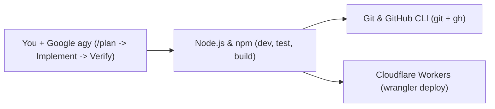

**English** | [中文](./README.zh.md) | [Tiếng Việt](./README.vi.md)

# Day 4 — Developer Tools & AI Coding Agents

**Estimated Time:** 1 Hour · **Previous:** [Day 3](../day-03-project-architecture/README.md) · **Next:** [Day 5](../day-05-tech-stack-deep-dive/README.md)

---

## Overview & Key Concepts
Modern vibe-coding game development combines four essential tools: **Node.js & npm**, **Git & GitHub (`gh`)**, **Cloudflare Workers (`wrangler`)**, and **AI coding agents (Google `agy`)**.



---

## Learning Objectives & Outcomes
By the end of Day 4, you will be able to:
1. Run project lifecycle scripts with `npm` (`dev`, `test`, `test:e2e`, `build`, `deploy`).
2. Create feature branches, commit, and manage repositories using `git` and `gh`.
3. Understand how [`wrangler.jsonc`](../../wrangler.jsonc) deploys `dist/` to Cloudflare Workers Static Assets.
4. Use Google `agy` effectively with `/plan`, `AGENTS.md`, and verification gates.

---

## Step-by-Step Guide

### 1. Node.js & npm Scripts
Inspect [`package.json`](../../package.json):
```bash
npm run dev        # Start local Vite dev server
npm test           # Run Vitest unit tests
npm run test:e2e   # Run Playwright Chromium tests
npm run build      # Type-check (tsc) + build static dist/
npm run deploy     # Build dist/ + deploy via wrangler
```

### 2. Git & GitHub CLI (`git` + `gh`)
Always isolate experiments on a branch before asking an AI agent to make large edits:
```bash
git status
git checkout -b practice-day-4
# ...make changes, test, then switch back:
git checkout main
git branch -d practice-day-4
```
Check GitHub CLI auth:
```bash
gh auth status
```

### 3. Cloudflare Workers (`wrangler`)
Open [`wrangler.jsonc`](../../wrangler.jsonc) and note how static hosting requires zero server code:
- `"assets": { "directory": "./dist", "not_found_handling": "single-page-application" }`
- Validate a deployment safely without publishing:
```bash
npm run build && npx wrangler deploy --dry-run
```

### 4. Working Effectively with Google `agy`
- **Start with `/plan`:** For any non-trivial feature or new game, prefix your prompt with `/plan` so `agy` researches first and aligns on design decisions before editing files.
- **Anchor on `AGENTS.md`:** Mention `AGENTS.md` compliance so `agy` remembers docs, icons/covers, How to Play, Tutorial, Hints, and tests.
- **Demand verification:** Always ask `agy` to run `npm test && npm run test:e2e && npx tsc --noEmit && npm run build`.

---

## Sample `agy` Prompts
```text
/plan Review games/dino-run/ and propose 3 small gameplay improvements we could implement safely on a new git branch.
```

---

## Key Takeaways
- Use `git` branches for safe experimentation and `wrangler deploy --dry-run` to validate builds before publishing.
- `/plan` + `AGENTS.md` + automated tests turn AI agents into reliable engineering partners.

---

## Exercises & Challenges (Prompt-Only Vibe Coding)

Use Google `agy` with the sample prompts below—no manual coding required:

1. **Understand the Project:** Ask `agy` to explain how `Makefile` and `scripts/check-compliance.mjs` enforce `AGENTS.md`.
   ```text
   Read Makefile and scripts/check-compliance.mjs, and explain each check that make verify runs before allowing a release.
   ```
2. **Improve a Feature:** Ask `agy` to enrich `make help` with grouped sections and example `GAME=<slug>` commands.
   ```text
   In Makefile, group the make help output into Setup, Dev, Quality, and Deploy sections while keeping the awk ## comment format intact. Verify with make help.
   ```
3. **Implement a New Feature:** Ask `agy` to add a `make status` target showing git branch, game count, and `dist/` build status.
   ```text
   Add a "status" target to Makefile (and update TODOs/BACKLOGs/Makefile.md) that prints the current git branch, number of games in games/, and whether dist/ exists. Verify with make status.
   ```
4. **Improve Tests / Docs:** Ask `agy` to add a "Common Troubleshooting" section to `QUICKSTART.md`.
   ```text
   Add a short Troubleshooting section to QUICKSTART.md covering Playwright browser install, port conflicts, and wrangler login.
   ```
5. **Create a New Game:** Ask `agy` to `/plan` and build a **"Reaction Timer"** game on a new git branch.
   ```text
   /plan Create a "Reaction Timer" game in games/reaction-timer/ on a new branch following AGENTS.md and .agents/skills/create-game/SKILL.md, measuring millisecond reaction time across 5 rounds with best-average persistence.
   ```
