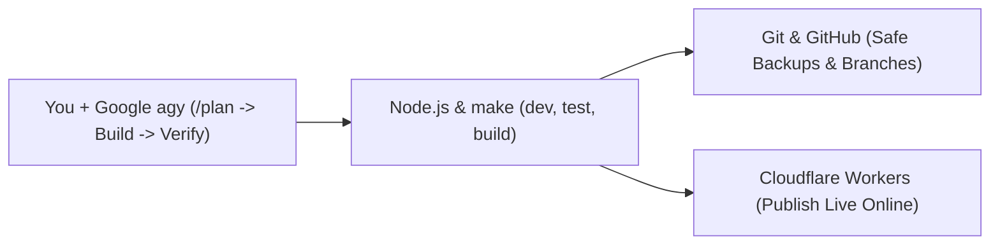

**English** | [中文](./README.zh.md) | [Tiếng Việt](./README.vi.md)

# Day 4 — Developer Tools & AI Coding Agents

**Estimated Time:** 1 Hour · **Previous:** [Day 3](../day-03-project-architecture/README.md) · **Next:** [Day 5](../day-05-tech-stack-deep-dive/README.md)

---

## Overview & Key Concepts
Modern vibe-coding game development uses four simple tools working together: **Node.js & `make`** (running & checking), **Git & GitHub** (saving versions safely), **Cloudflare Workers** (publishing online), and **Google `agy`** (your AI builder).



---

## Learning Objectives & Outcomes
By the end of Day 4, you will be able to:
1. Run everyday project shortcuts with `make` (`make dev`, `make test`, `make verify`, `make deploy-dry-run`).
2. Use Git branches to test new ideas safely without breaking your main version.
3. Ask `agy` how to set up Cloudflare and deploy your games online step by step.
4. Use `/plan` with `agy` so the AI aligns with you before making big changes.

---

## Step-by-Step Guide

### 1. Everyday `make` Shortcuts (Learn As You Go)
You don't need to memorize `make`, `git`, or `agy` manuals up front—just run these shortcuts when needed:
```bash
make help             # List every shortcut
make dev              # Start the 100% offline local game hub
make test             # Run unit tests + coverage check
make verify           # Run all quality & compliance checks
make deploy-dry-run   # Test-package static dist/ for Cloudflare (or Vercel) without publishing
```

### 2. Safe Experimenting with Git Branches
Using `git` is **strongly recommended** in vibe coding: committing regularly preserves your project history so you can always return to a safe checkpoint, and it helps AI agents better inspect, diff, and manage changes across your project.

Before trying a big new idea with `agy`, create a safe practice branch:
```bash
git checkout -b practice-day-4
# ...experiment freely, then switch back anytime:
git checkout main
```

### 3. Mastering Google `agy` Commands (`/plan`, `/goal`, `/teamwork`)
- **Free + Google AI Pro (`orchestrator` model):** `agy` is **free** to use, and **Google AI Pro is recommended** so you can access `agy`'s **`orchestrator`** model—ideal for multi-step planning, `/goal`, and `/teamwork`.
- **`/plan` (The Classic Magic Keyword):** Start a prompt with `/plan` whenever you want the AI to think, research, and show you a step-by-step plan for approval before changing any file. `/plan` is a classic magic keyword that works not only in **`agy`**, but also in **GitHub Copilot, Claude / Claude Code, ChatGPT / Codex, and Cursor**.
- **`/goal` (100% Autonomous, 100% Unattended):** Use `/goal` when you want `agy` to implement an **end-to-end task 100% autonomously and 100% unattended** (for example, building a full game, generating artwork, writing tests and docs, and looping until `make verify` passes).
- **`/teamwork` (Multi-Agent Parallel Execution):** Use `/teamwork` when you want `agy` to **spawn many agents at once**—for example, creating **more than one game at a time** (like *Snake* and *Breakout* in parallel) or dividing simulation, artwork, tests, and translations across a team.
- **Describe outcomes, not code:** Tell `agy` *what the player should experience*, and let `agy` handle the files and tests.

---

## Sample `agy` Prompts
```text
How can I deploy this project to Cloudflare, and how do I set up Cloudflare
from scratch (account, Wrangler login, and dry-run)?
```
```text
/plan Review Dino Run and suggest 3 fun gameplay improvements we could try
safely on a new Git branch.
```
```text
/goal Build a complete "Reaction Timer" game following AGENTS.md, including
custom icons/covers, How to Play, Tutorial, Hint, multilingual docs, and
automated tests. Do not stop until make verify GAME=reaction-timer passes.
```
```text
/teamwork Create two new puzzle games at the same time in parallel: "Memory
Match" and "Sliding 15-Puzzle", each following AGENTS.md and passing make
verify.
```

---

## Key Takeaways
- `make verify` is your one-command safety check before saving or publishing.
- `/plan` + plain-language prompts let non-IT creators steer AI agents with confidence.

---

## Exercises & Challenges (Prompt-Only Vibe Coding)

Use Google `agy` with the sample prompts below—no manual coding required:

1. **Understand the Project:** Ask `agy` to explain what `make verify` checks and why GitHub Actions is kept blank.
   ```text
   Explain in plain English what each step in make verify checks, and why this
   project keeps GitHub Actions blank and runs checks locally instead.
   ```
2. **Improve a Feature:** Ask `agy` to group `make help` output into neat categories (`Dev`, `Test`, `Deploy`, `Clean`).
   ```text
   Improve the make help command output so targets are grouped under Dev,
   Testing, Verification, and Deployment headings. Verify with make help.
   ```
3. **Implement a New Feature:** Ask `agy` to add a `make status` command showing the current Git branch, total games, and whether a build exists.
   ```text
   /plan Add a "make status" shortcut that prints the current Git branch, total
   number of games, and whether the production build folder is ready. Verify with
   make status.
   ```
4. **Improve Tests / Docs:** Ask `agy` to add a beginner-friendly "Cloudflare Setup & Troubleshooting" section to `QUICKSTART.md`.
   ```text
   Add a short, beginner-friendly Cloudflare setup and troubleshooting section to
   QUICKSTART.md covering Wrangler login, dry-run, and port conflicts.
   ```
5. **Create a New Game:** Ask `agy` to `/plan` and build a **"Reaction Timer"** game on a new Git branch.
   ```text
   /plan Create a "Reaction Timer" game on a new Git branch following AGENTS.md,
   measuring millisecond reaction time across 5 rounds with best-average saving,
   How to Play, Tutorial, and automated tests.
   ```
