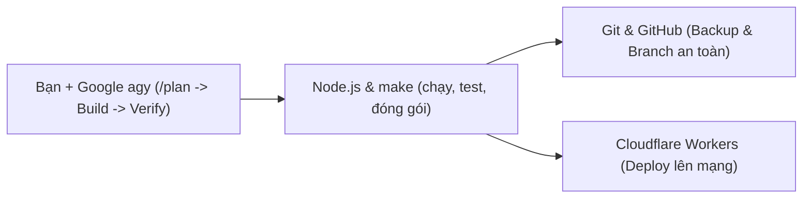

[English](./README.md) | [中文](./README.zh.md) | **Tiếng Việt**

# Ngày 4 — Bộ Đồ Nghề Dev & AI Coding Agents

**Thời lượng ước tính:** 1 Giờ · **Trước:** [Ngày 3](../day-03-project-architecture/README.vi.md) · **Tiếp theo:** [Ngày 5](../day-05-tech-stack-deep-dive/README.vi.md)

---

## Tổng quan & Ý chính
Workflow làm game vibe coding hiện đại gói gọn trong 4 món đồ nghề rất dễ xài: **Node.js & `make`** (chạy & check lỗi), **Git & GitHub** (lưu phiên bản cho an toàn), **Cloudflare Workers** (deploy lên mạng cho mọi người chơi) và **Google `agy`** (trợ lý AI của bạn).



---

## Mục tiêu & Kết quả sau Ngày 4
Xong Ngày 4, bạn sẽ làm chủ được:
1. Xài thành thạo mấy lệnh tắt `make` hằng ngày (`make dev`, `make test`, `make verify`, `make deploy-dry-run`).
2. Tạo `branch` mới trên Git để thử nghiệm ý tưởng tẹt ga mà không sợ hư bản chính.
3. Hỏi `agy` từng bước cách setup Cloudflare và deploy game lên mạng.
4. Dùng `/plan` với `agy` để chốt kế hoạch trước khi sửa lớn.

---

## Hướng dẫn từng bước

### 1. Mấy Lệnh Tắt `make` Dùng Hằng Ngày (Học tới đâu xài tới đó)
Khỏi cần học vẹt tài liệu `make`, `git` hay `agy` làm gì—cứ nhớ mấy lệnh tắt này khi cần là gõ:
```bash
make help             # Xem toàn bộ danh sách lệnh tắt
make dev              # Chạy game hub 100% offline trên máy
make test             # Chạy unit test + kiểm tra coverage
make verify           # Chạy full cổng verify (lint, typecheck, test, build, E2E)
make deploy-dry-run   # Build thử bản tĩnh dist/ cho Cloudflare (hoặc Vercel), chưa đẩy thật
```

### 2. Thử Nghiệm An Toàn Với Git Branch
Trong vibe coding, dùng `git` là **cực kỳ nên làm**: commit đều tay giúp bạn luôn có một điểm checkpoint an toàn để quay xe khi cần, đồng thời giúp AI agent soi lại thay đổi và quản lý dự án chuẩn chỉnh hơn.

Trước khi bày trò gì lớn với `agy`, cứ tách ra một nhánh thực hành cho yên tâm:
```bash
git checkout -b practice-day-4
# ...tha hồ thử nghiệm, muốn quay về bản gốc lúc nào cũng được:
git checkout main
```

### 3. Làm Chủ Tuyệt Chiêu Của Google `agy` (`/plan`, `/goal`, `/teamwork`)
- **Miễn phí + Google AI Pro (model `orchestrator`):** `agy` **miễn phí** để bắt đầu, nhưng **khuyên dùng Google AI Pro** để mở khóa model **`orchestrator`** trong `agy`—cực kỳ lợi hại cho mấy pha lên kế hoạch dài hơi, `/goal` và `/teamwork`.
- **`/plan` (Từ khóa Quốc dân Đa nền tảng):** Mở đầu prompt bằng `/plan` khi bạn muốn AI suy nghĩ kỹ, phân tích rồi trình bày kế hoạch để bạn gật đầu trước khi nó sửa file. `/plan` chạy ngon không chỉ trong **`agy`**, mà cả trên **GitHub Copilot, Claude / Claude Code, ChatGPT / Codex và Cursor**.
- **`/goal` (Tự động 100%, Khỏi cần ngồi canh):** Xài `/goal` khi bạn muốn `agy` tự làm **trọn gói từ đầu đến cuối không cần giám sát** (ví dụ: tự làm game hoàn chỉnh, vẽ icon/cover, viết test, viết docs rồi tự fix bug cho tới khi `make verify` pass hết).
- **`/teamwork` (Gọi cả đội Agent làm song song):** Xài `/teamwork` khi muốn `agy` **tung nhiều agent chạy cùng lúc**—ví dụ: **làm nhiều hơn một game một lúc** (như làm song song *Snake* và *Breakout*), hoặc chia team mỗi agent lo một mảng: logic, đồ họa, test và dịch thuật.
- **Mô tả trải nghiệm, đừng mô tả code:** Cứ nói cho `agy` biết *người chơi sẽ thấy gì và bấm ra sao*, chuyện file nào sửa ra sao để `agy` tự lo.

---

## Prompt mẫu cho `agy`
```text
How can I deploy this project to Cloudflare, and how do I set up Cloudflare
from scratch (account, Wrangler login, and dry-run)?
```
```text
/plan Review Dino Run and suggest 3 fun gameplay improvements we could try
safely on a new Git branch.
```
```text
/goal Build a complete "Reaction Timer" game following AGENTS.md, including
custom icons/covers, How to Play, Tutorial, Hint, multilingual docs, and
automated tests. Do not stop until make verify GAME=reaction-timer passes.
```
```text
/teamwork Create two new puzzle games at the same time in parallel: "Memory
Match" and "Sliding 15-Puzzle", each following AGENTS.md and passing make
verify.
```

---

## Chốt lại ý chính
- `make verify` là nút check an toàn "một phát ăn ngay" trước khi lưu hay deploy.
- `/plan` + prompt tiếng người tự nhiên giúp người không chuyên IT vẫn chỉ huy AI cực tự tin.

---

## Bài tập & Thử thách (Vibe Coding Thuần Prompt)

Dùng mấy prompt gợi ý bên dưới với Google `agy`—không cần tự gõ code:

1. **Hiểu Dự án Sâu hơn:** Nhờ `agy` giải thích `make verify` kiểm tra những gì và tại sao repo lại để trống GitHub Actions.
   ```text
   Explain in plain English what each step in make verify checks, and why this
   project keeps GitHub Actions blank and runs checks locally instead.
   ```
2. **Cải tiến Tính năng:** Nhờ `agy` gom lại output của `make help` theo nhóm (`Dev`, `Testing`, `Verification`, `Deployment`) cho dễ nhìn.
   ```text
   Improve the make help command output so targets are grouped under Dev,
   Testing, Verification, and Deployment headings. Verify with make help.
   ```
3. **Thêm Tính năng Mới:** Nhờ `agy` thêm lệnh tắt `make status` in ra branch Git hiện tại, tổng số game và tình trạng thư mục build.
   ```text
   /plan Add a "make status" shortcut that prints the current Git branch, total
   number of games, and whether the production build folder is ready. Verify with
   make status.
   ```
4. **Cải thiện Tài liệu:** Nhờ `agy` bổ sung mục "Cài đặt Cloudflare & Xử lý sự cố" thân thiện cho người mới vào `QUICKSTART.md`.
   ```text
   Add a short, beginner-friendly Cloudflare setup and troubleshooting section to
   QUICKSTART.md covering Wrangler login, dry-run, and port conflicts.
   ```
5. **Tạo Game Mới:** Nhờ `agy` dùng `/plan` làm game **"Đo Phản Xạ (Reaction Timer)"** trên một Git branch mới.
   ```text
   /plan Create a "Reaction Timer" game on a new Git branch following AGENTS.md,
   measuring millisecond reaction time across 5 rounds with best-average saving,
   How to Play, Tutorial, and automated tests.
   ```
