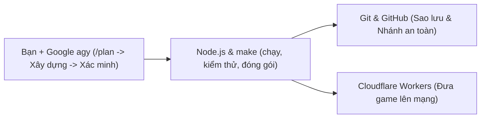

[English](./README.md) | [中文](./README.zh.md) | **Tiếng Việt**

# Ngày 4 — Công Cụ Lập Trình & AI Coding Agents

**Thời lượng ước tính:** 1 Giờ · **Trước:** [Ngày 3](../day-03-project-architecture/README.vi.md) · **Tiếp theo:** [Ngày 5](../day-05-tech-stack-deep-dive/README.vi.md)

---

## Tổng quan & Khái niệm chính
Quy trình làm game vibe coding hiện đại kết hợp 4 công cụ đơn giản: **Node.js & `make`** (chạy & kiểm tra), **Git & GitHub** (lưu phiên bản an toàn), **Cloudflare Workers** (xuất bản trực tuyến) và **Google `agy`** (trợ lý AI của bạn).



---

## Mục tiêu & Kết quả học tập
Sau Ngày 4, bạn sẽ có thể:
1. Dùng các lệnh tắt `make` hằng ngày (`make dev`, `make test`, `make verify`, `make deploy-dry-run`).
2. Dùng nhánh Git để thử ý tưởng mới an toàn mà không ảnh hưởng bản chính.
3. Hỏi `agy` cách thiết lập Cloudflare và triển khai game lên mạng từng bước.
4. Dùng `/plan` với `agy` để thống nhất kế hoạch trước khi thay đổi lớn.

---

## Hướng dẫn từng bước

### 1. Các Lệnh Tắt `make` Hằng Ngày
```bash
make help             # Xem toàn bộ lệnh tắt
make dev              # Chạy hub trò chơi tại máy
make test             # Chạy unit test + kiểm tra độ phủ
make verify           # Chạy toàn bộ cổng chất lượng & tuân thủ
make deploy-dry-run   # Kiểm tra đóng gói Cloudflare (chưa xuất bản)
```

### 2. Thử Nghiệm An Toàn với Nhánh Git
Trước khi thử ý tưởng lớn cùng `agy`, hãy tạo nhánh thực hành:
```bash
git checkout -b practice-day-4
# ...thử nghiệm thoải mái, quay lại bất cứ lúc nào:
git checkout main
```

### 3. Làm Việc Hiệu Quả với Google `agy`
- **Bắt đầu bằng `/plan`:** Với tính năng hoặc game mới, thêm `/plan` ở đầu câu lệnh để `agy` trình bày kế hoạch trước.
- **Mô tả kết quả, không cần mô tả code:** Chỉ nói cho `agy` *người chơi sẽ trải nghiệm gì*, để `agy` tự lo tệp tin và kiểm thử.

---

## Câu lệnh mẫu cho `agy`
```text
How can I deploy this project to Cloudflare, and how do I set up Cloudflare from scratch (account, Wrangler login, and dry-run)?
```
```text
/plan Review Dino Run and suggest 3 fun gameplay improvements we could try safely on a new Git branch.
```

---

## Điểm cốt lõi
- `make verify` là nút kiểm tra an toàn một chạm trước khi lưu hoặc phát hành.
- `/plan` + câu lệnh ngôn ngữ tự nhiên giúp người không chuyên IT điều phối AI tự tin.

---

## Bài tập & Thử thách (Vibe Coding Chỉ Dùng Câu Lệnh)

Sử dụng các câu lệnh mẫu bên dưới với Google `agy`—không cần tự viết code thủ công:

1. **Hiểu Dự án Sâu hơn:** Nhờ `agy` giải thích `make verify` kiểm tra những gì và vì sao tắt GitHub Actions.
   ```text
   Explain in plain English what each step in make verify checks, and why this project keeps GitHub Actions blank and runs checks locally instead.
   ```
2. **Cải tiến Tính năng:** Nhờ `agy` sắp xếp kết quả `make help` theo nhóm (`Dev`, `Testing`, `Verification`, `Deployment`).
   ```text
   Improve the make help command output so targets are grouped under Dev, Testing, Verification, and Deployment headings. Verify with make help.
   ```
3. **Triển khai Tính năng Mới:** Nhờ `agy` thêm lệnh `make status` hiển thị nhánh Git, số lượng game và trạng thái build.
   ```text
   /plan Add a "make status" shortcut that prints the current Git branch, total number of games, and whether the production build folder is ready. Verify with make status.
   ```
4. **Cải thiện Kiểm thử / Tài liệu:** Nhờ `agy` thêm mục "Cài đặt Cloudflare & Xử lý sự cố" thân thiện vào `QUICKSTART.md`.
   ```text
   Add a short, beginner-friendly Cloudflare setup and troubleshooting section to QUICKSTART.md covering Wrangler login, dry-run, and port conflicts.
   ```
5. **Tạo Game Mới:** Nhờ `agy` dùng `/plan` xây dựng game **"Đo Phản Xạ (Reaction Timer)"** trên một nhánh Git mới.
   ```text
   /plan Create a "Reaction Timer" game on a new Git branch following AGENTS.md, measuring millisecond reaction time across 5 rounds with best-average saving, How to Play, Tutorial, and automated tests.
   ```
