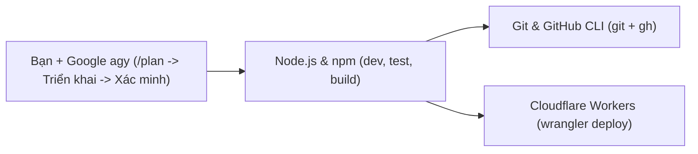

[English](./README.md) | [中文](./README.zh.md) | **Tiếng Việt**

# Ngày 4 — Công cụ Lập trình & AI Coding Agents

**Thời lượng ước tính:** 1 Giờ · **Trước:** [Ngày 3](../day-03-project-architecture/README.vi.md) · **Tiếp theo:** [Ngày 5](../day-05-tech-stack-deep-dive/README.vi.md)

---

## Tổng quan & Khái niệm chính
Quy trình phát triển game vibe-coding hiện đại kết hợp 4 công cụ thiết yếu: **Node.js & npm**, **Git & GitHub (`gh`)**, **Cloudflare Workers (`wrangler`)** và **AI coding agents (Google `agy`)**.



---

## Mục tiêu & Kết quả học tập
Sau Ngày 4, bạn sẽ có thể:
1. Chạy các script vòng đời dự án với `npm` (`dev`, `test`, `test:e2e`, `build`, `deploy`).
2. Tạo nhánh tính năng, commit và quản lý kho mã nguồn bằng `git` và `gh`.
3. Hiểu cách [`wrangler.jsonc`](../../wrangler.jsonc) triển khai `dist/` lên Cloudflare Workers Static Assets.
4. Sử dụng Google `agy` hiệu quả với `/plan`, `AGENTS.md` và các cổng xác minh.

---

## Hướng dẫn từng bước

### 1. Node.js & npm Scripts
Xem [`package.json`](../../package.json):
```bash
npm run dev        # Khởi động máy chủ Vite local
npm test           # Chạy kiểm thử đơn vị Vitest
npm run test:e2e   # Chạy kiểm thử Playwright Chromium
npm run build      # Kiểm tra kiểu (tsc) + build thư mục tĩnh dist/
npm run deploy     # Build dist/ + triển khai qua wrangler
```

### 2. Git & GitHub CLI (`git` + `gh`)
Luôn tách thử nghiệm sang một nhánh riêng trước khi yêu cầu AI agent chỉnh sửa lớn:
```bash
git status
git checkout -b practice-day-4
# ...thực hiện thay đổi, kiểm thử, sau đó quay lại:
git checkout main
git branch -d practice-day-4
```
Kiểm tra đăng nhập GitHub CLI:
```bash
gh auth status
```

### 3. Cloudflare Workers (`wrangler`)
Mở [`wrangler.jsonc`](../../wrangler.jsonc) và lưu ý việc lưu trữ tĩnh không cần mã máy chủ:
- `"assets": { "directory": "./dist", "not_found_handling": "single-page-application" }`
- Chạy thử quy trình triển khai mà không xuất bản:
```bash
npm run build && npx wrangler deploy --dry-run
```

### 4. Làm việc hiệu quả với Google `agy`
- **Bắt đầu với `/plan`:** Với tính năng hoặc game mới không tầm thường, hãy thêm `/plan` ở đầu câu lệnh để `agy` khảo sát và thống nhất thiết kế trước khi sửa tệp.
- **Bám sát `AGENTS.md`:** Nhắc tuân thủ `AGENTS.md` để `agy` luôn tạo đủ tài liệu, icon/cover, Hướng dẫn chơi, Tutorial, Gợi ý và kiểm thử.
- **Yêu cầu xác minh:** Luôn yêu cầu `agy` chạy `npm test && npm run test:e2e && npx tsc --noEmit && npm run build`.

---

## Câu lệnh mẫu cho `agy`
```text
/plan Review games/dino-run/ and propose 3 small gameplay improvements we could implement safely on a new git branch.
```

---

## Điểm cốt lõi
- Dùng nhánh `git` để thử nghiệm an toàn và `wrangler deploy --dry-run` để kiểm tra bản build trước khi phát hành.
- `/plan` + `AGENTS.md` + kiểm thử tự động biến AI agent thành cộng sự kỹ thuật đáng tin cậy.

---

## Bài tập & Thử thách (Vibe Coding Chỉ Dùng Câu Lệnh)

Sử dụng các câu lệnh mẫu bên dưới với Google `agy`—không cần tự viết code thủ công:

1. **Hiểu Dự án Sâu hơn:** Nhờ `agy` giải thích cách `Makefile` và `scripts/check-compliance.mjs` thực thi `AGENTS.md`.
   ```text
   Read Makefile and scripts/check-compliance.mjs, and explain each check that make verify runs before allowing a release.
   ```
2. **Cải tiến Tính năng:** Nhờ `agy` nhóm kết quả `make help` theo từng nhóm lệnh rõ ràng.
   ```text
   In Makefile, group the make help output into Setup, Dev, Quality, and Deploy sections while keeping the awk ## comment format intact. Verify with make help.
   ```
3. **Triển khai Tính năng Mới:** Nhờ `agy` thêm mục tiêu `make status` hiển thị nhánh git, số game và trạng thái `dist/`.
   ```text
   Add a "status" target to Makefile (and update TODOs/BACKLOGs/Makefile.md) that prints the current git branch, number of games in games/, and whether dist/ exists. Verify with make status.
   ```
4. **Cải thiện Kiểm thử / Tài liệu:** Nhờ `agy` bổ sung mục "Xử lý Sự cố Thường gặp" vào `QUICKSTART.md`.
   ```text
   Add a short Troubleshooting section to QUICKSTART.md covering Playwright browser install, port conflicts, and wrangler login.
   ```
5. **Tạo Game Mới:** Nhờ `agy` dùng `/plan` để xây dựng game **"Đo Phản Xạ (Reaction Timer)"** trên một nhánh git mới.
   ```text
   /plan Create a "Reaction Timer" game in games/reaction-timer/ on a new branch following AGENTS.md and .agents/skills/create-game/SKILL.md, measuring millisecond reaction time across 5 rounds with best-average persistence.
   ```
