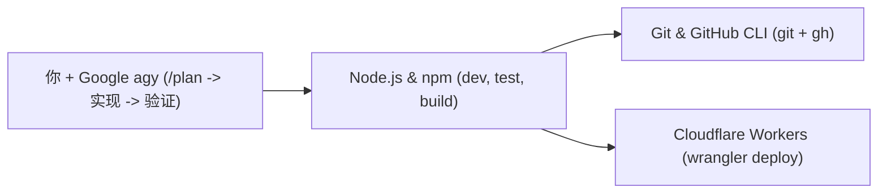

[English](./README.md) | **中文** | [Tiếng Việt](./README.vi.md)

# 第 4 天 — 开发工具与 AI 编程智能体

**预计用时：** 1 小时 · **上一篇：** [第 3 天](../day-03-project-architecture/README.zh.md) · **下一篇：** [第 5 天](../day-05-tech-stack-deep-dive/README.zh.md)

---

## 概览与核心概念
现代 Vibe Coding 游戏开发结合了四项核心工具：**Node.js 与 npm**、**Git 与 GitHub (`gh`)**、**Cloudflare Workers (`wrangler`)** 以及 **AI 编程智能体 (Google `agy`)**。



---

## 学习目标与成果
完成第 4 天后，你将能够：
1. 使用 `npm` 运行项目全生命周期脚本（`dev`、`test`、`test:e2e`、`build`、`deploy`）。
2. 使用 `git` 与 `gh` 创建特性分支、提交代码并管理仓库。
3. 理解 [`wrangler.jsonc`](../../wrangler.jsonc) 如何将 `dist/` 部署到 Cloudflare Workers Static Assets。
4. 高效结合 `/plan`、`AGENTS.md` 与验证门槛来使用 Google `agy`。

---

## 分步指南

### 1. Node.js 与 npm 脚本
查看 [`package.json`](../../package.json)：
```bash
npm run dev        # 启动本地 Vite 开发服务器
npm test           # 运行 Vitest 单元测试
npm run test:e2e   # 运行 Playwright Chromium 测试
npm run build      # 类型检查 (tsc) + 构建静态 dist/
npm run deploy     # 构建 dist/ 并通过 wrangler 部署
```

### 2. Git 与 GitHub CLI (`git` + `gh`)
在让 AI 智能体进行大规模修改前，务必先在独立分支上隔离实验：
```bash
git status
git checkout -b practice-day-4
# ...修改并测试后切换回主分支：
git checkout main
git branch -d practice-day-4
```
检查 GitHub CLI 登录状态：
```bash
gh auth status
```

### 3. Cloudflare Workers (`wrangler`)
打开 [`wrangler.jsonc`](../../wrangler.jsonc)，注意静态托管无需任何后端服务器代码：
- `"assets": { "directory": "./dist", "not_found_handling": "single-page-application" }`
- 安全预演部署而不实际发布：
```bash
npm run build && npx wrangler deploy --dry-run
```

### 4. 高效使用 Google `agy`
- **从 `/plan` 开始：** 对于非简单的新功能或新游戏，在提示词前加上 `/plan`，让 `agy` 先调研并确认设计决策再动手改代码。
- **锚定 `AGENTS.md`：** 明确要求遵循 `AGENTS.md`，确保 `agy` 覆盖文档、图标/封面、玩法说明、教学模式、提示与测试。
- **要求严格验证：** 始终让 `agy` 运行 `npm test && npm run test:e2e && npx tsc --noEmit && npm run build`。

---

## 示例 `agy` 提示词
```text
/plan Review games/dino-run/ and propose 3 small gameplay improvements we could implement safely on a new git branch.
```

---

## 核心要点
- 使用 `git` 分支安全实验，并用 `wrangler deploy --dry-run` 在发布前校验构建结果。
- `/plan` + `AGENTS.md` + 自动化测试，让 AI 智能体成为可靠的工程搭档。

---

## 练习与挑战（纯提示词 Vibe Coding）

使用下方示例提示词向 Google `agy` 提问——无需手动编写代码：

1. **深入理解项目：** 让 `agy` 解释 `Makefile` 与 `scripts/check-compliance.mjs` 如何自动落实 `AGENTS.md`。
   ```text
   Read Makefile and scripts/check-compliance.mjs, and explain each check that make verify runs before allowing a release.
   ```
2. **改进现有功能：** 让 `agy` 将 `make help` 的输出按功能分组展示。
   ```text
   In Makefile, group the make help output into Setup, Dev, Quality, and Deploy sections while keeping the awk ## comment format intact. Verify with make help.
   ```
3. **实现新功能：** 让 `agy` 在 `Makefile` 中新增 `make status` 目标，显示分支、游戏数与构建状态。
   ```text
   Add a "status" target to Makefile (and update TODOs/BACKLOGs/Makefile.md) that prints the current git branch, number of games in games/, and whether dist/ exists. Verify with make status.
   ```
4. **完善测试 / 文档：** 让 `agy` 为 `QUICKSTART.md` 补充“常见问题排查”章节。
   ```text
   Add a short Troubleshooting section to QUICKSTART.md covering Playwright browser install, port conflicts, and wrangler login.
   ```
5. **创建新游戏：** 让 `agy` 在新 Git 分支上使用 `/plan` 创建 **“反应速度测试 (Reaction Timer)”** 游戏。
   ```text
   /plan Create a "Reaction Timer" game in games/reaction-timer/ on a new branch following AGENTS.md and .agents/skills/create-game/SKILL.md, measuring millisecond reaction time across 5 rounds with best-average persistence.
   ```
