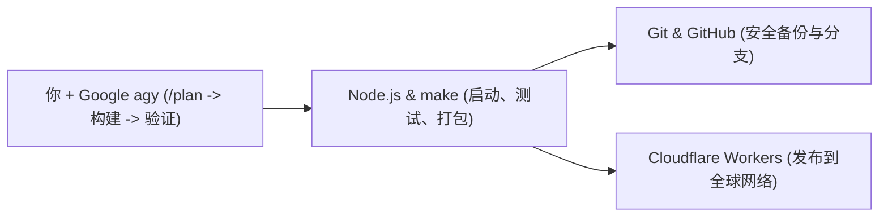

[English](./README.md) | **中文** | [Tiếng Việt](./README.vi.md)

# 第 4 天 — 开发工具与 AI 编程智能体

**预计用时：** 1 小时 · **上一篇：** [第 3 天](../day-03-project-architecture/README.zh.md) · **下一篇：** [第 5 天](../day-05-tech-stack-deep-dive/README.zh.md)

---

## 概览与核心概念
现代 Vibe Coding 游戏开发只需配合四样简单工具：**Node.js 与 `make`**（启动与检查）、**Git 与 GitHub**（安全备份版本）、**Cloudflare Workers**（上线发布）以及 **Google `agy`**（你的 AI 助手）。



---

## 学习目标与成果
完成第 4 天后，你将能够：
1. 使用 `make` 快捷命令完成日常操作（`make dev`、`make test`、`make verify`、`make deploy-dry-run`）。
2. 使用 Git 分支安全地尝试新创意，而不影响主版本。
3. 向 `agy` 询问如何从零配置 Cloudflare 并把游戏上线部署。
4. 在发起大改动前用 `/plan` 让 `agy` 先给出清晰计划。

---

## 分步指南

### 1. 日常 `make` 快捷命令（边做边学）
无需提前死记 `make`、`git` 或 `agy` 手册——需要时运行以下快捷命令即可：
```bash
make help             # 查看全部快捷命令
make dev              # 启动 100% 离线本地游戏大厅
make test             # 运行单元测试与覆盖率检查
make verify           # 运行全部质量与合规检查
make deploy-dry-run   # 预演打包静态 dist/（可用于 Cloudflare 或 Vercel），不实际发布
```

### 2. 用 Git 分支安全实验
在让 `agy` 尝试新创意前，先建一个练习分支：
```bash
git checkout -b practice-day-4
# ...自由实验，随时切回主分支：
git checkout main
```

### 3. 高效配合 Google `agy`
- **从 `/plan` 开始：** 做新功能或新游戏前加上 `/plan`，让 `agy` 先和你对齐方案。
- **描述结果而非代码：** 只告诉 `agy` *玩家应该看到什么体验*，由它负责定位文件与测试。

---

## 示例 `agy` 提示词
```text
How can I deploy this project to Cloudflare, and how do I set up Cloudflare from scratch (account, Wrangler login, and dry-run)?
```
```text
/plan Review Dino Run and suggest 3 fun gameplay improvements we could try safely on a new Git branch.
```

---

## 核心要点
- `make verify` 是保存或发布前的一键安全检查。
- `/plan` + 通俗自然语言提示词，让非 IT 创作者也能稳健驾驭 AI 智能体。

---

## 练习与挑战（纯提示词 Vibe Coding）

使用下方示例提示词向 Google `agy` 提问——无需手动编写代码：

1. **深入理解项目：** 让 `agy` 解释 `make verify` 都检查什么，以及为什么不启用 GitHub Actions。
   ```text
   Explain in plain English what each step in make verify checks, and why this project keeps GitHub Actions blank and runs checks locally instead.
   ```
2. **改进现有功能：** 让 `agy` 将 `make help` 输出按类别（开发、测试、验证、部署）分组。
   ```text
   Improve the make help command output so targets are grouped under Dev, Testing, Verification, and Deployment headings. Verify with make help.
   ```
3. **实现新功能：** 让 `agy` 新增 `make status` 命令，显示当前 Git 分支、游戏数量与构建状态。
   ```text
   /plan Add a "make status" shortcut that prints the current Git branch, total number of games, and whether the production build folder is ready. Verify with make status.
   ```
4. **完善测试 / 文档：** 让 `agy` 为 `QUICKSTART.md` 添加新手友好的“Cloudflare 配置与排查”章节。
   ```text
   Add a short, beginner-friendly Cloudflare setup and troubleshooting section to QUICKSTART.md covering Wrangler login, dry-run, and port conflicts.
   ```
5. **创建新游戏：** 让 `agy` 在新 Git 分支上使用 `/plan` 创建 **“反应速度测试 (Reaction Timer)”** 游戏。
   ```text
   /plan Create a "Reaction Timer" game on a new Git branch following AGENTS.md, measuring millisecond reaction time across 5 rounds with best-average saving, How to Play, Tutorial, and automated tests.
   ```
