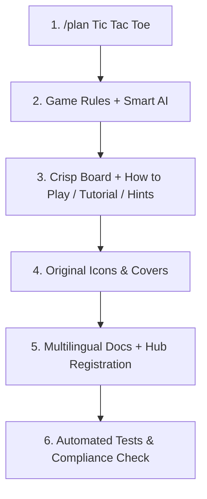

**English** | [中文](./README.zh.md) | [Tiếng Việt](./README.vi.md)

# Day 7 — Building Your First Board Game from Scratch

**Estimated Time:** 1 Hour · **Previous:** [Day 6](../day-06-modifying-dino-run/README.md) · **Next:** [Day 8](../day-08-building-a-2d-game/README.md)

---

## Overview & Key Concepts
Today you will guide `agy` to build a complete, **`AGENTS.md`-compliant** board game from scratch—**Tic Tac Toe**—with both **vs AI (Easy & Unbeatable)** and **2-Player Local** modes, original artwork, multilingual docs, automated tests, and unified Dashboard registration!



---

## Learning Objectives & Outcomes
By the end of Day 7, you will be able to:
1. Drive a full new-game creation from `/plan` to working build using plain-language prompts.
2. Ask `agy` to follow [`AGENTS.md`](../../AGENTS.md) automatically (docs, icons/covers, How to Play, Tutorial, Hints, and tests).
3. Verify both your standalone game and the unified Hub with `make verify`.

---

## Step-by-Step Guide

### 1. Create a Feature Branch
```bash
git checkout -b day-07-tic-tac-toe
```

### 2. Use `/plan` with `agy` to Build `Tic Tac Toe`
Paste the sample prompt below, review `agy`'s plan, and approve execution. `agy` will automatically pick the next free Playwright port, wire shared styles, generate icons/covers, and register the game on the Hub.

### 3. Verify Both Standalone and Unified Hub
```bash
make verify GAME=tic-tac-toe
make verify
```

---

## Sample `agy` Prompts

**Planning & Implementation Prompt:**
```text
/plan Create a new board game "Tic Tac Toe" in games/tic-tac-toe/ following
AGENTS.md completely:
- Modes: vs AI (Easy + Unbeatable) and 2-Player Local
- Crisp X & O board matching the Gemini Games purple/ivory theme
- Sound effects + Mute toggle, How to Play modal, 3-step Tutorial, smart Hint,
  and saved scores
- Original icons, HD/Full-HD covers, full docs (including English, Chinese,
  and Vietnamese READMEs)
- Automated unit tests (>=70% coverage) + Playwright browser tests, registered
  on the Hub
```

---

## Key Takeaways
- Turn-based board games are the ideal first "from scratch" project because rules and AI opponents are easy to test automatically.
- Mentioning `AGENTS.md` in your prompt ensures `agy` handles artwork, docs, translations, and Hub registration for you.

---

## Exercises & Challenges (Prompt-Only Vibe Coding)

Use Google `agy` with the sample prompts below—no manual coding required:

1. **Understand the Project:** Ask `agy` to explain how the Unbeatable AI decides its moves in plain English.
   ```text
   Explain in plain English how the Unbeatable AI in Tic Tac Toe (or Checkers)
   thinks ahead to never lose a match.
   ```
2. **Improve a Feature:** Ask `agy` to animate the winning 3-in-a-row line and highlight the Hint cell.
   ```text
   Improve Tic Tac Toe by animating the winning 3-in-a-row line and gently
   highlighting the suggested Hint square. Verify with make verify
   GAME=tic-tac-toe.
   ```
3. **Implement a New Feature:** Ask `agy` to add a **Best-of-5 Series Scoreboard** or **4×4 Grid Mode**.
   ```text
   /plan Add a Best-of-5 Series scoreboard (X wins, O wins, Draws, and Match
   Winner banner) to Tic Tac Toe that saves automatically. Verify with make
   verify GAME=tic-tac-toe.
   ```
4. **Improve Tests / Docs:** Ask `agy` to verify that Unbeatable AI never loses across all opening moves.
   ```text
   Add an automated unit test for Tic Tac Toe that tests every possible opening
   move against Unbeatable AI to prove it never loses, keeping coverage >=70%.
   ```
5. **Create a New Game:** Ask `agy` to build a similar strategy board game: **Connect Four (`4-in-a-Row`)**.
   ```text
   /plan Create "Connect Four" following AGENTS.md, with a 7x6 drop-disc board,
   vs AI + 2-Player Local, How to Play, Tutorial, Hint, and automated unit +
   browser tests.
   ```
