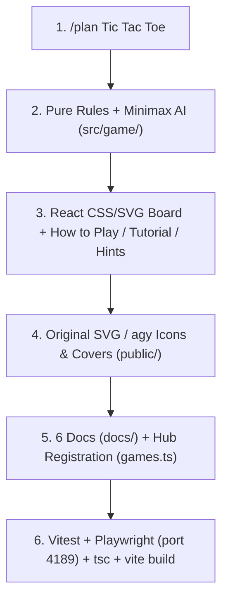

**English** | [中文](./README.zh.md) | [Tiếng Việt](./README.vi.md)

# Day 7 — Building Your First Board Game from Scratch

**Estimated Time:** 1 Hour · **Previous:** [Day 6](../day-06-modifying-dino-run/README.md) · **Next:** [Day 8](../day-08-building-a-2d-game/README.md)

---

## Overview & Key Concepts
Today you will build a complete, **`AGENTS.md`-compliant** board game from scratch—**Tic Tac Toe** (`games/tic-tac-toe/`)—with both **vs AI (Minimax)** and **2-Player Local** modes, original artwork, 6 docs, automated tests, and unified Dashboard registration!



---

## Learning Objectives & Outcomes
By the end of Day 7, you will be able to:
1. Drive a full new-game implementation from `/plan` to production build using `agy`.
2. Enforce every [`AGENTS.md`](../../AGENTS.md) standard: `docs/`, `public/icons/*`, `public/graphics/*`, `How to Play`, `Tutorial`, `Hints`, Vitest, and Playwright.
3. Register a new game in [`src/registry/games.ts`](../../src/registry/games.ts) and assign a fresh Playwright port (`4189+`).

---

## Step-by-Step Guide

### 1. Create a Feature Branch
```bash
git checkout -b day-07-tic-tac-toe
```

### 2. Review `AGENTS.md` Constraints Before Prompting
- **Dedicated Playwright Port:** Ports `4175`–`4188` are already used; assign **`4189`** for `games/tic-tac-toe/playwright.config.ts`.
- **Original Graphics:** Prefer crisp `.svg` sprites for the board (`X` / `O`) and ask `agy` (`image-generator`) to generate `public/icons/*` and `public/graphics/*`.
- **Shared Styles:** Import `../../../styles/tokens.css` and `../../../styles/game-ui.css` in `src/main.tsx`.

### 3. Use `/plan` with `agy` to Build `games/tic-tac-toe/`
Paste the sample prompt below, review `agy`'s plan, and approve execution.

### 4. Verify Both Standalone and Unified Hub
```bash
cd games/tic-tac-toe && npm test && npm run test:e2e && npx tsc --noEmit && npm run build
cd ../.. && npm test && npm run test:e2e && npx tsc --noEmit && npm run build
```

---

## Sample `agy` Prompts

**Planning & Implementation Prompt:**
```text
/plan Implement a new board game "Tic Tac Toe" in games/tic-tac-toe/ following AGENTS.md completely:
- Modes: vs AI (Easy + Unbeatable Minimax) and 2-Player Local
- Clean pure simulation in src/game/ (win/draw detection, Minimax AI, smart Hint, 3-step Tutorial, localStorage tic_tac_toe_v1)
- Crisp CSS/SVG X & O board using shared styles/tokens.css and styles/game-ui.css
- Web Audio SFX + Mute toggle, How to Play modal, original icons & HD/Full-HD covers in public/, and all 6 docs in docs/
- Vitest unit tests + Playwright E2E tests on dedicated port 4189
- Register in src/registry/games.ts (category: Board) and update root tests
```

---

## Key Takeaways
- Board games are the ideal first "from scratch" project because turn-based rules and Minimax AI are easy to unit-test deterministically.
- Assigning a unique Playwright port prevents conflicts across the monorepo.

---

## Exercises & Challenges (Prompt-Only Vibe Coding)

Use Google `agy` with the sample prompts below—no manual coding required:

1. **Understand the Project:** Ask `agy` to explain how Minimax AI evaluates board positions in your Tic Tac Toe engine.
   ```text
   Read games/tic-tac-toe/src/game/engine.ts (or games/checkers/src/game/ai.ts) and explain how Minimax / Alpha-Beta scores winning, losing, and drawing moves.
   ```
2. **Improve a Feature:** Ask `agy` to animate the winning 3-in-a-row line and highlight the smart Hint cell.
   ```text
   In games/tic-tac-toe/, highlight the winning line with an animated SVG stroke and pulse the Hint cell cleanly. Verify with make verify GAME=tic-tac-toe.
   ```
3. **Implement a New Feature:** Ask `agy` to add a **Best-of-5 Series Scoreboard** or **4×4 Grid Mode**.
   ```text
   /plan Add a Best-of-5 Series scoreboard (X wins, O wins, Draws, Match Winner banner) to games/tic-tac-toe/ persisted in tic_tac_toe_v1. Verify with make verify GAME=tic-tac-toe.
   ```
4. **Improve Tests / Docs:** Ask `agy` to add exhaustive Vitest tests proving Unbeatable Minimax never loses.
   ```text
   In games/tic-tac-toe/src/game/__tests__/engine.test.ts, add a unit test that plays all possible human opening moves against Unbeatable Minimax and asserts AI never loses, keeping coverage >=70%.
   ```
5. **Create a New Game:** Ask `agy` to build a similar strategy board game: **Connect Four (`4-in-a-Row`)**.
   ```text
   /plan Create "Connect Four" in games/connect-four/ following AGENTS.md and .agents/skills/create-game/SKILL.md, with 7x6 grid, vs AI + 2P Local, How to Play, Tutorial, Hint, and Vitest >=70% coverage.
   ```
