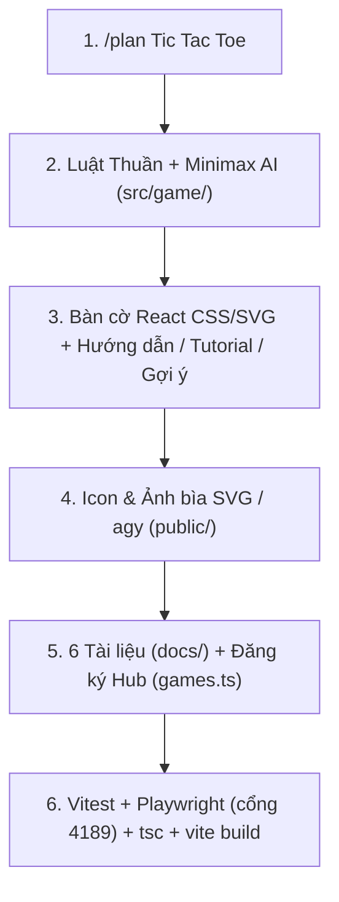

[English](./README.md) | [中文](./README.zh.md) | **Tiếng Việt**

# Ngày 7 — Xây dựng Game Bàn cờ Đầu tiên từ Con số 0

**Thời lượng ước tính:** 1 Giờ · **Trước:** [Ngày 6](../day-06-modifying-dino-run/README.vi.md) · **Tiếp theo:** [Ngày 8](../day-08-building-a-2d-game/README.vi.md)

---

## Tổng quan & Khái niệm chính
Hôm nay bạn sẽ xây dựng một game bàn cờ hoàn chỉnh **tuân thủ `AGENTS.md`** từ đầu—**Tic Tac Toe (Cờ Ca-rô 3×3)** (`games/tic-tac-toe/`)—với cả chế độ **Đấu AI (Minimax)** và **2 Người chơi tại chỗ**, đồ họa gốc, 6 tài liệu, kiểm thử tự động và đăng ký vào Dashboard hợp nhất!



---

## Mục tiêu & Kết quả học tập
Sau Ngày 7, bạn sẽ có thể:
1. Điều phối quy trình tạo game mới hoàn chỉnh từ `/plan` đến bản build sản phẩm bằng `agy`.
2. Áp dụng đầy đủ mọi tiêu chuẩn trong [`AGENTS.md`](../../AGENTS.md): `docs/`, `public/icons/*`, `public/graphics/*`, Hướng dẫn chơi, Tutorial, Gợi ý, Vitest và Playwright.
3. Đăng ký game mới vào [`src/registry/games.ts`](../../src/registry/games.ts) và cấp cổng Playwright riêng (`4189+`).

---

## Hướng dẫn từng bước

### 1. Tạo nhánh tính năng
```bash
git checkout -b day-07-tic-tac-toe
```

### 2. Kiểm tra các ràng buộc `AGENTS.md` trước khi ra lệnh
- **Cổng Playwright riêng:** Các cổng `4175`–`4188` đã được sử dụng; hãy gán **`4189`** cho `games/tic-tac-toe/playwright.config.ts`.
- **Đồ họa gốc:** Ưu tiên `.svg` sắc nét cho quân cờ (`X` / `O`) và nhờ `agy` (`image-generator`) tạo `public/icons/*` và `public/graphics/*`.
- **Giao diện dùng chung:** Import `../../../styles/tokens.css` và `../../../styles/game-ui.css` trong `src/main.tsx`.

### 3. Dùng `/plan` với `agy` để xây dựng `games/tic-tac-toe/`
Dán câu lệnh mẫu bên dưới, xem xét kế hoạch của `agy` và phê duyệt thực thi.

### 4. Xác minh cả bản Độc lập và Hub Hợp nhất
```bash
cd games/tic-tac-toe && npm test && npm run test:e2e && npx tsc --noEmit && npm run build
cd ../.. && npm test && npm run test:e2e && npx tsc --noEmit && npm run build
```

---

## Câu lệnh mẫu cho `agy`

**Câu lệnh Lập kế hoạch & Triển khai:**
```text
/plan Implement a new board game "Tic Tac Toe" in games/tic-tac-toe/ following AGENTS.md completely:
- Modes: vs AI (Easy + Unbeatable Minimax) and 2-Player Local
- Clean pure simulation in src/game/ (win/draw detection, Minimax AI, smart Hint, 3-step Tutorial, localStorage tic_tac_toe_v1)
- Crisp CSS/SVG X & O board using shared styles/tokens.css and styles/game-ui.css
- Web Audio SFX + Mute toggle, How to Play modal, original icons & HD/Full-HD covers in public/, and all 6 docs in docs/ (plus README.zh.md and README.vi.md)
- Vitest unit tests + Playwright E2E tests on dedicated port 4189
- Register in src/registry/games.ts (category: Board) and update root tests
```

---

## Điểm cốt lõi
- Game bàn cờ theo lượt là dự án "từ con số 0" lý tưởng vì luật thắng/thua và Minimax AI rất dễ viết unit test xác định.
- Cấp phát cổng Playwright riêng biệt giúp tránh xung đột khi kiểm thử trong monorepo.

---

## Bài tập & Thử thách
1. Chơi một ván đầy đủ với **AI Minimax Bất Bại** và xác nhận AI không bao giờ thua.
2. **Thử thách:** Mở rộng Tic Tac Toe với **Chế độ Bàn 4×4** hoặc **Bảng điểm Best-of-5** bằng một câu lệnh tiếp theo và thêm unit test cho tính năng đó.
