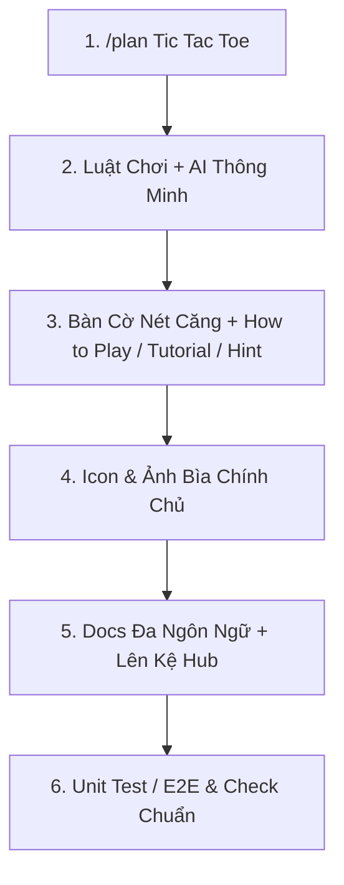

[English](./README.md) | [中文](./README.zh.md) | **Tiếng Việt**

# Ngày 7 — Tự Tay Dựng Game Bàn Cờ Đầu Tiên Từ Số 0

**Thời lượng ước tính:** 1 Giờ · **Trước:** [Ngày 6](../day-06-modifying-dino-run/README.vi.md) · **Tiếp theo:** [Ngày 8](../day-08-building-a-2d-game/README.vi.md)

---

## Bức tranh toàn cảnh
Hôm nay bạn sẽ chỉ đạo `agy` dựng hẳn một game bàn cờ mới toanh **chuẩn chỉnh `AGENTS.md`** từ trang giấy trắng—**Tic Tac Toe**—có đủ chế độ **Đấu AI (Dễ & Bất Bại)** lẫn **2 Người chơi chung máy**, kèm bộ icon/ảnh bìa riêng, docs đa ngôn ngữ, test tự động và lên kệ thẳng trên **Hub**!



---

## Học xong hôm nay bạn làm được gì?
1. Điều phối `agy` làm trọn gói một game mới từ bước `/plan` cho tới lúc chạy thật chỉ bằng ngôn ngữ tự nhiên.
2. Để `agy` tự động lo mọi quy chuẩn trong [`AGENTS.md`](../../AGENTS.md) (docs, icon/cover, **How to Play**, **Tutorial**, **Hint**, **unit test** và **E2E**).
3. Kiểm tra cả bản chạy riêng lẫn toàn bộ **Hub** bằng `make verify`.

---

## Từng bước thực hành

### 1. Tạo một feature branch mới
```bash
git checkout -b day-07-tic-tac-toe
```

### 2. Dùng `/plan` để `agy` dựng `Tic Tac Toe`
Dán **prompt** mẫu bên dưới vào, liếc qua bản kế hoạch của `agy` rồi bấm duyệt. Mọi thứ từ chọn port Playwright rảnh, gắn giao diện chung, vẽ icon/ảnh bìa đến đăng ký lên **Hub** sẽ được `agy` lo từ đầu tới cuối.

### 3. Chạy verify cả game lẻ lẫn toàn Hub
```bash
make verify GAME=tic-tac-toe
make verify
```

---

## Prompt mẫu cho `agy`

**Prompt Lên Plan & Triển khai:**
```text
/plan Create a new board game "Tic Tac Toe" in games/tic-tac-toe/ following
AGENTS.md completely:
- Modes: vs AI (Easy + Unbeatable) and 2-Player Local
- Crisp X & O board matching the Gemini Games purple/ivory theme
- Sound effects + Mute toggle, How to Play modal, 3-step Tutorial, smart Hint,
  and saved scores
- Original icons, HD/Full-HD covers, full docs (including English, Chinese,
  and Vietnamese READMEs)
- Automated unit tests (>=70% coverage) + Playwright browser tests, registered
  on the Hub
```

---

## Chốt lại cho nhớ
- Game bàn cờ theo lượt là bài tập "mở hàng" cực đẹp khi làm từ số 0 vì luật chơi rõ ràng, AI dễ viết **unit test** để kiểm chứng.
- Chỉ cần nhắc nhẹ `AGENTS.md` trong **prompt**, `agy` sẽ tự động lo luôn phần artwork, docs, dịch thuật và đăng ký **Hub** mà bạn không phải nhắc lại từng món.

---

## Bài tập thực hành (Vibe Coding thuần bằng Prompt)

Cứ copy các prompt bên dưới giao cho Google `agy` xử lý—không cần đụng tay gõ code:

1. **Hiểu sâu logic game:** Nhờ `agy` giải thích bằng ngôn ngữ đời thường cách AI Bất Bại tính trước nước đi để không bao giờ thua.
   ```text
   Explain in plain English how the Unbeatable AI in Tic Tac Toe (or Checkers)
   thinks ahead to never lose a match.
   ```
2. **Nâng cấp trải nghiệm:** Nhờ `agy` thêm hiệu ứng cho đường thắng 3 ô và làm ô **Hint** sáng nhẹ cho dễ thấy.
   ```text
   Improve Tic Tac Toe by animating the winning 3-in-a-row line and gently
   highlighting the suggested Hint square. Verify with make verify
   GAME=tic-tac-toe.
   ```
3. **Thêm tính năng mới:** Nhờ `agy` gắn thêm bảng điểm **Best-of-5 Series** tự động lưu lại kết quả.
   ```text
   /plan Add a Best-of-5 Series scoreboard (X wins, O wins, Draws, and Match
   Winner banner) to Tic Tac Toe that saves automatically. Verify with make
   verify GAME=tic-tac-toe.
   ```
4. **Củng cố unit test:** Nhờ `agy` viết test tự động thử mọi nước đi mở màn để chứng minh AI Bất Bại không thể bị đánh bại.
   ```text
   Add an automated unit test for Tic Tac Toe that tests every possible opening
   move against Unbeatable AI to prove it never loses, keeping coverage >=70%.
   ```
5. **Tạo game mới:** Nhờ `agy` dựng tiếp một game bàn cờ chiến thuật kinh điển khác: **Connect Four**.
   ```text
   /plan Create "Connect Four" following AGENTS.md, with a 7x6 drop-disc board,
   vs AI + 2-Player Local, How to Play, Tutorial, Hint, and automated unit +
   browser tests.
   ```
