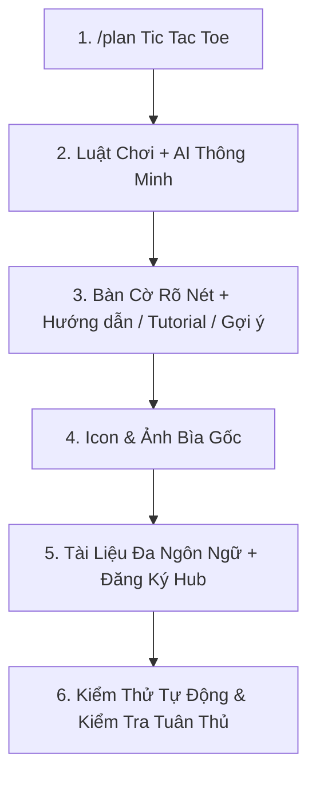

[English](./README.md) | [中文](./README.zh.md) | **Tiếng Việt**

# Ngày 7 — Xây Dựng Game Bàn Cờ Đầu Tiên Từ Đầu

**Thời lượng ước tính:** 1 Giờ · **Trước:** [Ngày 6](../day-06-modifying-dino-run/README.vi.md) · **Tiếp theo:** [Ngày 8](../day-08-building-a-2d-game/README.vi.md)

---

## Tổng quan & Khái niệm chính
Hôm nay bạn sẽ hướng dẫn `agy` xây dựng một game bàn cờ hoàn chỉnh **tuân thủ `AGENTS.md`** từ con số 0—**Tic Tac Toe**—với chế độ **Đấu AI (Dễ & Bất Bại)** và **2 Người chơi tại chỗ**, đồ họa gốc, tài liệu đa ngôn ngữ, kiểm thử tự động và đăng ký lên Hub!



---

## Mục tiêu & Kết quả học tập
Sau Ngày 7, bạn sẽ có thể:
1. Điều phối tạo một game mới hoàn chỉnh từ `/plan` đến bản chạy thật bằng câu lệnh tự nhiên.
2. Nhờ `agy` tự động tuân thủ [`AGENTS.md`](../../AGENTS.md) (tài liệu, icon/ảnh bìa, Hướng dẫn chơi, Tutorial, Gợi ý và kiểm thử).
3. Xác minh cả game độc lập lẫn Hub hợp nhất với `make verify`.

---

## Hướng dẫn từng bước

### 1. Tạo nhánh tính năng
```bash
git checkout -b day-07-tic-tac-toe
```

### 2. Dùng `/plan` với `agy` để xây dựng `Tic Tac Toe`
Dán câu lệnh mẫu bên dưới, xem kế hoạch của `agy` rồi phê duyệt. `agy` sẽ tự chọn cổng Playwright trống, gắn giao diện dùng chung, tạo icon/ảnh bìa và đăng ký game lên Hub.

### 3. Xác minh cả bản Độc lập và Hub Hợp nhất
```bash
make verify GAME=tic-tac-toe
make verify
```

---

## Câu lệnh mẫu cho `agy`

**Câu lệnh Lập kế hoạch & Triển khai:**
```text
/plan Create a new board game "Tic Tac Toe" in games/tic-tac-toe/ following
AGENTS.md completely:
- Modes: vs AI (Easy + Unbeatable) and 2-Player Local
- Crisp X & O board matching the Gemini Games purple/ivory theme
- Sound effects + Mute toggle, How to Play modal, 3-step Tutorial, smart Hint,
  and saved scores
- Original icons, HD/Full-HD covers, full docs (including English, Chinese,
  and Vietnamese READMEs)
- Automated unit tests (>=70% coverage) + Playwright browser tests, registered
  on the Hub
```

---

## Điểm cốt lõi
- Game bàn cờ theo lượt là dự án "từ đầu" lý tưởng vì luật chơi và đối thủ AI rất dễ kiểm thử tự động.
- Nhắc `AGENTS.md` trong câu lệnh giúp `agy` tự lo luôn đồ họa, tài liệu, bản dịch và đăng ký Hub.

---

## Bài tập & Thử thách (Vibe Coding Chỉ Dùng Câu Lệnh)

Sử dụng các câu lệnh mẫu bên dưới với Google `agy`—không cần tự viết code thủ công:

1. **Hiểu Dự án Sâu hơn:** Nhờ `agy` giải thích cách AI Bất Bại tính trước nước đi bằng ngôn ngữ đời thường.
   ```text
   Explain in plain English how the Unbeatable AI in Tic Tac Toe (or Checkers)
   thinks ahead to never lose a match.
   ```
2. **Cải tiến Tính năng:** Nhờ `agy` thêm hiệu ứng cho đường thắng 3 ô và làm nổi bật ô Gợi ý.
   ```text
   Improve Tic Tac Toe by animating the winning 3-in-a-row line and gently
   highlighting the suggested Hint square. Verify with make verify
   GAME=tic-tac-toe.
   ```
3. **Triển khai Tính năng Mới:** Nhờ `agy` thêm bảng điểm **Loạt đấu Best-of-5** cho Tic Tac Toe.
   ```text
   /plan Add a Best-of-5 Series scoreboard (X wins, O wins, Draws, and Match
   Winner banner) to Tic Tac Toe that saves automatically. Verify with make
   verify GAME=tic-tac-toe.
   ```
4. **Cải thiện Kiểm thử / Tài liệu:** Nhờ `agy` kiểm chứng tự động rằng AI Bất Bại không bao giờ thua.
   ```text
   Add an automated unit test for Tic Tac Toe that tests every possible opening
   move against Unbeatable AI to prove it never loses, keeping coverage >=70%.
   ```
5. **Tạo Game Mới:** Nhờ `agy` xây dựng game bàn cờ chiến thuật tương tự: **Cờ Nối 4 (Connect Four)**.
   ```text
   /plan Create "Connect Four" following AGENTS.md, with a 7x6 drop-disc board,
   vs AI + 2-Player Local, How to Play, Tutorial, Hint, and automated unit +
   browser tests.
   ```
