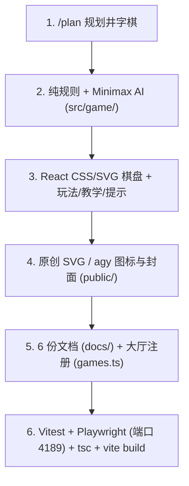

[English](./README.md) | **中文** | [Tiếng Việt](./README.vi.md)

# 第 7 天 — 从零构建你的第一款棋盘游戏

**预计用时：** 1 小时 · **上一篇：** [第 6 天](../day-06-modifying-dino-run/README.zh.md) · **下一篇：** [第 8 天](../day-08-building-a-2d-game/README.zh.md)

---

## 概览与核心概念
今天你将从零构建一款完全符合 **`AGENTS.md`** 规范的棋盘游戏——**井字棋 (Tic Tac Toe)**（`games/tic-tac-toe/`），支持 **人机对战 (Minimax)** 与 **本地双人** 模式，配有原创美术、6 份文档、自动化测试与统一游戏大厅注册！



---

## 学习目标与成果
完成第 7 天后，你将能够：
1. 使用 `agy` 完成从 `/plan` 到生产构建的完整新游戏开发流程。
2. 严格落实 [`AGENTS.md`](../../AGENTS.md) 全部规范：`docs/`、`public/icons/*`、`public/graphics/*`、玩法说明、教学模式、提示、Vitest 与 Playwright。
3. 在 [`src/registry/games.ts`](../../src/registry/games.ts) 中注册新游戏，并分配独立的 Playwright 端口（`4189+`）。

---

## 分步指南

### 1. 创建特性分支
```bash
git checkout -b day-07-tic-tac-toe
```

### 2. 提问前核对 `AGENTS.md` 约束
- **专用 Playwright 端口：** `4175`–`4188` 已被占用；请为 `games/tic-tac-toe/playwright.config.ts` 分配 **`4189`**。
- **原创美术资源：** 棋盘 (`X` / `O`) 优先使用 crisp `.svg` 矢量图，并让 `agy`（`image-generator`）生成 `public/icons/*` 与 `public/graphics/*`。
- **共享样式：** 在 `src/main.tsx` 中引入 `../../../styles/tokens.css` 与 `../../../styles/game-ui.css`。

### 3. 使用 `/plan` 让 `agy` 构建 `games/tic-tac-toe/`
粘贴下方示例提示词，审阅 `agy` 的计划并批准执行。

### 4. 同时验证独立模式与统一大厅
```bash
cd games/tic-tac-toe && npm test && npm run test:e2e && npx tsc --noEmit && npm run build
cd ../.. && npm test && npm run test:e2e && npx tsc --noEmit && npm run build
```

---

## 示例 `agy` 提示词

**规划与实现提示词：**
```text
/plan Implement a new board game "Tic Tac Toe" in games/tic-tac-toe/ following AGENTS.md completely:
- Modes: vs AI (Easy + Unbeatable Minimax) and 2-Player Local
- Clean pure simulation in src/game/ (win/draw detection, Minimax AI, smart Hint, 3-step Tutorial, localStorage tic_tac_toe_v1)
- Crisp CSS/SVG X & O board using shared styles/tokens.css and styles/game-ui.css
- Web Audio SFX + Mute toggle, How to Play modal, original icons & HD/Full-HD covers in public/, and all 6 docs in docs/ (plus README.zh.md and README.vi.md)
- Vitest unit tests + Playwright E2E tests on dedicated port 4189
- Register in src/registry/games.ts (category: Board) and update root tests
```

---

## 核心要点
- 回合制棋盘游戏非常适合作为第一款“从零构建”的项目，因为胜负规则与 Minimax AI 极易编写确定性单元测试。
- 分配唯一的 Playwright 端口可以避免多游戏并行测试冲突。

---

## 练习与挑战（纯提示词 Vibe Coding）

使用下方示例提示词向 Google `agy` 提问——无需手动编写代码：

1. **深入理解项目：** 让 `agy` 解释井字棋或国际跳棋中的 Minimax AI 如何评估棋盘局面。
   ```text
   Read games/tic-tac-toe/src/game/engine.ts (or games/checkers/src/game/ai.ts) and explain how Minimax / Alpha-Beta scores winning, losing, and drawing moves.
   ```
2. **改进现有功能：** 让 `agy` 为三连胜线添加平滑 SVG 动画与提示高亮。
   ```text
   In games/tic-tac-toe/, highlight the winning line with an animated SVG stroke and pulse the Hint cell cleanly. Verify with make verify GAME=tic-tac-toe.
   ```
3. **实现新功能：** 让 `agy` 为井字棋增加 **五局三胜 (Best-of-5)** 记分牌。
   ```text
   /plan Add a Best-of-5 Series scoreboard (X wins, O wins, Draws, Match Winner banner) to games/tic-tac-toe/ persisted in tic_tac_toe_v1. Verify with make verify GAME=tic-tac-toe.
   ```
4. **完善测试 / 文档：** 让 `agy` 补充穷举单元测试，验证无敌 Minimax AI 永不落败。
   ```text
   In games/tic-tac-toe/src/game/__tests__/engine.test.ts, add a unit test that plays all possible human opening moves against Unbeatable Minimax and asserts AI never loses, keeping coverage >=70%.
   ```
5. **创建新游戏：** 让 `agy` 创建一款类似的策略棋盘游戏 **四子棋 (Connect Four)**。
   ```text
   /plan Create "Connect Four" in games/connect-four/ following AGENTS.md and .agents/skills/create-game/SKILL.md, with 7x6 grid, vs AI + 2P Local, How to Play, Tutorial, Hint, and Vitest >=70% coverage.
   ```
