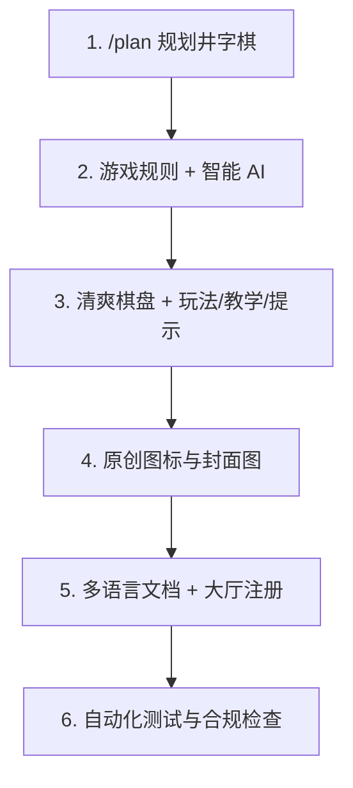

[English](./README.md) | **中文** | [Tiếng Việt](./README.vi.md)

# 第 7 天 — 从零构建你的第一款棋盘游戏

**预计用时：** 1 小时 · **上一篇：** [第 6 天](../day-06-modifying-dino-run/README.zh.md) · **下一篇：** [第 8 天](../day-08-building-a-2d-game/README.zh.md)

---

## 概览与核心概念
今天你将引导 `agy` 从零打造一款完全符合 **`AGENTS.md`** 规范的棋盘游戏——**井字棋 (Tic Tac Toe)**——支持 **人机对战（简单与无敌难度）** 与 **本地双人** 模式，配有原创美术、三语文档、自动化测试与统一大厅注册！



---

## 学习目标与成果
完成第 7 天后，你将能够：
1. 用自然语言提示词驱动 `agy` 完成从 `/plan` 到可运行游戏的完整构建。
2. 让 `agy` 自动遵守 [`AGENTS.md`](../../AGENTS.md)（文档、图标封面、玩法说明、教学模式、提示与测试）。
3. 使用 `make verify` 同时验证独立游戏与统一游戏大厅。

---

## 分步指南

### 1. 创建特性分支
```bash
git checkout -b day-07-tic-tac-toe
```

### 2. 使用 `/plan` 让 `agy` 构建 `Tic Tac Toe`
粘贴下方示例提示词，审阅 `agy` 的计划并批准执行。`agy` 会自动分配空闲测试端口、接入共享主题、生成图标封面并注册到大厅。

### 3. 验证独立游戏与统一大厅
```bash
make verify GAME=tic-tac-toe
make verify
```

---

## 示例 `agy` 提示词

**规划与实现提示词：**
```text
/plan Create a new board game "Tic Tac Toe" in games/tic-tac-toe/ following AGENTS.md completely:
- Modes: vs AI (Easy + Unbeatable) and 2-Player Local
- Crisp X & O board matching the Gemini Games purple/ivory theme
- Sound effects + Mute toggle, How to Play modal, 3-step Tutorial, smart Hint, and saved scores
- Original icons, HD/Full-HD covers, full docs (including English, Chinese, and Vietnamese READMEs)
- Automated unit tests (>=70% coverage) + Playwright browser tests, registered on the Hub
```

---

## 核心要点
- 回合制棋盘游戏非常适合作为第一款“从零打造”的项目，因为规则与 AI 对手极易自动化测试。
- 在提示词中提及 `AGENTS.md`，`agy` 就会为你包办美术、文档、翻译与大厅注册。

---

## 练习与挑战（纯提示词 Vibe Coding）

使用下方示例提示词向 Google `agy` 提问——无需手动编写代码：

1. **深入理解项目：** 让 `agy` 用通俗语言解释“无敌 AI”是如何思考每一步落子的。
   ```text
   Explain in plain English how the Unbeatable AI in Tic Tac Toe (or Checkers) thinks ahead to never lose a match.
   ```
2. **改进现有功能：** 让 `agy` 为三连胜线添加平滑动画与提示高亮。
   ```text
   Improve Tic Tac Toe by animating the winning 3-in-a-row line and gently highlighting the suggested Hint square. Verify with make verify GAME=tic-tac-toe.
   ```
3. **实现新功能：** 让 `agy` 为井字棋增加 **五局三胜 (Best-of-5)** 记分牌。
   ```text
   /plan Add a Best-of-5 Series scoreboard (X wins, O wins, Draws, and Match Winner banner) to Tic Tac Toe that saves automatically. Verify with make verify GAME=tic-tac-toe.
   ```
4. **完善测试 / 文档：** 让 `agy` 补充自动化测试，证明无敌 AI 在所有开局下都不会落败。
   ```text
   Add an automated unit test for Tic Tac Toe that tests every possible opening move against Unbeatable AI to prove it never loses, keeping coverage >=70%.
   ```
5. **创建新游戏：** 让 `agy` 创建一款类似的策略棋盘游戏 **四子棋 (Connect Four)**。
   ```text
   /plan Create "Connect Four" following AGENTS.md, with a 7x6 drop-disc board, vs AI + 2-Player Local, How to Play, Tutorial, Hint, and automated unit + browser tests.
   ```
