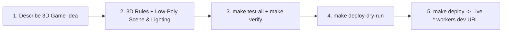

**English** | [中文](./README.zh.md) | [Tiếng Việt](./README.vi.md)

# Day 9 — Building a 3D Game & Deploying to Cloudflare

**Estimated Time:** 1 Hour · **Previous:** [Day 8](../day-08-building-a-2d-game/README.md) · **Course Index:** [Courses README](../README.md)

---

## Overview & Key Concepts
On your capstone day, you will guide `agy` to build a **3D WebGL game** from scratch (using **Three.js**, just like **SimCity 3D**) and deploy your entire Gemini Games collection live to **Cloudflare Workers**!



---

## Learning Objectives & Outcomes
By the end of Day 9, you will be able to:
1. Guide `agy` to build a low-poly 3D game with lighting, shadows, smooth camera, and automated 3D browser tests.
2. Run the full monorepo quality gates (`make test-all`, `make verify`).
3. Set up Cloudflare Wrangler, run a safe dry-run, and publish your games live with `make deploy`.

---

## Step-by-Step Guide

### 1. Create a Feature Branch
```bash
git checkout -b day-09-3d-game
```

### 2. Prompt `agy` with `/plan` to Build Your 3D Game
Use the sample prompt below to build **Marble Maze 3D** (or another 3D concept like **3D Block Stacker**). `agy` will automatically follow `SimCity 3D`'s Three.js & WebGL testing patterns.

### 3. Verify & Deploy Live (Cloudflare Workers or Vercel)
You can keep your customized hub **100% offline** on your machine, or publish the static `dist/` build to **Cloudflare Workers** (like the live demo at **[https://gemini-games.vuhung16plus.workers.dev/](https://gemini-games.vuhung16plus.workers.dev/)**) or alternatively **Vercel**:
```bash
make verify GAME=marble-maze
make test-all
make verify
make deploy-dry-run
make deploy           # Deploy to Cloudflare Workers (default)
# Or deploy static dist/ to Vercel: npx vercel --prod dist
```

---

## Sample `agy` Prompts

```text
/plan Build a new 3D game "Marble Maze 3D" in games/marble-maze/ using
Three.js following AGENTS.md and SimCity 3D's patterns:
- 3D wooden maze with tilting physics, wall bumps, hazards, goal hole, 5
  levels, timer, and saved best times
- Low-poly 3D visuals with shadows, smooth camera follow, and WebGL browser
  tests
- Sound effects + Mute, How to Play modal, 3-step Tutorial, live Hint,
  original icons/covers, and multilingual docs
```

---

## Key Takeaways
- Even 3D Three.js games follow the exact same vibe-coding workflow: **Describe -> `/plan` -> `make verify` -> `make deploy`**.
- One `make deploy` command publishes the Hub and all your games to Cloudflare's global edge network.

---

## Exercises & Challenges (Prompt-Only Vibe Coding)

Use Google `agy` with the sample prompts below—no manual coding required:

1. **Understand the Project:** Ask `agy` how `SimCity 3D` renders a 3D world in the browser and how 3D tests run without a physical GPU.
   ```text
   Explain in plain English how SimCity 3D creates 3D buildings, day/night
   lighting, and shadows in the browser, and how Playwright tests 3D graphics
   automatically.
   ```
2. **Improve a Feature:** Ask `agy` to smooth the camera follow and shadow clarity in your 3D game.
   ```text
   Improve Marble Maze 3D so the camera follows the rolling marble smoothly and
   the marble casts a crisp shadow on the wooden board. Verify with make verify
   GAME=marble-maze.
   ```
3. **Implement a New Feature:** Ask `agy` to add a **Day / Night lighting toggle** inspired by `SimCity 3D`.
   ```text
   /plan Add a Day / Night lighting toggle to Marble Maze 3D (saved with player
   settings) that smoothly shifts the scene lighting. Verify with make verify
   GAME=marble-maze.
   ```
4. **Improve Tests / Docs:** Ask `agy` to run all monorepo quality & compliance gates and fix any gaps before deployment.
   ```text
   Run make test-all, make verify, and make deploy-dry-run, and help me resolve
   any coverage or documentation issues before deploying live.
   ```
5. **Create a New Game (`/goal` Unattended End-to-End Challenge):** Challenge `agy` to run **100% autonomously and unattended** to build **Block Stacker 3D**, pass `make verify`, and prepare deployment.
   ```text
   /goal Create "Block Stacker 3D" using Three.js following AGENTS.md (custom
   artwork, How to Play, Tutorial, Hint, multilingual docs, and >=70% test
   coverage), then run make verify and prepare make deploy-dry-run without
   stopping until everything passes.
   ```


---

## Course Wrap-Up & Closing Note

Thank you for learning with me, and I hope you enjoyed the course! You now have a practical understanding of **AI coding agents**, **prompting** (`/plan`, `/goal`, `/teamwork`), and **hands-on game development**.

As you move on to your next projects, remember:
- **Games & Webapps Are Just One Example:** `"Game"`, `"webapp"`, `"TypeScript"`, `"React"`, and `"Three.js"` here are simply one example of a problem and a tech stack. Once you master how to prompt clearly and work with AI agents, you can comfortably explore **any tech stack and any problem**.
- **Why the SDLC Looks Heavy:** The SDLC, `git` checkpoints, automated tests, and `make verify` introduced in this project may look heavy at first—but those guardrails **keep you safe so you don't shoot yourself in the foot**.
- **Make the Process Your Own:** Once you are confident, **feel free to tailor and lighten the process** to match your own workflow!
