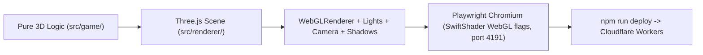

# Day 9 — Building a 3D Game from Scratch & Deploying to Cloudflare

**Estimated Time:** 1 Hour · **Previous:** [Day 8](../day-08-building-a-2d-game/README.md) · **Course Index:** [Courses README](../README.md)

---

## Overview & Key Concepts
On your capstone day, you will build a **3D WebGL game** from scratch using **Vanilla Three.js + TypeScript + React HUD** (following the exact architecture of [`games/simcity/`](../../games/simcity/docs/architecture.md)) and deploy your finished Gemini Games collection live to **Cloudflare Workers Static Assets**!



---

## Learning Objectives & Outcomes
By the end of Day 9, you will be able to:
1. Build a Vanilla Three.js 3D game with procedural low-poly meshes, lighting, camera controls, and clean GPU `.dispose()` cleanup.
2. Configure Playwright with SwiftShader WebGL flags so 3D `<canvas>` E2E tests pass reliably in headless Chromium.
3. Build and deploy the entire multi-game hub to **Cloudflare Workers** using `npm run deploy`.

---

## Step-by-Step Guide

### 1. Create a Feature Branch
```bash
git checkout -b day-09-3d-game
```

### 2. Study `games/simcity/` as Your 3D Reference
Open:
- [`games/simcity/src/renderer/CityScene.ts`](../../games/simcity/src/renderer/CityScene.ts) — Note `WebGLRenderer`, `ResizeObserver`, `PCFSoftShadowMap`, `try/catch` WebGL fallback, and `.dispose()`.
- [`games/simcity/playwright.config.ts`](../../games/simcity/playwright.config.ts) — Note the Chromium launch args (`--use-gl=angle`, `--use-angle=swiftshader`, `--enable-webgl`, `--ignore-gpu-blocklist`).

### 3. Prompt `agy` with `/plan` to Build Your 3D Game
Choose a crisp 3D arcade concept (e.g., **3D Marble Maze**, **3D Endless Runner**, or **3D Block Stacker**) on dedicated Playwright port **`4191`**.

### 4. Verify & Deploy Live to Cloudflare Workers
```bash
# Verify your new 3D game
cd games/marble-maze && npm test && npm run test:e2e && npx tsc --noEmit && npm run build

# Verify the unified hub (all games together)
cd ../.. && npm test && npm run test:e2e && npx tsc --noEmit && npm run build

# Dry-run & deploy to Cloudflare Workers Static Assets
npx wrangler deploy --dry-run
npm run deploy
```

---

## Sample `agy` Prompts

```text
/plan Build a new 3D game "Marble Maze 3D" in games/marble-maze/ using Vanilla Three.js + TypeScript + React HUD following AGENTS.md and games/simcity/ patterns:
- Pure simulation in src/game/ (3D board tilt physics, wall collisions, goal hole, hazards, 5 levels, timer, localStorage marble_maze_v1)
- Vanilla Three.js renderer in src/renderer/ (procedural low-poly wooden maze, metallic marble, directional shadows, smooth camera, ResizeObserver, full .dispose())
- Web Audio roll/bump/win SFX + Mute, How to Play modal, 3-step Tutorial, live Hint
- Original icons & HD/Full-HD covers in public/, all 6 docs in docs/
- Vitest unit tests + Playwright WebGL E2E tests on dedicated port 4191 (with SwiftShader flags)
- Register in src/registry/games.ts (category: Puzzle) and update root tests
```

---

## Key Takeaways
- Decoupling `src/game/` from Three.js lets you unit-test 3D gameplay logic at full speed in Node.
- Always dispose Three.js geometries, materials, and renderers on unmount to prevent GPU memory leaks.
- One `npm run deploy` compiles and publishes every game in the repository to Cloudflare's global edge network.

---

## Exercises & Challenges
1. Add a **Day / Night lighting toggle** to your 3D game (inspired by `games/simcity/`).
2. **Final Capstone Challenge:** Merge your favorite Day 7, Day 8, or Day 9 game into `main`, run `npm run deploy`, and share your live `*.workers.dev` URL!
