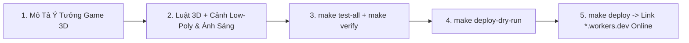

[English](./README.md) | [中文](./README.zh.md) | **Tiếng Việt**

# Ngày 9 — Dựng Game 3D & Deploy Thẳng Lên Cloudflare

**Thời lượng ước tính:** 1 Giờ · **Trước:** [Ngày 8](../day-08-building-a-2d-game/README.vi.md) · **Mục lục Khóa học:** [Courses README](../README.vi.md)

---

## Bức tranh toàn cảnh
Chốt hạ ngày cuối cùng, bạn sẽ chỉ đạo `agy` dựng hẳn một **game WebGL 3D** từ số 0 (dùng **Three.js**, chung họ với **SimCity 3D**) rồi **deploy** toàn bộ kho Gemini Games lên **Cloudflare Workers** để ai cũng vào chơi được!



---

## Học xong hôm nay bạn làm được gì?
1. Ra lệnh cho `agy` dựng game 3D low-poly có ánh sáng, đổ bóng, camera bám mượt mà kèm bộ **E2E test** cho WebGL.
2. Chạy trọn bộ cổng kiểm định của cả repo (`make test-all`, `make verify`) không sót lỗi nào.
3. Cấu hình Cloudflare Wrangler, chạy thử bản đóng gói (`dry-run`) và bấm nút xuất bản lên mạng với `make deploy`.

---

## Từng bước thực hành

### 1. Tạo một feature branch mới
```bash
git checkout -b day-09-3d-game
```

### 2. Dùng `/plan` để `agy` dựng Game 3D
Dán **prompt** mẫu bên dưới để làm **Marble Maze 3D** (hoặc **Block Stacker 3D**). `agy` sẽ tự kế thừa các mẫu **Three.js** và cách test WebGL từ **SimCity 3D**.

### 3. Verify & Deploy lên mây (Cloudflare Workers hoặc Vercel)
Bạn có thể giữ game hub chạy **100% offline** trên máy, hoặc đẩy bản **build** tĩnh `dist/` lên **Cloudflare Workers** (giống hệt bản Live Demo tại **[https://gemini-games.vuhung16plus.workers.dev/](https://gemini-games.vuhung16plus.workers.dev/)**) hay **Vercel**:
```bash
make verify GAME=marble-maze
make test-all
make verify
make deploy-dry-run
make deploy           # Deploy lên Cloudflare Workers (mặc định)
# Hoặc đẩy bản tĩnh dist/ lên Vercel: npx vercel --prod dist
```

---

## Prompt mẫu cho `agy`

```text
/plan Build a new 3D game "Marble Maze 3D" in games/marble-maze/ using
Three.js following AGENTS.md and SimCity 3D's patterns:
- 3D wooden maze with tilting physics, wall bumps, hazards, goal hole, 5
  levels, timer, and saved best times
- Low-poly 3D visuals with shadows, smooth camera follow, and WebGL browser
  tests
- Sound effects + Mute, How to Play modal, 3-step Tutorial, live Hint,
  original icons/covers, and multilingual docs
```

---

## Chốt lại cho nhớ
- Kể cả game 3D **Three.js** cũng đi đúng một vòng lặp vibe coding quen thuộc: **Mô tả -> `/plan` -> `make verify` -> `make deploy`**.
- Chỉ cần một lệnh `make deploy` duy nhất là cả **Hub** lẫn mọi game bạn tự làm đều lên sóng toàn cầu trên mạng Cloudflare.

---

## Bài tập thực hành (Vibe Coding thuần bằng Prompt)

Cứ copy các prompt bên dưới giao cho Google `agy` xử lý—không cần gõ dòng code nào:

1. **Hiểu sâu đồ họa 3D:** Nhờ `agy` giải thích cách `SimCity 3D` dựng nhà cửa, ánh sáng Ngày/Đêm và cách Playwright test WebGL mà không cần card rời.
   ```text
   Explain in plain English how SimCity 3D creates 3D buildings, day/night
   lighting, and shadows in the browser, and how Playwright tests 3D graphics
   automatically.
   ```
2. **Làm mượt camera & bóng đổ:** Nhờ `agy` chỉnh camera lướt theo viên bi êm hơn và đổ bóng rõ nét trên mặt gỗ.
   ```text
   Improve Marble Maze 3D so the camera follows the rolling marble smoothly and
   the marble casts a crisp shadow on the wooden board. Verify with make verify
   GAME=marble-maze.
   ```
3. **Thêm tính năng Ngày / Đêm:** Nhờ `agy` gắn thêm nút chuyển ánh sáng **Day / Night** (lưu lại theo setting người chơi) học hỏi từ `SimCity 3D`.
   ```text
   /plan Add a Day / Night lighting toggle to Marble Maze 3D (saved with player
   settings) that smoothly shifts the scene lighting. Verify with make verify
   GAME=marble-maze.
   ```
4. **Tổng duyệt trước khi lên sóng:** Nhờ `agy` chạy hết các bài **unit test**, **verify** và **deploy-dry-run** để dọn sạch lỗi **coverage** hay docs trước khi bấm **deploy**.
   ```text
   Run make test-all, make verify, and make deploy-dry-run, and help me resolve
   any coverage or documentation issues before deploying live.
   ```
5. **Tạo game mới (Thử thách `/goal` 100% Tự động không cần canh):** Thả `agy` chạy tự do từ đầu đến cuối để dựng **Block Stacker 3D**, vượt ải `make verify` và chuẩn bị sẵn sàng cho `make deploy-dry-run`.
   ```text
   /goal Create "Block Stacker 3D" using Three.js following AGENTS.md (custom
   artwork, How to Play, Tutorial, Hint, multilingual docs, and >=70% test
   coverage), then run make verify and prepare make deploy-dry-run without
   stopping until everything passes.
   ```

---

## Tổng Kết Khóa Học & Đôi Lời Nhắn Nhủ

Cảm ơn bạn đã đi cùng mình hết chặng đường 9 ngày, mong là bạn đã có những giờ phút thực hành thật vui! Giờ đây bạn đã nắm trong tay bộ kỹ năng thực chiến với **AI coding agent**, **nghệ thuật viết prompt** (`/plan`, `/goal`, `/teamwork`) và **tự tay cho ra lò những tựa game chạy thật**.

Trước khi bạn bắt tay vào những dự án tiếp theo, nhớ giữ mấy ý nhỏ này trong túi:
- **Game & Webapp chỉ là phép thử:** `"Game"`, `"webapp"`, `"TypeScript"`... trong khóa học này chỉ là một ví dụ cụ thể. Một khi đã quen cách ra đề bài bằng **prompt** và phối hợp với AI, bạn hoàn toàn có thể tự tin nhảy sang **bất kỳ tech stack hay bài toán nào khác**.
- **Sao quy trình nhìn hơi "cồng kềnh" thế?** Quy trình SDLC, tách branch `git`, viết **unit test**/**E2E** tự động và `make verify` ban đầu có thể thấy hơi nhiều bước—nhưng chúng chính là **dây đai an toàn giúp bạn không tự bắn vào chân mình**.
- **Thoải mái tinh giản theo gu riêng:** Khi đã cứng tay rồi, **bạn cứ mạnh dạn gọt bớt quy trình cho nhẹ nhàng, hợp nhịp làm việc của mình nhất nhé!**
