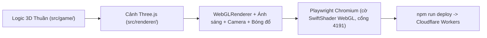

[English](./README.md) | [中文](./README.zh.md) | **Tiếng Việt**

# Ngày 9 — Xây dựng Game 3D từ Con số 0 & Triển khai lên Cloudflare

**Thời lượng ước tính:** 1 Giờ · **Trước:** [Ngày 8](../day-08-building-a-2d-game/README.vi.md) · **Mục lục Khóa học:** [Courses README](../README.vi.md)

---

## Tổng quan & Khái niệm chính
Trong ngày tổng kết, bạn sẽ xây dựng một **game WebGL 3D** từ đầu bằng **Vanilla Three.js + TypeScript + React HUD** (theo đúng kiến trúc của [`games/simcity/`](../../games/simcity/docs/architecture.md)) và triển khai bộ sưu tập Gemini Games hoàn chỉnh lên **Cloudflare Workers Static Assets**!



---

## Mục tiêu & Kết quả học tập
Sau Ngày 9, bạn sẽ có thể:
1. Xây dựng game 3D Vanilla Three.js với khối hình low-poly tạo bằng mã, ánh sáng, điều khiển camera và dọn dẹp GPU `.dispose()` sạch sẽ.
2. Cấu hình Playwright với cờ SwiftShader WebGL để kiểm thử E2E `<canvas>` 3D chạy ổn định trên Chromium không giao diện.
3. Build và triển khai toàn bộ hub đa game lên **Cloudflare Workers** bằng `npm run deploy`.

---

## Hướng dẫn từng bước

### 1. Tạo nhánh tính năng
```bash
git checkout -b day-09-3d-game
```

### 2. Tham khảo `games/simcity/` làm mẫu 3D
Mở và xem:
- [`games/simcity/src/renderer/CityScene.ts`](../../games/simcity/src/renderer/CityScene.ts) — Lưu ý `WebGLRenderer`, `ResizeObserver`, `PCFSoftShadowMap`, xử lý dự phòng WebGL `try/catch` và `.dispose()`.
- [`games/simcity/playwright.config.ts`](../../games/simcity/playwright.config.ts) — Lưu ý các tham số khởi chạy Chromium (`--use-gl=angle`, `--use-angle=swiftshader`, `--enable-webgl`, `--ignore-gpu-blocklist`).

### 3. Dùng `/plan` với `agy` để xây dựng Game 3D của bạn
Chọn một ý tưởng arcade 3D gọn gàng (ví dụ **3D Marble Maze**, **3D Endless Runner** hoặc **3D Block Stacker**) trên cổng Playwright riêng **`4191`**.

### 4. Xác minh & Triển khai Trực tiếp lên Cloudflare Workers
```bash
# Xác minh game 3D mới của bạn
cd games/marble-maze && npm test && npm run test:e2e && npx tsc --noEmit && npm run build

# Xác minh hub hợp nhất (tất cả game cùng lúc)
cd ../.. && npm test && npm run test:e2e && npx tsc --noEmit && npm run build

# Chạy thử & triển khai lên Cloudflare Workers Static Assets
npx wrangler deploy --dry-run
npm run deploy
```

---

## Câu lệnh mẫu cho `agy`

```text
/plan Build a new 3D game "Marble Maze 3D" in games/marble-maze/ using Vanilla Three.js + TypeScript + React HUD following AGENTS.md and games/simcity/ patterns:
- Pure simulation in src/game/ (3D board tilt physics, wall collisions, goal hole, hazards, 5 levels, timer, localStorage marble_maze_v1)
- Vanilla Three.js renderer in src/renderer/ (procedural low-poly wooden maze, metallic marble, directional shadows, smooth camera, ResizeObserver, full .dispose())
- Web Audio roll/bump/win SFX + Mute, How to Play modal, 3-step Tutorial, live Hint
- Original icons & HD/Full-HD covers in public/, all 6 docs in docs/ (plus README.zh.md and README.vi.md)
- Vitest unit tests + Playwright WebGL E2E tests on dedicated port 4191 (with SwiftShader flags)
- Register in src/registry/games.ts (category: Puzzle) and update root tests
```

---

## Điểm cốt lõi
- Tách `src/game/` khỏi Three.js giúp bạn chạy unit test logic gameplay 3D ở tốc độ tối đa trong Node.
- Luôn `.dispose()` geometry, material và renderer của Three.js khi unmount để tránh rò rỉ bộ nhớ GPU.
- Một lệnh `npm run deploy` duy nhất biên dịch và xuất bản mọi game trong kho mã nguồn lên mạng biên toàn cầu của Cloudflare.

---

## Bài tập & Thử thách
1. Thêm nút **Chuyển đổi ánh sáng Ngày / Đêm** cho game 3D của bạn (lấy cảm hứng từ `games/simcity/`).
2. **Thử thách Tốt nghiệp:** Hợp nhất game Ngày 7, Ngày 8 hoặc Ngày 9 yêu thích của bạn vào `main`, chạy `npm run deploy` và chia sẻ đường dẫn `*.workers.dev` trực tuyến!
