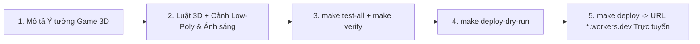

[English](./README.md) | [中文](./README.zh.md) | **Tiếng Việt**

# Ngày 9 — Xây Dựng Game 3D & Triển Khai Lên Cloudflare

**Thời lượng ước tính:** 1 Giờ · **Trước:** [Ngày 8](../day-08-building-a-2d-game/README.vi.md) · **Mục lục Khóa học:** [Courses README](../README.vi.md)

---

## Tổng quan & Khái niệm chính
Trong ngày tổng kết, bạn sẽ hướng dẫn `agy` xây dựng một **game WebGL 3D** từ đầu (dùng **Three.js**, giống như **SimCity 3D**) và triển khai toàn bộ bộ sưu tập Gemini Games lên **Cloudflare Workers**!



---

## Mục tiêu & Kết quả học tập
Sau Ngày 9, bạn sẽ có thể:
1. Hướng dẫn `agy` tạo game 3D low-poly có ánh sáng, bóng đổ, camera mượt và kiểm thử trình duyệt 3D tự động.
2. Chạy toàn bộ cổng chất lượng của monorepo (`make test-all`, `make verify`).
3. Thiết lập Cloudflare Wrangler, chạy thử đóng gói và xuất bản trực tuyến bằng `make deploy`.

---

## Hướng dẫn từng bước

### 1. Tạo nhánh tính năng
```bash
git checkout -b day-09-3d-game
```

### 2. Dùng `/plan` với `agy` để xây dựng Game 3D
Dùng câu lệnh mẫu bên dưới để làm **Marble Maze 3D** (hoặc **Block Stacker 3D**). `agy` sẽ tự áp dụng các mẫu Three.js và kiểm thử WebGL của `SimCity 3D`.

### 3. Xác minh & Triển khai Trực tiếp (Cloudflare Workers hoặc Vercel)
Bạn có thể giữ game hub chạy **100% ngoại tuyến** trên máy, hoặc phát hành bản build tĩnh `dist/` lên **Cloudflare Workers** (như bản demo tại **[https://gemini-games.vuhung16plus.workers.dev/](https://gemini-games.vuhung16plus.workers.dev/)**) hoặc **Vercel**:
```bash
make verify GAME=marble-maze
make test-all
make verify
make deploy-dry-run
make deploy           # Triển khai lên Cloudflare Workers (mặc định)
# Hoặc triển khai bản tĩnh dist/ lên Vercel: npx vercel --prod dist
```

---

## Câu lệnh mẫu cho `agy`

```text
/plan Build a new 3D game "Marble Maze 3D" in games/marble-maze/ using Three.js following AGENTS.md and SimCity 3D's patterns:
- 3D wooden maze with tilting physics, wall bumps, hazards, goal hole, 5 levels, timer, and saved best times
- Low-poly 3D visuals with shadows, smooth camera follow, and WebGL browser tests
- Sound effects + Mute, How to Play modal, 3-step Tutorial, live Hint, original icons/covers, and multilingual docs
```

---

## Điểm cốt lõi
- Ngay cả game 3D Three.js cũng tuân theo đúng quy trình vibe coding: **Mô tả -> `/plan` -> `make verify` -> `make deploy`**.
- Một lệnh `make deploy` duy nhất xuất bản cả Hub lẫn mọi game của bạn lên mạng biên toàn cầu Cloudflare.

---

## Bài tập & Thử thách (Vibe Coding Chỉ Dùng Câu Lệnh)

Sử dụng các câu lệnh mẫu bên dưới với Google `agy`—không cần tự viết code thủ công:

1. **Hiểu Dự án Sâu hơn:** Nhờ `agy` giải thích cách `SimCity 3D` dựng thế giới 3D trên trình duyệt và cách kiểm thử 3D tự động không cần GPU rời.
   ```text
   Explain in plain English how SimCity 3D creates 3D buildings, day/night lighting, and shadows in the browser, and how Playwright tests 3D graphics automatically.
   ```
2. **Cải tiến Tính năng:** Nhờ `agy` làm mượt camera theo bóng và làm rõ bóng đổ trong game 3D.
   ```text
   Improve Marble Maze 3D so the camera follows the rolling marble smoothly and the marble casts a crisp shadow on the wooden board. Verify with make verify GAME=marble-maze.
   ```
3. **Triển khai Tính năng Mới:** Nhờ `agy` thêm nút **Chuyển đổi ánh sáng Ngày / Đêm** lấy cảm hứng từ `SimCity 3D`.
   ```text
   /plan Add a Day / Night lighting toggle to Marble Maze 3D (saved with player settings) that smoothly shifts the scene lighting. Verify with make verify GAME=marble-maze.
   ```
4. **Cải thiện Kiểm thử / Tài liệu:** Nhờ `agy` chạy toàn bộ cổng chất lượng & tuân thủ trước khi triển khai lên mạng.
   ```text
   Run make test-all, make verify, and make deploy-dry-run, and help me resolve any coverage or documentation issues before deploying live.
   ```
5. **Tạo Game Mới:** Nhờ `agy` xây dựng thêm một game 3D (**Block Stacker 3D**) và hướng dẫn triển khai lên Cloudflare Workers.
   ```text
   /plan Create "Block Stacker 3D" using Three.js following AGENTS.md, then run make verify and guide me through make deploy to Cloudflare Workers.
   ```
