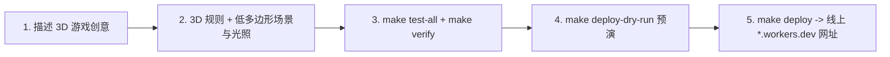

[English](./README.md) | **中文** | [Tiếng Việt](./README.vi.md)

# 第 9 天 — 从零构建 3D 游戏并部署至 Cloudflare

**预计用时：** 1 小时 · **上一篇：** [第 8 天](../day-08-building-a-2d-game/README.zh.md) · **课程目录：** [课程首页](../README.zh.md)

---

## 概览与核心概念
在毕业实战日，你将引导 `agy` 从零打造一款 **3D WebGL 游戏**（使用 **Three.js**，就像 **SimCity 3D** 一样），并将整个 Gemini Games 作品集上线部署到 **Cloudflare Workers**！



---

## 学习目标与成果
完成第 9 天后，你将能够：
1. 引导 `agy` 打造带有光照、阴影、平滑视角和自动化 3D 浏览器测试的低多边形 3D 游戏。
2. 运行全仓库质量与覆盖率门槛（`make test-all`、`make verify`）。
3. 配置 Cloudflare Wrangler，完成预演并用 `make deploy` 一键上线。

---

## 分步指南

### 1. 创建特性分支
```bash
git checkout -b day-09-3d-game
```

### 2. 使用 `/plan` 提示 `agy` 构建 3D 游戏
使用下方示例提示词构建 **3D 弹珠迷宫 (Marble Maze 3D)**（或 **3D 叠方块**）。`agy` 会自动沿用 `SimCity 3D` 的 Three.js 与测试模式。

### 3. 验证并上线部署（Cloudflare Workers 或 Vercel）
你可以让游戏大厅在本地 **100% 离线** 运行，也可以把静态 `dist/` 构建产物发布到 **Cloudflare Workers**（就像在线演示 **[https://gemini-games.vuhung16plus.workers.dev/](https://gemini-games.vuhung16plus.workers.dev/)**），或备选部署到 **Vercel**：
```bash
make verify GAME=marble-maze
make test-all
make verify
make deploy-dry-run
make deploy           # 部署到 Cloudflare Workers（默认）
# 或将静态 dist/ 部署到 Vercel：npx vercel --prod dist
```

---

## 示例 `agy` 提示词

```text
/plan Build a new 3D game "Marble Maze 3D" in games/marble-maze/ using Three.js following AGENTS.md and SimCity 3D's patterns:
- 3D wooden maze with tilting physics, wall bumps, hazards, goal hole, 5 levels, timer, and saved best times
- Low-poly 3D visuals with shadows, smooth camera follow, and WebGL browser tests
- Sound effects + Mute, How to Play modal, 3-step Tutorial, live Hint, original icons/covers, and multilingual docs
```

---

## 核心要点
- 即使是 3D Three.js 游戏，也遵循完全相同的 Vibe Coding 流程：**描述需求 -> `/plan` -> `make verify` -> `make deploy`**。
- 一条 `make deploy` 命令即可把游戏大厅与全部游戏发布到 Cloudflare 全球边缘网络。

---

## 练习与挑战（纯提示词 Vibe Coding）

使用下方示例提示词向 Google `agy` 提问——无需手动编写代码：

1. **深入理解项目：** 让 `agy` 用大白话讲解 `SimCity 3D` 如何在浏览器里绘制 3D 世界，以及如何在没有独立显卡时自动测试 3D 画面。
   ```text
   Explain in plain English how SimCity 3D creates 3D buildings, day/night lighting, and shadows in the browser, and how Playwright tests 3D graphics automatically.
   ```
2. **改进现有功能：** 让 `agy` 优化 3D 游戏中的相机跟随平滑度与阴影清晰度。
   ```text
   Improve Marble Maze 3D so the camera follows the rolling marble smoothly and the marble casts a crisp shadow on the wooden board. Verify with make verify GAME=marble-maze.
   ```
3. **实现新功能：** 让 `agy` 为 3D 游戏添加受 `SimCity 3D` 启发的 **昼夜光照切换** 开关。
   ```text
   /plan Add a Day / Night lighting toggle to Marble Maze 3D (saved with player settings) that smoothly shifts the scene lighting. Verify with make verify GAME=marble-maze.
   ```
4. **完善测试 / 文档：** 让 `agy` 在上线前运行全仓库质量与合规检查，并修复所有发现的问题。
   ```text
   Run make test-all, make verify, and make deploy-dry-run, and help me resolve any coverage or documentation issues before deploying live.
   ```
5. **创建新游戏：** 让 `agy` 使用 Three.js 再构建一款 3D 游戏（**Block Stacker 3D**）并上线部署。
   ```text
   /plan Create "Block Stacker 3D" using Three.js following AGENTS.md, then run make verify and guide me through make deploy to Cloudflare Workers.
   ```
