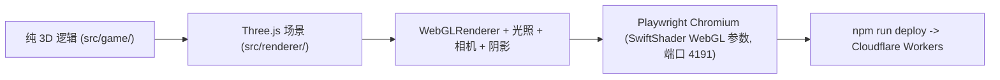

[English](./README.md) | **中文** | [Tiếng Việt](./README.vi.md)

# 第 9 天 — 从零构建 3D 游戏并部署至 Cloudflare

**预计用时：** 1 小时 · **上一篇：** [第 8 天](../day-08-building-a-2d-game/README.zh.md) · **课程目录：** [课程首页](../README.zh.md)

---

## 概览与核心概念
在毕业实战日，你将使用 **Vanilla Three.js + TypeScript + React HUD**（完全遵循 [`games/simcity/`](../../games/simcity/docs/architecture.md) 的架构模式）从零构建一款 **3D WebGL 游戏**，并将整套 Gemini Games 作品集上线部署到 **Cloudflare Workers Static Assets**！



---

## 学习目标与成果
完成第 9 天后，你将能够：
1. 构建包含程序化低多边形网格、光照、相机控制与完整 GPU `.dispose()` 释放的 Vanilla Three.js 3D 游戏。
2. 为 Playwright 配置 SwiftShader WebGL 启动参数，使 3D `<canvas>` E2E 测试在无头 Chromium 中稳定通过。
3. 使用 `npm run deploy` 将整个多游戏大厅构建并部署到 **Cloudflare Workers**。

---

## 分步指南

### 1. 创建特性分支
```bash
git checkout -b day-09-3d-game
```

### 2. 以 `games/simcity/` 作为 3D 参考模板
打开以下文件学习：
- [`games/simcity/src/renderer/CityScene.ts`](../../games/simcity/src/renderer/CityScene.ts) — 关注 `WebGLRenderer`、`ResizeObserver`、`PCFSoftShadowMap`、`try/catch` WebGL 降级处理以及 `.dispose()`。
- [`games/simcity/playwright.config.ts`](../../games/simcity/playwright.config.ts) — 关注 Chromium 启动参数（`--use-gl=angle`、`--use-angle=swiftshader`、`--enable-webgl`、`--ignore-gpu-blocklist`）。

### 3. 使用 `/plan` 提示 `agy` 构建你的 3D 游戏
选择一个精炼的 3D 街机概念（例如 **3D 弹珠迷宫**、**3D 无尽跑酷** 或 **3D 方块堆叠**），分配专用 Playwright 端口 **`4191`**。

### 4. 验证并上线部署至 Cloudflare Workers
```bash
# 验证你的新 3D 游戏
cd games/marble-maze && npm test && npm run test:e2e && npx tsc --noEmit && npm run build

# 验证统一大厅（全部游戏联调）
cd ../.. && npm test && npm run test:e2e && npx tsc --noEmit && npm run build

# 预演并部署至 Cloudflare Workers Static Assets
npx wrangler deploy --dry-run
npm run deploy
```

---

## 示例 `agy` 提示词

```text
/plan Build a new 3D game "Marble Maze 3D" in games/marble-maze/ using Vanilla Three.js + TypeScript + React HUD following AGENTS.md and games/simcity/ patterns:
- Pure simulation in src/game/ (3D board tilt physics, wall collisions, goal hole, hazards, 5 levels, timer, localStorage marble_maze_v1)
- Vanilla Three.js renderer in src/renderer/ (procedural low-poly wooden maze, metallic marble, directional shadows, smooth camera, ResizeObserver, full .dispose())
- Web Audio roll/bump/win SFX + Mute, How to Play modal, 3-step Tutorial, live Hint
- Original icons & HD/Full-HD covers in public/, all 6 docs in docs/ (plus README.zh.md and README.vi.md)
- Vitest unit tests + Playwright WebGL E2E tests on dedicated port 4191 (with SwiftShader flags)
- Register in src/registry/games.ts (category: Puzzle) and update root tests
```

---

## 核心要点
- 将 `src/game/` 与 Three.js 解耦，让你能在 Node 中全速单元测试 3D 游戏逻辑。
- 组件卸载时务必释放 Three.js 的几何体、材质与渲染器，防止 GPU 内存泄漏。
- 一条 `npm run deploy` 即可编译并发布仓库中的所有游戏到 Cloudflare 全球边缘网络。

---

## 练习与挑战（纯提示词 Vibe Coding）

使用下方示例提示词向 Google `agy` 提问——无需手动编写代码：

1. **深入理解项目：** 让 `agy` 解释 Three.js `.dispose()` 资源释放与 SwiftShader WebGL 测试参数。
   ```text
   Read games/simcity/src/renderer/CityScene.ts and games/simcity/playwright.config.ts, and explain how WebGL fallback, ResizeObserver, .dispose(), and SwiftShader flags work together.
   ```
2. **改进现有功能：** 让 `agy` 优化 3D 游戏中的相机阻尼跟随与阴影质感。
   ```text
   In games/marble-maze/src/renderer/, add smooth lerp camera follow and tune directional shadow bias so the marble casts a crisp shadow without acne. Verify with make test-e2e GAME=marble-maze.
   ```
3. **实现新功能：** 让 `agy` 为你的 3D 游戏添加受 `games/simcity/` 启发的 **昼夜光照切换** 开关。
   ```text
   /plan Add a Day / Night lighting toggle to games/marble-maze/ (persisted in marble_maze_v1) that smoothly adjusts ambient and directional light colors. Verify with make verify GAME=marble-maze.
   ```
4. **完善测试 / 文档：** 让 `agy` 在部署前运行全仓库质量与合规门槛检查。
   ```text
   Run make test-all, make verify, and make deploy-dry-run, and fix any compliance or >=70% coverage gaps reported.
   ```
5. **创建新游戏：** 让 `agy` 使用 Three.js 再构建一款 3D 游戏（**3D 叠方块 Block Stacker 3D**）并预演部署。
   ```text
   /plan Create "Block Stacker 3D" in games/block-stacker-3d/ using Vanilla Three.js following AGENTS.md and .agents/skills/create-game/SKILL.md, then run make verify and make deploy-dry-run.
   ```
