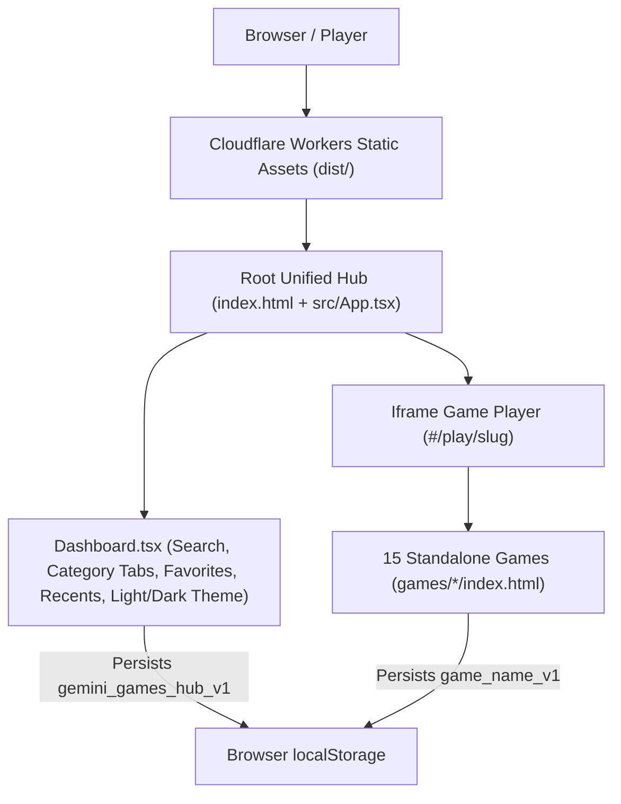
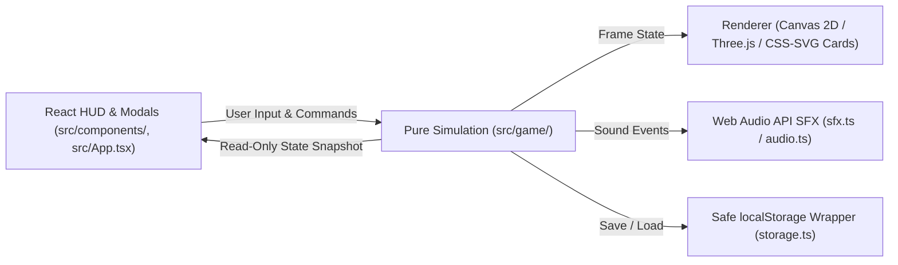
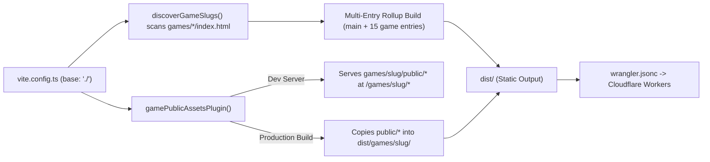

# Gemini Games — Architecture

**Gemini Games** is a multi-entry Vite + React + TypeScript monorepo that serves a unified 4-column **Dashboard** at `/` and **15 self-contained 2D & 3D web games** under `games/<slug>/`.

---

## 1. High-Level System Architecture

- **Unified Hub (`src/`):** Manages game discovery ([`src/registry/games.ts`](../src/registry/games.ts)), hub preferences ([`src/registry/hubStorage.ts`](../src/registry/hubStorage.ts)), and embeds each selected game cleanly inside an isolated `<iframe>` route (`#/play/<slug>`).
- **Standalone Games (`games/<slug>/`):** Every game is a complete Vite sub-app with its own `index.html`, `package.json`, `docs/`, `public/` assets, Vitest suite, and Playwright E2E suite.

---

## 2. Per-Game Module Architecture

Every game separates pure deterministic simulation from rendering, audio, persistence, and React UI overlays:

- **Pure Simulation (`src/game/`):** Framework-free TypeScript rules, physics, AI opponents, tutorial state, and hints—tested deterministically in Node via Vitest.
- **Rendering Layer:** Uses HTML5 Canvas 2D (`battle-city`, `dino-run`, `flappy-bird`, `super-mario-bros`, `tetris`, `cozy-town-tycoon`), Vanilla Three.js (`simcity`), or CSS/SVG (`1024`, `checkers`, `sudoku`, `solitaire`, `ta-la-phom`, `tan-do`, `tien-len-mien-bac`, `tien-len-mien-nam`).
- **Shared Design System (`styles/`):** All games import [`styles/tokens.css`](../styles/tokens.css), [`styles/game-ui.css`](../styles/game-ui.css), and [`styles/theme.ts`](../styles/theme.ts).

---

## 3. Multi-Entry Build & Asset Pipeline

- During `npm run dev`, [`vite.config.ts`](../vite.config.ts) mounts a middleware serving each game's `public/` directory at `/games/<slug>/*`.
- During `npm run build`, Rollup bundles `index.html` plus all 15 `games/*/index.html` entries into `dist/`, and `closeBundle()` copies every game's `public/` icons, manifests, and HD/Full-HD cover graphics into `dist/games/<slug>/`.
