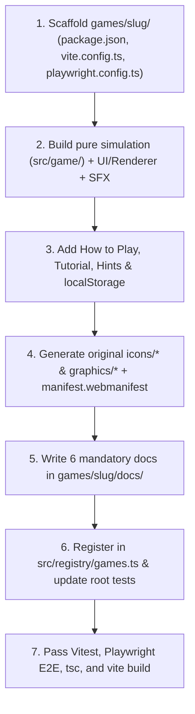
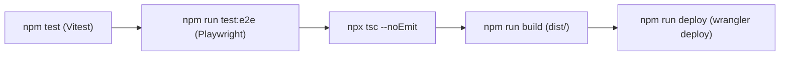

# Gemini Games — Developer Guide

This guide explains how to work in the **Gemini Games** repository, add new games, run all verification gates, and deploy to Cloudflare.

---

## 1. Repository Structure

```text
gemini-games/
├── docs/                  # Root architecture, developer guide, and tech stack
├── e2e/                   # Root unified hub Playwright E2E tests
├── games/                 # 15 standalone games (each with docs/, public/, src/, e2e/)
├── src/                   # Root Dashboard, iframe player, and registry
│   ├── components/
│   └── registry/
├── styles/                # Shared tokens.css, game-ui.css, theme.ts, STYLE_GUIDE.md
├── techstacks/            # Shared 2D & 3D stack guidelines
├── package.json           # Root scripts (dev, build, test, test:e2e, deploy)
├── vite.config.ts         # Multi-entry Vite config + gamePublicAssetsPlugin
└── wrangler.jsonc         # Cloudflare Workers Static Assets config
```

---

## 2. Adding a New Game (`AGENTS.md` Checklist)

Follow [`AGENTS.md`](../AGENTS.md) whenever creating a new game in `games/<game-slug>/`:



1. **Dedicated Playwright Port:** Assign an unused local port in `games/<slug>/playwright.config.ts` (ports `4175`–`4188` are currently in use).
2. **Relative Paths:** Use `base: './'` in `vite.config.ts` and `./src/main.tsx`, `./icons/*`, `./graphics/cover-hd.png` in `index.html`.
3. **Shared Styles:** Import `../../../styles/tokens.css` and `../../../styles/game-ui.css` in `src/main.tsx` before local styles.
4. **Hub Registration:** Add the game entry alphabetically in [`src/registry/games.ts`](../src/registry/games.ts) and update [`src/registry/__tests__/games.test.ts`](../src/registry/__tests__/games.test.ts) and [`e2e/hub.spec.ts`](../e2e/hub.spec.ts).

---

## 3. Verification & Deployment Workflow



Run from either a specific `games/<slug>/` directory or the repository root:

```bash
npm test            # Pure simulation & registry unit tests
npm run test:e2e    # Real Chromium browser E2E tests
npx tsc --noEmit    # Strict TypeScript check
npm run build       # Static production build into dist/
npm run deploy      # Root only: build dist/ and deploy to Cloudflare Workers
```
