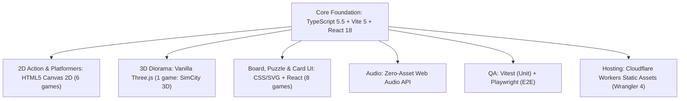

# Gemini Games — Tech Stack

Aligned with [`techstacks/techstack.md`](../techstacks/techstack.md), every project in **Gemini Games** shares a consistent TypeScript + Vite + React foundation while picking the lightest, fastest rendering layer for each game's dimension.

---

## 1. Stack Overview

---

## 2. Technology Matrix

| Layer | Technology | Usage in Project |
| :--- | :--- | :--- |
| **Language** | TypeScript `5.5` (`strict: true`) | Pure simulation engines, 3D scene logic, React UI, and hub registry |
| **UI & HUD** | React `18.3` | Unified Dashboard, iframe player, HUD bars, How to Play modals, and touch controls |
| **Build & Dev** | Vite `5.4` (`base: './'`) | Multi-entry Rollup bundling (`dist/`) and `/games/<slug>/*` static asset serving |
| **2D Canvas Rendering** | HTML5 Canvas 2D API | `battle-city`, `cozy-town-tycoon`, `dino-run`, `flappy-bird`, `super-mario-bros`, `tetris` |
| **3D Rendering** | Three.js `0.170` (`WebGLRenderer`) | `simcity` (low-poly procedural buildings, shadows, orbit/pan/zoom camera, raycasting) |
| **Vector / Card UI** | CSS Grid + Inline SVG | `1024`, `checkers`, `solitaire`, `sudoku`, `ta-la-phom`, `tan-do`, `tien-len-mien-bac`, `tien-len-mien-nam` |
| **Audio** | Web Audio API | Zero-asset procedural chiptune, card, and arcade sound effects |
| **Persistence** | Browser `localStorage` | Versioned per-game keys (`<game>_v1`) and hub state (`gemini_games_hub_v1`) |
| **Unit Testing** | Vitest `2.0` | Deterministic simulation, rules, AI, combo solvers, and storage tests |
| **E2E Testing** | Playwright `1.49` (Chromium) | Real browser input, WebGL rendering, modals, hotseat handoffs, and reload persistence |
| **Deployment** | Cloudflare Workers + Wrangler `4` | Static asset hosting from `./dist` via [`wrangler.jsonc`](../wrangler.jsonc) |

---

## 3. Why Zero External Runtime Assets?
All graphics (`public/icons/*`, `public/graphics/*`) are bundled locally and all in-game sprites, cards, 3D meshes, and audio effects are rendered procedurally at runtime—ensuring instant loading, offline resilience, and zero external CDN dependencies.
